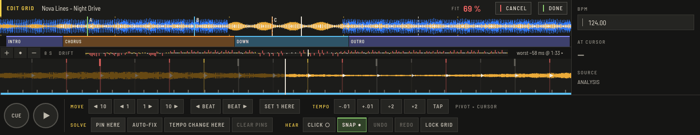
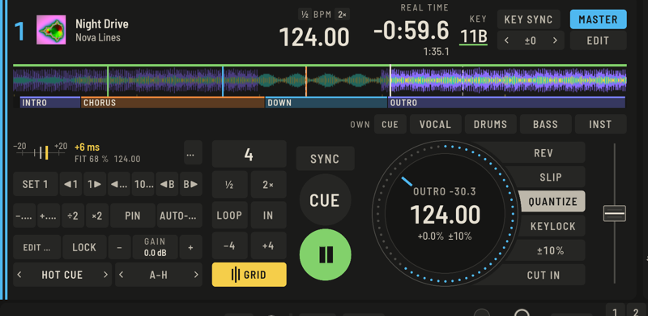

Die Analyse findet das Tempo und die erste Zählzeit automatisch, und für die meiste elektronische Musik reicht das. Liegt ein Grid daneben, zeigt OpenDJDecks dir, wo, und korrigiert es mit sehr wenig Arbeit.

## Schnelle Korrekturen

In Prepare hat der Tab **RASTER** des Players die häufigsten Korrekturen:

- **÷2** und **×2** halbieren oder verdoppeln ein falsches Tempo.
- **1 HIER** (`D`) macht den Beat am Cursor zur ersten Zählzeit.
- **◀ 1** und **1 ▶** schieben das Grid um eine Millisekunde.
- **GRID SPERREN** (`L`) schützt es vor weiteren Änderungen und vor einer neuen Analyse.
- Mit `B` tippst du das Tempo mit: ab dem vierten Tipp folgt das Grid.

## GRID BEARBEITEN

Für alles Schwierigere drücke **GRID BEARBEITEN** (`⇧G`) oder **BEARBEITEN …** im GRID-Panel am Perform-Deck. Der Player zeigt die erkannten Kicks als lange und die Transienten als kurze Linien und färbt jeden Beat-Strich danach, wie weit er von ihnen weg ist: bis 5 ms, bis 15 ms oder weiter.

Die Kopfzeile zeigt eine **FIT**-Bewertung und einen **DRIFT**-Streifen über den ganzen Track. Ein Klick auf den Streifen springt dorthin; die **schlechteste** Stelle hat einen eigenen Link.

Alles in der Sitzung gehört zusammen: **ABBRECHEN** verwirft sie, **FERTIG** behält sie als einen Rückgängig-Schritt.

### Verschieben und Tempo sind getrennt

- **VERSCHIEBEN:** **◀ 10**, **◀ 1**, **1 ▶**, **10 ▶** schieben das ganze Grid in Millisekunden; **◀ BEAT** und **BEAT ▶** um einen Beat; **1 HIER** macht den Beat am Cursor zur 1 und setzt ihn auf seinen Kick.
- **TEMPO:** **−.01**, **+.01**, **÷2**, **×2** und **TAP** ändern das Tempo um den Cursor, die Stelle, die du gerade ansiehst, bleibt also stehen.

Du kannst das Grid auch mit der Maus ziehen. Es rastet innerhalb von 15 ms an den Kicks ein; mit `Alt` ohne Einrasten. Doppelklick auf einen Beat macht ihn zur 1. Mausrad scrollt, `⌘`-Mausrad zoomt.

### Pins

**PIN HIER** (`P`) sagt: Dieser Beat sitzt genau hier, am Kick ausgerichtet. Ein Pin verschiebt das ganze Grid. Setze einen zweiten weit weg, am besten nahe dem Ende, und das Tempo dazwischen wird gelöst. **PINS LÖSCHEN** entfernt sie und lässt das Grid stehen.

### AUTO-FIX

**AUTO-FIX** (`F`) korrigiert Versatz und Tempo aus den Kicks des Abschnitts am Cursor. Tempowechsel findet es auch.

### Tempowechsel

Für Live-Aufnahmen und alte Platten startet **TEMPOWECHSEL HIER** ein neues Tempo am Cursor, gemessen an den Kicks danach. Pins dazwischen ergeben abschnittsweise Tempi, und der Taktzähler läuft weiter. Die Tempotasten ändern nur den Abschnitt am Cursor.

### Der Klick

**KLICK ●** (`C`) spielt ein Metronom auf dem Grid, während die Vorschau läuft, höher auf der 1. Hör im Kopfhörer hin. **SNAP ●** (`S`) legt fest, ob **1 HIER**, **PIN** und Ziehen an den Kicks einrasten.

### Tasten in GRID BEARBEITEN

`←` `→` um 1 ms, `⇧←` `⇧→` um 10 ms, `⌥←` `⌥→` um einen Beat; `↑` `↓` ändern das Tempo um 0,01 BPM (`⇧` um 0,1); `1` setzt die 1, `P` pinnt, `F` Auto-Fix, `C` Klick, `S` Snap, `T` Tap; `[` und `]` springen zwischen Problemstellen; `Return` ist **FERTIG**, `Esc` **ABBRECHEN**, und `⌘Z` / `⇧⌘Z` widerrufen innerhalb der Sitzung.

## Ein Grid korrigieren, während der Track läuft

Jedes Perform-Deck hat neben dem Pad-Modus eine **GRID**-Taste. Sie tauscht die Pads gegen ein Panel, das funktioniert, während der Track läuft: eine Anzeige, wie weit das Grid neben den Kicks liegt (der Median der letzten acht Beats), **FIT**, das Tempo und **KLICK** im Kopfhörer.

- **1 SETZEN**: Der gerade gehörte Kick (innerhalb ±60 ms) wird die 1.
- **◀1 / 1▶ / ◀10 / 10▶ / ◀B / B▶** schieben und versetzen.
- **−.01 / +.01 / ÷2 / ×2** ändern das Tempo um den Abspielpunkt.
- **PIN** und **AUTO-FIX** funktionieren wie im Editor. Zwei Pins lösen das Tempo.
- **BEARBEITEN …** öffnet den Track im Prepare-Editor; **SPERREN** schützt ihn.
- **GAIN − / +** korrigiert die Lautheit des Tracks in 0,5-dB-Schritten.

Änderungen werden sofort gespeichert, und die Decks folgen ohne Lücke; Schübe innerhalb von anderthalb Sekunden sind ein Rückgängig-Schritt. Am Controller macht die Taste **TAP** dasselbe wie drei Taps: ein konstantes Grid im getippten Tempo.

## Wenn das Tempo immer wieder falsch ist

Öffne **Einstellungen › Analyse › BPM-Bereich**, wähle einen, der zur Musik passt, und **analysiere** den Track neu. Ein gesperrtes Grid fasst die Analyse nicht an.

Der aktive Bereich steht dort, wo Tracks analysiert werden: als **BPM-BEREICH** im Tab **INFO** des Prepare-Players und neben dem Fortschritt, während Tracks analysiert werden (**ANALYSE 3/10 · 70–180 BPM**).

## Schnelle Musik und halb oder doppelt am Deck

Für Hardcore, Gabber und andere Musik über 200 BPM wähle **150–300**. Tempi werden dann so gelesen, wie sie gespielt sind, nicht halbiert. In Tests mit erzeugten Click-, Kick-, Kick-und-Snare- und House-Loops bei 170, 200, 220, 250 und 280 BPM hat jeder Bereich, der das Tempo enthält, es auf 0,05 BPM genau gelesen; der Standard **70–180** liest 200 als 100 und 220 als 110, wie er soll. An einer Sammlung echter Platten in diesen Tempi ist das noch nicht geprüft.

Kommt ein einzelner Track trotzdem halb oder doppelt heraus, drücke **÷2** oder **×2** neben **BPM** im Deck-Kopf. Ein Druck halbiert oder verdoppelt das Grid des Tracks, gespeichert mit dem Track und mit einem Schritt rückgängig; ein gesperrtes Grid bleibt, wie es ist. Auf schmaleren Decks liegen dieselben Tasten im **GRID**-Panel. Am Controller: `deck.bpm_half` und `deck.bpm_double`.
