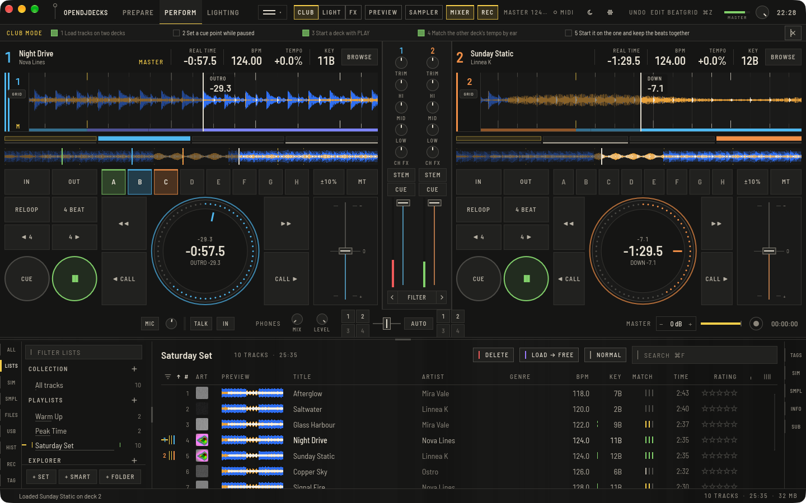

Wenn du auf dem Controller gelernt hast und dich auf Club-Player vorbereiten willst, verwandelt **CLUB** in der oberen Leiste (`⌥⌘J`) jedes Deck in einen Player-Bildschirm. Sync auf dem Bildschirm ist aus, die Cue-Regeln der Player gelten, und eine kleine Checkliste hakt sich selbst ab, während du lädst, cuest und nach Gehör beatmatchst.

## Was anders ist

- Jedes Deck zeigt einen Player-Bildschirm: die Wellenform, eine Übersicht zum Suchen per Klick, die Jog-Anzeige mit Restzeit, Taktzähler und Phrase, und eine vierteilige Beat-Position unter der Wellenform, mit der du zwei Decks optisch abgleichst. **Einstellungen › Ansicht** kann dort auch den Takt des anderen Decks zeigen.
- **BROWSE** öffnet einen Browser wie am Player: Quelle, dann Playlists, dann Tracks, aus deiner Bibliothek oder von einem Stick.
- Hot Cues arbeiten mit Halten, Memory Cues werden mit **CALL** aufgerufen, und **IN**, **OUT**, **RELOOP** / **EXIT**, **4 BEAT**, **JUMP**, die Suchtasten ◀◀ und ▶▶, der Tempobereich und **MASTER TEMPO** stehen auf dem Bildschirm.
- **Kein Sync auf dem Bildschirm.** Tempo oben ist langsamer, wie am Player.

## Die Checkliste

**CLUB-MODUS** zeigt, was als Nächstes zu tun ist: einen Track aus dem Browser laden, den Cue setzen, nach Gehör beatmatchen. Jeder Schritt hakt sich ab, wenn du ihn gemacht hast. **Checkliste ausblenden** blendet sie aus.

Das ist eine Übungsansicht: Sie trainiert den Ablauf, den du auch am echten Club-Player brauchst.
