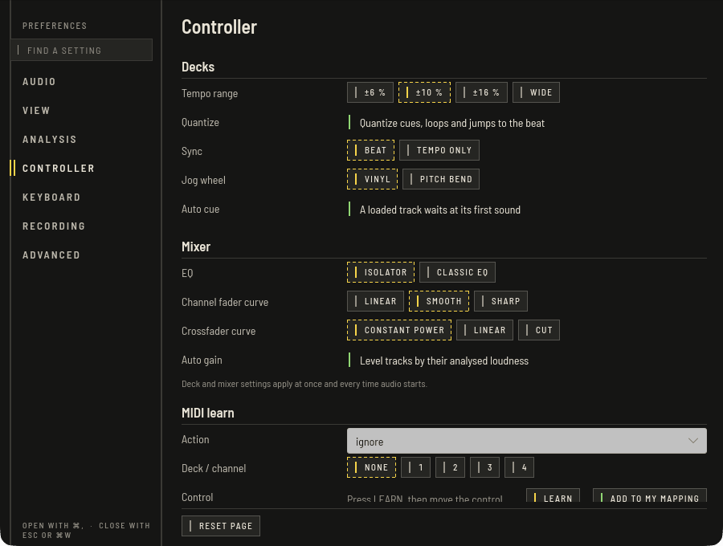

OpenDJDecks bringt Mappings mit, kompatibel mit Pioneer DJ DDJ-FLX10 und DDJ-FLX4, mit LED-Rückmeldung für Play, Cue, Sync, Master, Keylock, Slip, Loop, die Pads und die Pegelanzeigen. Die Mappings sind noch nicht vollständig auf echten Geräten bestätigt, einzelne Regler oder LEDs funktionieren vielleicht nicht: Probiere sie vor einem Gig aus. Stecke einen Controller per USB ein; er wird in wenigen Sekunden erkannt und sein Audio-Interface automatisch benutzt (**Einstellungen › Audio › Ausgabegerät**).

Bewegst du nach einem Sprung im Preset einen Regler, sorgt Soft Takeover dafür, dass sich der Wert erst ändert, wenn der echte Regler dort angekommen ist.

## Am Controller stöbern

Drehe den Browse-Encoder, um durch die Liste zu gehen. **BACK** verschiebt den Fokus in den Baum, wo Drehen durch die Listen geht (mit Shift um acht) und ein Druck einen Ordner öffnet oder in die Trackliste wechselt. In der Liste lädt ein Druck auf ein freies Deck, Shift-Druck fügt der Tag-Liste hinzu. **VIEW** schaltet in Prepare den ganzen Browser und in Perform das Browse-Layout.

## MIDI-Learn

Unter **Einstellungen › Controller › MIDI-Learn**:

1. Wähle eine **Aktion** und, falls sinnvoll, ein **Deck / Kanal**.
2. Drücke **LERNEN** und bewege dann das Bedienelement.
3. Es wird beschrieben und als Mapping-Zeile gezeigt. **ZU MEINEM MAPPING** schreibt es in deine eigene Mapping-Datei, die ab dem nächsten Start gilt.

**Eigene Mapping-Datei** lädt ein Mapping zusätzlich zu den eingebauten und hat für sein Gerät Vorrang. Das Format beschreibt `docs/controller-mappings.md`; Details in den [Entwickler-Docs](../../controller-mappings.md).

## MIDI-Monitor

Schalte **Monitor** an, um jede eingehende MIDI-Nachricht und ihre Wirkung zu sehen, zum Beispiel wenn du herausfinden willst, was ein Regler sendet.
