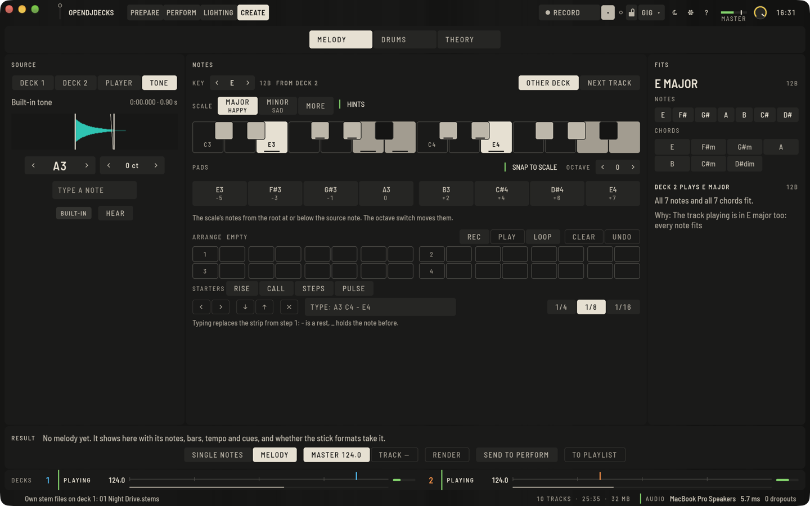
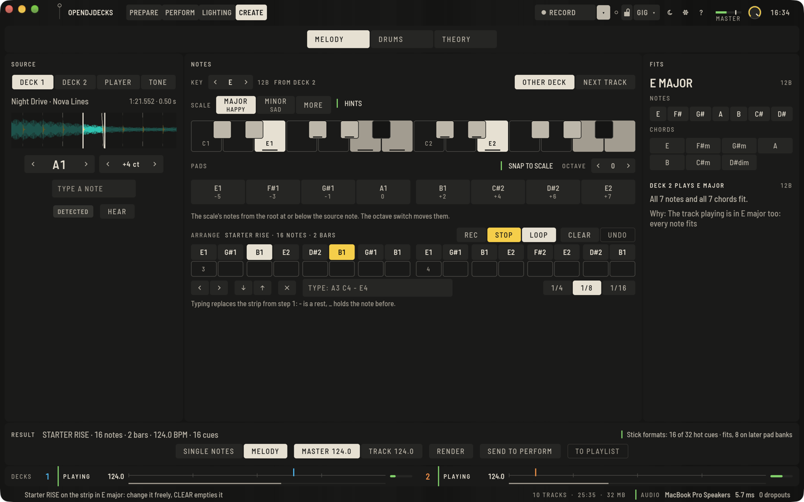
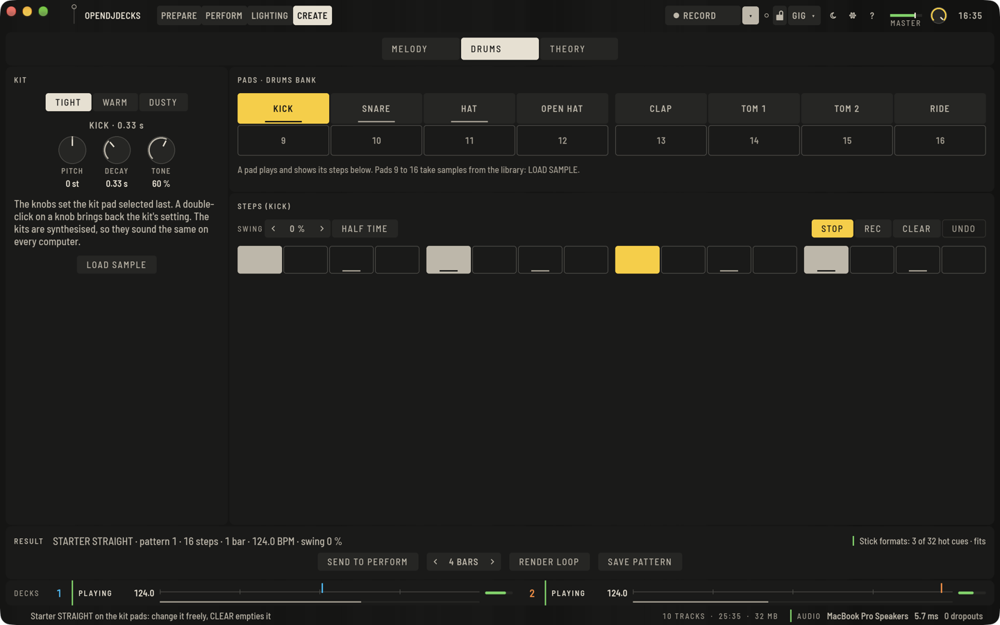
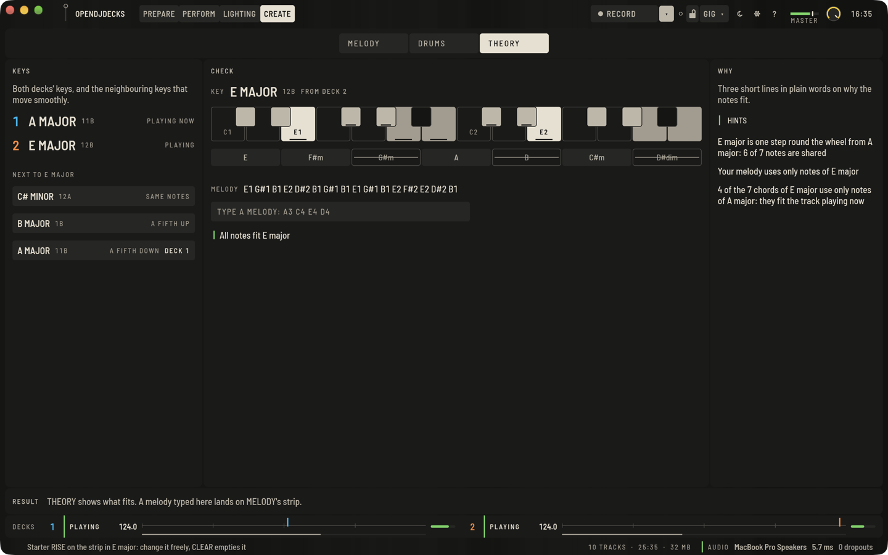

**CREATE** ist der vierte Tab neben PREPARE, PERFORM und LIGHTING. Hier machst du, wofür du vor einem Set sonst ein eigenes Produktionsprogramm öffnen würdest:

- die Melodie des nächsten Tracks mit einem Ton aus dem laufenden Track spielen,
- eine kleine Drum-Machine spielen,
- sehen, welche Töne und Tonarten passen.

Was du machst, wird eine normale Datei in deiner Bibliothek, mit Beatgrid und Hot Cues. Sie geht wie jeder Track in Playlists und auf Sticks. CREATE ist mit Absicht klein: keine Timeline, keine Pianorolle, kein Mischpult.

Die Decks spielen weiter, während CREATE offen ist. Die Leiste unten zeigt beide Decks: ob sie laufen, das Tempo, wo sie im Takt stehen, und den Pegel.

## Der erste Blick

CREATE ist nie leer, auch bevor du etwas geladen hast:

- **QUELLE** hält den eingebauten Klang (**KLANG**, markiert mit **EINGEBAUT**): ein schlichtes A3, das die App selbst erzeugt. Die Pads und die Klaviatur spielen ihn sofort, ohne Track.
- Eine leere Leiste in MELODY und THEORY bietet **STARTER** an: vier kurze Melodien (**AUFSTIEG**, **RUF**, **STUFEN**, **PULS**).
- Leere Drum-Schritte bieten drei Starter-Patterns (**GERADE**, **GEBROCHEN**, **LUFTIG**) auf dem eingebauten Kit an.

Ein Starter kommt nur auf eine leere Leiste oder auf leere Schritte. Er ersetzt also nie, was du gemacht hast. Er spielt in der gewählten Tonart. Ist noch keine Tonart gewählt, bringt er seine eigene vom Ausgangston mit, angezeigt als **STARTER-TONART**. Solange du nichts änderst, zeigen die Leiste und die Ergebnisleiste STARTER und seinen Namen. Änderst du einen Ton, gehört die Melodie dir. **LEEREN** leert die Leiste, dann sind die Starter wieder da.

Die Starter sind kurze Übungen, die für OpenDJDecks geschrieben wurden (gebrochene Akkorde, Tonleiterschritte, ein wiederholter Grundton). Sie stammen aus keinem Song.

## MELODY: eine Melodie aus einem Ton

MELODY liest sich von links nach rechts: **QUELLE**, dann **NOTEN**, dann **PASST**.

### Einen Ton wählen

1. Drücke unter QUELLE **DECK 1**, **DECK 2** oder **PLAYER**. CREATE nimmt ein kurzes Stück dieses Tracks, dort wo er gerade steht.
2. Ziehe **IN** und **OUT** auf der vergrößerten Wellenform um einen sauberen Ton. Die Pfeiltasten verschieben einen Griff in kleinen Schritten.
3. **HÖREN** spielt ihn, mit einer kurzen Blende bei OUT.

Die Tonhöhe steht als Note und Cent da, zum Beispiel „A3 +12 ct“:

- **ERKANNT**: CREATE ist sich sicher.
- **UNSICHER**: Prüfe sie mit dem Ohr.
- **VON DIR GESETZT**: Du hast sie mit den Pfeilen korrigiert oder eine Note wie A3 oder F#2 eingegeben.

**KLANG** holt jederzeit den eingebauten Klang zurück.

### Tonart, Pads und Klaviatur

- **TONART** folgt der Tonart des anderen Decks (**ANDERES DECK**). **NÄCHSTER TRACK** nimmt die Tonart des nächsten Tracks in der Warteschlange oder im Set. Die Pfeile und **DUR**, **MOLL** oder **MEHR** setzen sie von Hand.
- Mit **AN SKALA AUSRICHTEN** liegen auf den 8 Pads die Töne der Skala. Ohne liegen dort alle Halbtöne ab dem Ausgangston. **OKTAVE** verschiebt sie.
- Ein Pad mit **WEIT** liegt mehr als 7 Halbtöne vom Ausgangston entfernt und kann unnatürlich klingen. Ein Ausgangston näher daran klingt sauberer.
- Die Klaviatur zeigt den Grundton, die Skala und die Töne außerhalb. Drück eine Taste, um sie zu hören.

### Anordnen

Die Leiste darunter hat bis zu 32 Schritte auf dem Master-Raster (**1/4**, **1/8**, **1/16**).

- Drück **REC** und spiel dann die Pads, die Tasten oder ein MIDI-Keyboard. Läuft ein Deck, landen die Töne auf dem nächsten Schritt des Rasters. Sonst füllen sie die Leiste Schritt für Schritt.
- Oder tippe die Töne ein, etwa `A3 C4 - E4 _`. Dabei ist `-` eine Pause, und `_` hält den Ton davor.
- Tippe auf einen Schritt, um ihn zu wählen. Die Pfeile verschieben oder ändern ihn, das Kreuz leert ihn.
- **PLAY** spielt die Leiste im Takt des Masters, auf dem Kopfhörer, während ein Deck läuft. **LOOP** wiederholt sie.
- **LEEREN** leert die Leiste, **RÜCKGÄNGIG** holt sie zurück.

### Rendern

Die Ergebnisleiste sagt schon vor dem Rendern, was die Datei enthalten wird: Töne, Takte, Tempo und Hot Cues, und ob die Stick-Formate so viele Cues aufnehmen.

- **EINZELTÖNE** legt jeden verschiedenen Ton auf einen eigenen Takt, mit einem Hot Cue pro Ton, zum Spielen von Hand.
- **MELODY** spielt die Leiste im Takt, mit einem Cue pro Ton in Reihenfolge, fertig als Übergang.
- **MASTER** oder **TRACK** wählt das Tempo der Datei.
- **RENDERN** schreibt eine neue WAV-Datei mit festem Beatgrid und den Cues. Dein Quelltrack bleibt unverändert. Ist sie fertig, zeigt der Knopf **FERTIG** in Grün.

Gerenderte Dateien liegen im Ordner `created` neben deiner Bibliothek und stehen im Browser unter **ERSTELLT**.

### Ins Set

- **IN PLAYLIST** fügt die gerenderte Datei einer Playlist oder einem Set hinzu, oder einer neuen Playlist. Sticks, die diese Playlist synchronisieren, bekommen die Datei beim nächsten Sync. Die Statuszeile nennt sie.
- **AN PERFORM** legt die Töne auf den Pad-Modus **MELODY** jedes Decks und in die MELODY-Bank des Samplers. Die Pads A–H spielen die Töne, die Pfeile neben dem Modus schalten eine Oktave höher. Der Knopf zeigt **GESENDET** in Grün.

## DRUMS: eine kleine Drum-Machine

- **KIT** wählt ein eingebautes Kit (**KNAPP**, **WARM**, **STAUBIG**). Die Klänge erzeugt die App selbst, darum klingen sie auf jedem Computer gleich. **PITCH**, **DECAY** und **TONE** ändern das zuletzt gewählte Pad. Ein Doppelklick auf einen Regler holt die Einstellung des Kits zurück.
- Die Pads 1 bis 8 sind das Kit: KICK, SNARE, HAT, HAT OFFEN, CLAP, TOM 1, TOM 2 und RIDE. Die Pads 9 bis 16 nehmen eigene Samples: **SAMPLE LADEN** legt den Track aus dem Prepare-Player auf ein Pad.
- Drück ein Pad, um es zu hören und seine 16 Schritte zu sehen. Tippe auf einen Schritt, um ihn zu setzen.
- **PLAY** spielt die Schritte im Master-Tempo, ab dem nächsten Takt, wenn ein Deck läuft. **REC** legt die Pads, die du dabei drückst, auf den nächsten Schritt.
- **SWING** verzögert jeden Schritt zwischen den Schlägen. **HALBES TEMPO** macht jeden Schritt zur Achtelnote, für Musik, die du im halben Tempo liest.
- **LEEREN** leert alle Schritte, **RÜCKGÄNGIG** holt sie zurück.

Die Drum-Machine ist der Sequencer des Samplers mit seiner DRUMS-Bank, keine zweite:

- **PATTERN SICHERN** legt die Schritte auf ein PATTERN-Pad in Perform.
- **AN PERFORM** schaltet zusätzlich den Sampler auf die DRUMS-Bank.
- **LOOP RENDERN** schreibt das Pattern als Loop-Datei mit 1, 2, 4 oder 8 Takten im Master-Tempo. Die Datei hat ein Beatgrid, einen Loop über die ganze Datei und einen Hot Cue pro Klang.

## THEORY: welche Töne passen

- **TONARTEN** zeigt die Tonarten beider Decks als Notennamen, mit der Rad-Schreibweise daneben, und die Tonarten neben der gewählten, die weich wechseln.
- **PRÜFEN** zeigt die gewählte Tonart, die Klaviatur und ihre Akkorde. Ein gedrückter Akkord markiert seine Töne auf der Klaviatur. Tippe hier eine Melodie ein (sie landet auf der Leiste in MELODY) oder drück einen Starter. Die Zeile darunter sagt „Alle Töne passen“ oder nennt die Töne außerhalb der Tonart.
- **WARUM** gibt bis zu drei kurze Gründe in einfachen Worten. **HINWEISE** blendet sie aus, zusammen mit FRÖHLICH und TRAURIG unter den Skalen.

PASST in MELODY zeigt das Gleiche in kurz: welche Töne und Akkorde der gewählten Tonart zum gerade laufenden Track passen.

## Ein MIDI-Keyboard

Schließ ein beliebiges MIDI-Keyboard oder einen Pad-Controller an, für den es in OpenDJDecks kein Controller-Mapping gibt. Solange CREATE offen ist, spielen seine Töne hier. Beim ersten Mal nennt die Statuszeile das Gerät.

- **In MELODY und THEORY** spielt eine Taste diesen Ton vom Ausgangston aus, wie die Klaviatur. Ist **REC** an, kommt der Ton auch auf die Leiste. Genutzt werden die Töne von C1 bis C7. Die Anschlagstärke wird nicht genutzt: Jeder Ton spielt so laut wie ein Pad.
- **In DRUMS** spielen die MIDI-Noten 36 bis 51 (C2 bis D#3, wie OpenDJDecks Noten benennt) die Pads 1 bis 16. Viele Pad-Controller senden diese Noten ab ihrem ersten Pad. Andere Noten tun dort nichts.

Ein gemappter DJ-Controller und ein Controller, den du dem Licht gegeben hast, spielen nie in CREATE: Ihre Töne bleiben ihre eigenen. Außerhalb von CREATE tut ein Keyboard nichts, und OpenDJDecks öffnet solche Geräte nur, solange CREATE offen ist.

## Grenzen

- Die Tonerkennung kann eine lange Pad-Fläche, einen verstimmten oder einen verrauschten Ton falsch lesen. Prüfe Töne mit **UNSICHER** mit dem Ohr und korrigiere sie.
- Große Verschiebungen (mehr als 7 Halbtöne, markiert mit WEIT) können unnatürlich klingen.
- Ob gerenderte Dateien mit vielen Hot Cues auf Club-Playern wie gedacht spielen, wurde noch nicht auf echten Playern ausprobiert.
- Das MIDI-Keyboard ist mit simulierten Tönen getestet, nicht mit echten Keyboards. Anschlagstärke, Note-Offs, Sustain-Pedal und Pitch Bend werden nicht genutzt.
- Keine Timeline, keine Pianorolle, keine Plug-ins und keine Automation, mit Absicht.
