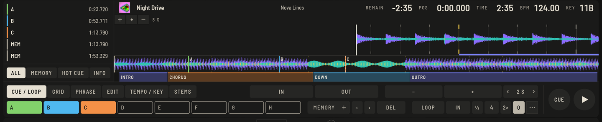
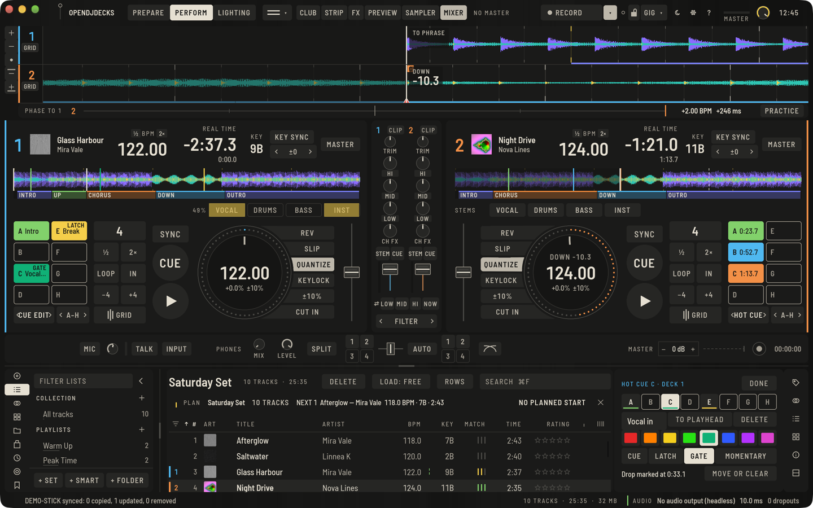
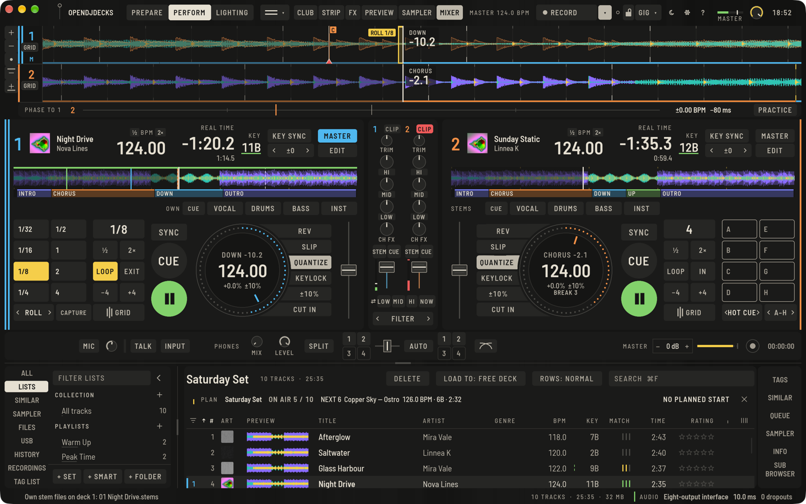

Öffne einen Track im Player oben in Prepare, um Cues zu setzen. Alles, was du hier setzt, wird mit dem Track gespeichert und erreicht deine [USB-Sticks](usb-sticks.md) von selbst.

## Hot Cues

Acht Pads, **A** bis **H**, springen sofort an eine Stelle im Track.

1. Bewege den Cursor an die Stelle: Klick auf die Wellenform oder Pfeiltasten (`←` `→` fein, `⌥←` `⌥→` um zwei Sekunden).
2. Klicke ein leeres Pad oder drücke `1` bis `8`. Mit **Q** (Quantisieren) rastet der Cue auf dem Beat ein.
3. Ein gesetztes Pad springt dorthin. In Prepare löschen `⇧⌘1` bis `⇧⌘8` die Pads.

In Perform funktionieren die Pads genauso und werden sofort gespeichert: am Deck oder am Controller ist Setzen und Löschen je ein Rückgängig-Schritt. Halte einen gesetzten Hot Cue im Pausenzustand gedrückt, um ihn vorzuhören; ein Rechtsklick löscht.

Bei mehr als acht Stellen schaltest du am Deck die Bank um: **A–H**, **I–P**, **Q–X** und **Y–AF** mit **‹ ›** im **HOT CUE**-Pad-Modus oder per Tastatur.

## Hot Cues in Perform bearbeiten

Wähle **CUE-EDIT** als Pad-Modus eines Decks. Die Pads wählen jetzt einen Hot Cue, statt ihn zu spielen (der bearbeitete leuchtet), und ein Bereich neben der Liste bearbeitet ihn, ohne Perform zu verlassen:

- **NAME**: tippen und Return drücken. Der Name steht auf dem Pad.
- **FARBE**: acht Farben; die gewählte ist gefüllt.
- Die Reihe **CUE**, **LATCH**, **GATE**, **MOMENTAN** sagt, wie das Pad diesen Cue spielt. **CUE** ist das gewohnte Pad: Es springt, während das Deck spielt, und pausiert spielt es nur, solange du es hältst. **LATCH** springt und spielt weiter, auch von einem pausierten Deck. **GATE** spielt ab dem Cue nur, solange du das Pad hältst, auch während das Deck spielt, und hält dann am Cue an. **MOMENTAN** spielt ab dem Cue, solange du es hältst, und lässt den Track dann dort weiterlaufen, wo er gewesen wäre, wie Slip. Ein Pad, das nicht gewohnt spielt, nennt seine Spielweise in seiner Ecke.
- **AN ABSPIELPUNKT** setzt den Cue an den Abspielpunkt (mit Quantize auf den Beat) oder speichert dort einen, wenn das Pad leer war; **LÖSCHEN** entfernt ihn.
- **DROP** markiert den Drop des Tracks, siehe [Phrasen](phrases.md#phrasenspruenge-und-der-drop).

Jede Änderung ist ein Rückgängig-Schritt und kommt mit dem nächsten Sync auf die Sticks. **FERTIG** (oder ein anderer Pad-Modus) führt zurück zu den Pads. Am Controller schaltet `deck.pad_mode` mit `mode = "cue_edit"` dorthin; die Pads des Controllers wählen dann den Cue. Die Spielweisen sind in der Engine getestet, an einem echten Controller noch nicht ausprobiert.

Ist der **PLATTER** ausgeblendet (**Ansicht › Deck-Layout › ZEIGEN**), nehmen die Pads seinen Platz und zeigen die Cue-Namen ganz.

## Memory Cues

Memory Cues sind Marker, die du ohne Pad durchschalten kannst.

1. Drücke **MEMORY +** (oder `M`) am Cursor.
2. **‹** und **›** schalten durch, oder `R` und `T`.
3. **ENTF** (oder `⇧M`) entfernt den Memory Cue am Cursor.

In Perform rufen die Tasten für vorherigen / nächsten Memory Cue und dieselben Controller-Knöpfe sie auf; der Pad-Modus Memory Cue zeigt sie auf den Pads. Setzen und Löschen vom Controller ändert den Track mit.

## Die Cue-Liste

Die Liste rechts im Player hat die Tabs **ALLE**, **MEMORY** und **HOT CUE**. Wähle einen Cue aus, um ihn zu bearbeiten:

- Doppelklick, **Name** eintippen, Return. Namen stehen auf den Pads.
- Wähle eine der acht **Farben**.
- **ZUM CURSOR** verschiebt ihn zum Cursor, auf den Beat; Loops behalten ihre Länge.
- **→ HOT** macht aus einem Memory Cue einen Hot Cue auf dem ersten freien Pad.
- Die Löschtaste entfernt ihn.

## Loops

Im Player-Tab **CUE / LOOP** und am Perform-Deck:

- **LOOP** startet einen Auto-Loop der angezeigten Länge; ein zweiter Druck verlässt ihn. **½** und **2×** ändern die Länge von 1/32 bis 32 Beats.
- **IN** und **OUT** setzen einen manuellen Loop; **EXIT** verlässt ihn. In Perform wird er mit demselben Knopf neu gestartet.
- Der Pad-Modus **ROLL** rollt einen kurzen Loop, solange du ein Pad hältst, siehe unten.

Drücke **MEMORY +**, während ein Loop läuft, um ihn als Memory-Loop zu speichern, oder setze einen Hot Cue auf einen Loop. **AKTIV** im Cue-Editor macht aus einem gespeicherten Loop einen aktiven: Er greift von selbst, wenn die Wiedergabe ihn erreicht.

## Loop Roll und Sichern

Wähle in Perform **ROLL** als Pad-Modus. Die Pads tragen die Längen **1/32**, **1/16**, **1/8**, **1/4** (links) und **1/2**, **1**, **2**, **4** Beats (rechts).

- **Halte ein Pad**, um zu rollen: Der Loop beginnt auf dem Grid (mit **Q**) und wiederholt sich, solange du hältst. Der Track läuft darunter weiter, eine feine Linie auf der Wellenform zeigt wo; lässt du los, geht es dort weiter, wie bei Slip.
- Das gehaltene Pad ist gefüllt, und das Loop-Band auf der Wellenform nennt den Roll, zum Beispiel **ROLL 1/8**.
- **SICHERN** in der Modusleiste behält den Loop, den du gerade gehört hast, Roll oder Loop, als Hot Loop auf dem ersten freien Pad der Bank. Sind alle acht belegt, wird er ein Memory Loop. Jedes Sichern ist ein Rückgängig-Schritt und wird mit dem Track gespeichert.

Am Controller: `deck.loop_roll` mit `beats`, der Pad-Modus `loop_roll` und `deck.loop_capture`. Rolls sind in der Engine und der App getestet; auf Hardware-Pads sind sie noch nicht ausprobiert.

## Cues wie bei deinen anderen Tracks

Zeilenmenü: **Cues wie bei meinen anderen setzen**. OpenDJDecks schaut, wo du auf vorbereiteten Tracks Hot Cues und Memory Cues gesetzt hast, gemessen in Takten ab dem ersten Beat, den Phrasen und dem Ende, und füllt freie Pads der gewählten Tracks mit denselben Namen, Farben und Loop-Längen. Dafür braucht es mindestens drei analysierte Tracks mit Cues.

Unter **Einstellungen › Analyse › Cue-Punkte** passiert das auf Wunsch bei neu analysierten Tracks ohne Cues. Standardmäßig ist das aus. Jedes Setzen ist ein Rückgängig-Schritt.

## Auto Cue beim Laden

Ein geladener Track wartet an seinem ersten Ton, oder am ersten Memory Cue, falls er einen hat. Abschalten kannst du das unter **Einstellungen › Controller › Decks › Auto Cue**.
