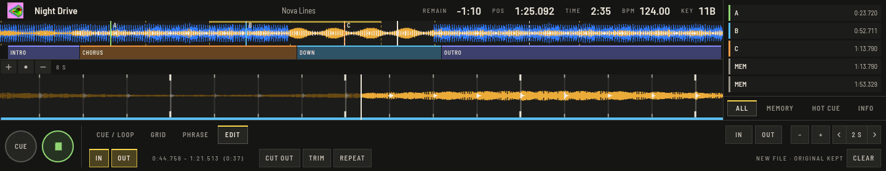

Manchmal braucht ein Track ein kürzeres Intro, einen Breakdown weniger oder einen Teil zweimal. Der Tab **EDIT** im Prepare-Player macht aus einem markierten Bereich einen neuen Track. Die Originaldatei wird nie angefasst, und das Ergebnis ist eine ganz normale Audiodatei, die überall läuft, in OpenDJDecks oder jeder anderen Software.

## So geht's

1. Öffne den Track im **Prepare**-Player und wähle den Tab **EDIT**.
2. Markiere den Bereich: Setze den Cursor an den Anfang und drücke **IN** (`⇧I`), dann ans Ende und drücke **OUT** (`⇧O`). Du kannst auch mit `⇧` über die Übersicht oben ziehen. **LÖSCHEN** verwirft den Bereich.
3. Wähle, was damit geschieht:
   - **HERAUSSCHNEIDEN** macht eine neue Datei *ohne* den Bereich (`⇧⌘X`).
   - **ZUSCHNEIDEN** macht eine neue Datei *nur mit* dem Bereich (`⇧⌘K`).
   - **WIEDERHOLEN** macht eine neue Datei, in der der Bereich zweimal läuft (`⇧⌘E`).
4. Während des Erstellens zeigt die Anzeige **WIRD ERSTELLT …**. Die Schnittstellen bekommen kurze 5-ms-Überblendungen, damit nichts knackt.

## Das Ergebnis

Eine neue 24-Bit-WAV-Datei neben dem Original, in deiner Bibliothek als **Titel (Edit)** mit den Original-Tags und dem Cover. Sie wird automatisch analysiert, Tempo, Grid und Phrasen sind also fertig.

> [!TIP]
> Setze den Bereich auf den Beat: Mit dem am Grid eingerasteten Cursor bleibt der Schnitt im Takt. Nutze die **Q**-Taste und [prüfe vorher das Grid](beatgrid.md), wenn der Track nicht sauber darauf liegt.

## Gut zu wissen

- Das ist ein Editor für jeweils einen Bereich, ohne Mehrspur-Arrangement.
- Hot Cues des Originals werden nicht in den Edit übernommen. Setze im neuen Track neue.
- Einen Edit entfernst du wie jeden Track aus der Bibliothek; am Original wurde nichts verändert.
