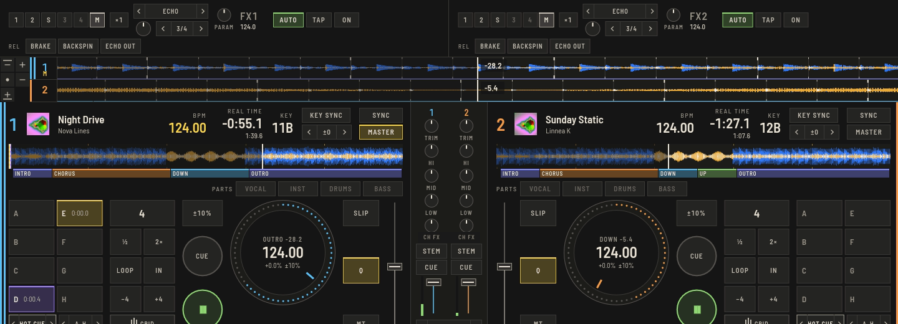
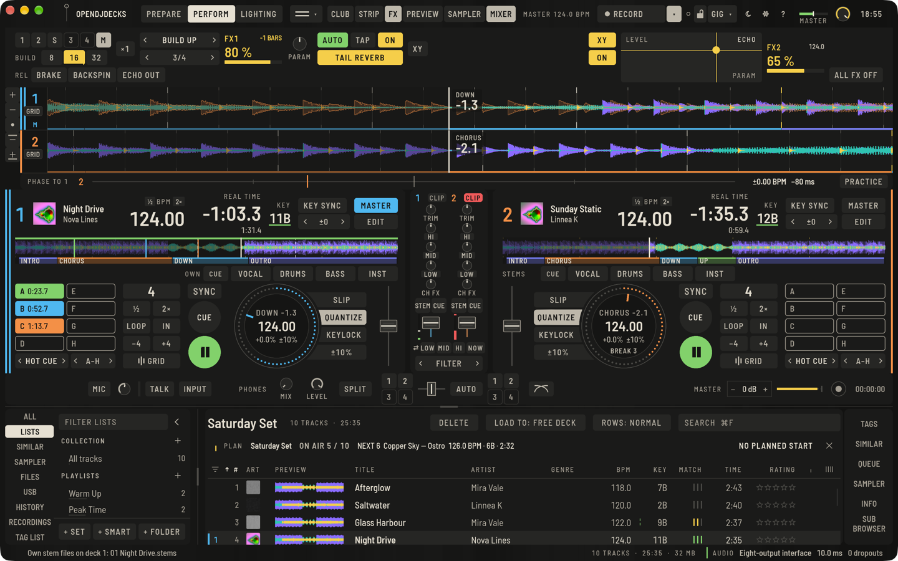

Drücke **FX** in der oberen Leiste (`⌥⌘F`), um die zwei Tempo-FX-Einheiten über den Decks zu öffnen.

## Tempo FX

Jede Einheit, **FX1** und **FX2**, wählt einen Effekt (Liste oder **‹ ›**), eine Beat-Länge und ein Ziel:

1. Wähle den Effekt, indem du seinen Namen für die Liste anklickst, oder mit **‹ ›**.
2. Wähle die Länge mit den **BEAT**-Tasten, 1/8 bis 16 Beats. Sie folgt dem Deck-Tempo; **TAP** setzt dein eigenes Tempo (drei Taps) und **AUTO** kehrt zum Deck zurück.
3. Lege ihn auf: die Tasten **1** bis **4** für Kanäle, den Sampler oder **MASTER**.
4. Stelle die Stärke und **PARAM** (den zweiten Regler des Effekts, etwa Filterrichtung oder Tonhöhe) ein, dann drücke **ON**. Die Stärke ist der große Prozentwert neben dem Effekt, mit einem Balken darunter: daran entlangziehen oder am Mausrad drehen. Er leuchtet in der Farbe des Effekts, solange der Effekt an ist.

**×3** legt drei Effekte in eine Einheit: Jeder Slot hat eigenen Effekt, Beat, Tiefe und An/Aus.

### Effekte

Echo, Delay, Ping Pong, Reverb, Flanger, Phaser, Roll, Slip Roll, Filter, Trans, Pitch, Vinyl Brake, Helix, Spiral und mehr, inklusive der Remix-Effekte unten. Am Controller werden seine Effektnamen dem nächstliegenden zugeordnet.

- **LOW CUT ECHO** ist ein Echo, dessen Wiederholungen jedes Mal mehr Bässe verlieren; **PARAM** verschiebt den Schnitt.
- **MULTI TAP** wiederholt viermal über seine Länge, abwechselnd links und rechts.
- **JET** ist ein Flanger mit starker Rückkopplung und kurzem, hellem Sweep.
- **STRETCH** spielt den Klang ab dem Einschalten langsamer, ohne die Tonhöhe zu ändern; **PARAM** stellt das Tempo ein.
- **SHEPARD SAW** scheint endlos zu steigen, eine Oktave pro Länge; **SHEPARD TRI** geht hoch und wieder runter.

### Remix-Effekte

In derselben Liste:

- **BUILD UP** schneidet die Bässe über seine Länge immer höher ab, während ein Rausch-Sweep aufsteigt. **PARAM** stellt das Rauschen ein.
- **BREAKDOWN** schließt die Höhen und senkt den Pegel.
- **REVERSE ROLL** wiederholt die erfassten Beats rückwärts.

### Exit FX

**BRAKE**, **BACKSPIN** und **ECHO OUT** wirken auf das Ziel einer Einheit, solange gehalten, danach kommt die Musik zurück. Am Controller ist die Release-Taste Echo Out.

## Für den Drop

Ab Version 0.8 hat jede Einheit, was du rund um einen Drop brauchst.

- **BUILD 8 / 16 / 32** startet einen Build-up, der bis zur nächsten Linie von 8, 16 oder 32 Takten im Grid des Tracks steigt und dann loslässt, damit der Drop sauber kommt. Ist weniger als ein Takt bis zu dieser Linie übrig, nimmt er die nächste. Die Einheit zählt die verbleibenden Takte (**-6 TAKTE**), und die leuchtende Taste füllt sich, während der Build-up steigt. Ein zweiter Druck auf die leuchtende Taste beendet ihn früher. Gezählt wird im Grid des Decks, dem die Einheit folgt (dem Master-Deck bei **M**); ein Grid, das daneben liegt, setzt auch den Gipfel daneben.
- **TAIL** wählt, was ausklingt, nachdem du einen Effekt ausschaltest: **TAIL AUS**, **TAIL ECHO** (der Klang beim Loslassen wiederholt sich jeden Beat und verklingt) oder **TAIL HALL** (er geht in einen Hall über). Das zählt bei Effekten ohne eigenen Nachhall, etwa Roll, Flanger, Filter oder dem Build-up; Echo, Delay und Reverb klingen ohnehin aus.
- **XY** macht die Einheit zu einer großen Fläche. Quer ist der Parameter des Effekts, nach oben seine Stärke. Drück irgendwo, und der Effekt spielt, solange du hältst; beim Loslassen geht er aus und sein Tail klingt aus. Ein Effekt, der schon an war, bleibt an. **XY** in der Ecke holt die Regler zurück. In Fenstern schmaler als 1400 px sitzt die Taste **XY** in der zweiten Zeile der Einheit.
- **ALLE FX AUS** am rechten Ende des Panels stoppt jeden Effekt auf einmal: beide Einheiten mit allen Slots und Tails, Exit- und Hold-FX und die **CH FX**-Regler, die in die Mitte zurückgehen. Auf der Tastatur ist das `⇧Esc`, in einem Controller-Mapping `fx_panic`.

Getestet ist das mit erzeugten Tracks und in den Tests der App, noch nicht nach Gehör auf einem Gig oder von einem Hardware-Controller (`tempo_fx.build_up` und `fx_panic` stecken noch in keinem mitgelieferten Mapping).

## Channel FX

**‹ FILTER ›** unter dem Mixer wählt den Channel FX, den der **CH FX**-Regler jedes Kanals steuert: Filter, Noise, Space, Crush, Echo, Pitch, Dub Echo und Sweep. Deine Wahl wird gemerkt. `⇧J` und `⇧S` schalten durch.

Filter arbeitet wie der Colour-Filter eines Club-Mixers: Eine kleine Zone um die Mitte lässt den Klang unverändert, nach links fährt ein steiler Tiefpass (24 dB/Okt.) von 20 kHz bis etwa 70 Hz herunter, nach rechts ein Hochpass von 20 Hz bis etwa 6 kHz hinauf. Der größte Teil des Regelwegs liegt im musikalisch wichtigen Bereich, und die Resonanz steigt zu den Enden hin leicht an.

Auto Channel FX ist einer davon: ein Regler mit Tiefpass und Echo nach links, Hochpass und Reverb nach rechts.

## Hold FX

Der Pad-Modus **HOLD FX** legt acht Presets auf die Pads, Beat- und Release-Effekte, aktiv solange gehalten. **‹ ›** schaltet zwischen zwei Seiten.

## Stem FX

Unter der Kanalzuweisung einer Einheit begrenzen die Tasten **ALL**, **VOC**, **DRUM**, **BASS** und **INST** sie auf einen Stem des Kanals: Die Einheit bearbeitet nur diesen Stem, der vor EQ und Fader wieder in den Kanal zurückkehrt. Dafür braucht der Track [getrennte Stems](stems.md).
