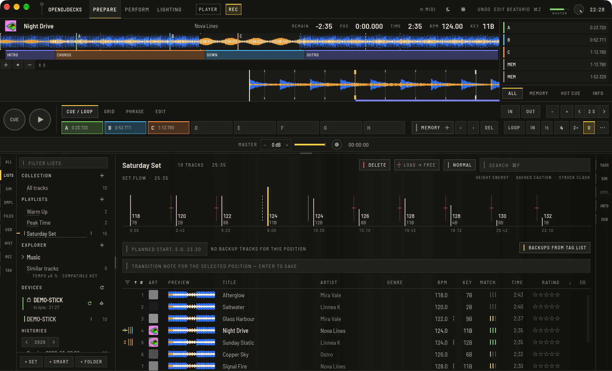

OpenDJDecks hat zwei Arbeitsmodi. In **Prepare** sortierst du Musik und setzt Cues, zu Hause. **Perform** sind die Decks und der Mixer für den Gig. Oben links schaltest du jederzeit um; was geladen ist, bleibt geladen.

## 1. Installieren

Lade die App für deinen Rechner von der [Download-Seite](/download/) und folge dort der kurzen Anleitung für dein System. Auf dem Mac braucht der erste Start eine einmalige Bestätigung, weil die App nicht von Apple signiert ist.

Die Oberfläche ist Deutsch oder Englisch und folgt deinem System. Selbst wählen kannst du sie unter **Einstellungen** (Zahnrad oben oder `⌘,` auf dem Mac und `Strg+,` auf Windows und Linux), dann **Ansicht › Sprache**.

## 2. Musik hinzufügen

Die App verweist auf deine Musik dort, wo sie schon liegt. Dateien werden nie kopiert oder verändert.

1. Drücke auf dem leeren Bibliotheksbildschirm **MUSIKORDNER HINZUFÜGEN**, oder **MUSIK HINZUFÜGEN** über der Liste, oder **Ablage › Musikordner hinzufügen…**.
2. Wähle den Ordner mit deinen Tracks. Unterordner gehören dazu.
3. Die Tracks erscheinen sofort unter **Alle Tracks**.

Du kannst Dateien und Ordner auch aus dem Finder oder Dateimanager auf das Fenster ziehen; sie kommen in die Sammlung und, falls geöffnet, in die aktuelle Playlist oder das Set.

Hast du schon eine Bibliothek in anderer DJ-Software, lies zuerst [Bibliothek importieren](importing-your-library.md): Der Import bringt deine Cues und Grids mit.

## 3. Die Analyse laufen lassen

Neue Tracks werden von selbst im Hintergrund analysiert: BPM und Beatgrid mit der ersten Zählzeit, Tonart, Wellenformen in drei Farbbändern, Phrasen und Lautheit. Das Band ganz unten im Fenster zeigt den Fortschritt, und du kannst währenddessen weiterarbeiten.

- Eine kurze Linie in der Statusspalte heißt: Der Track wartet auf die Analyse. Eine durchgestrichene Linie heißt: Die Datei fehlt; hilft [Fehlersuche](troubleshooting.md#ein-track-hat-eine-durchgestrichene-linie).
- Um einen Track neu zu analysieren: Rechtsklick und **Analysieren** (oder `⇧⌘A` im Player). Grids und Tonarten, die du von Hand gesetzt oder importiert hast, bleiben erhalten; einen Track ganz schützt **Analyse sperren / entsperren** im selben Menü.
- Das Tempo wird standardmäßig in den Bereich 87 bis 175 BPM gefaltet. Für Hip-Hop oder Drum & Bass stellst du vor der Analyse **Einstellungen › Analyse › BPM-Bereich** um.

## 4. Reinhören

Klicke einen Track in der Liste an, er öffnet sich im Player oben in Prepare. Mit `Leertaste` hörst du ihn vor; ein Klick auf die große Wellenform springt dorthin.

## 5. Zu Perform

1. Klicke oben auf **PERFORM**.
2. Doppelklicke einen Track in der Liste, er lädt auf ein freies Deck. In Prepare öffnet ein Doppelklick stattdessen den Player.
3. Drücke den Play-Knopf am Deck oder `Z` für Deck 1 und `N` für Deck 2.

Hast du einen kompatiblen Controller, stecke ihn per USB ein; er wird in wenigen Sekunden erkannt und sein Audio-Interface automatisch benutzt. Siehe [Controller](controllers.md).

## Wie es weitergeht

- [Bibliothek und Playlists](library.md): Tracks sortieren und finden
- [Cues und Loops](cues-and-loops.md): die Stellen markieren, die du spielst
- [USB-Sticks](usb-sticks.md): die Musik zum Raspberry Pi oder auf einen anderen Rechner bringen
- [Die Grundlagen von Perform](perform-basics.md)
