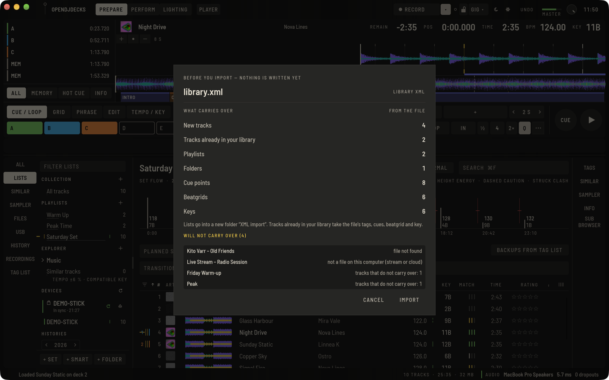
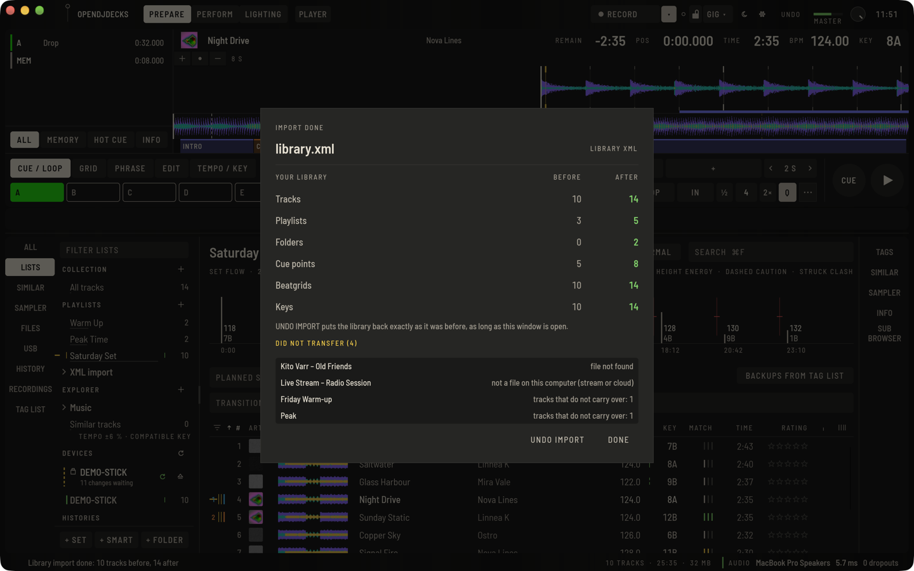

OpenDJDecks kann eine Bibliothek aus einer **Bibliotheks-XML-Datei** einlesen, damit du mit deinen Cues, Beatgrids, Tonarten und Playlists startest.

## Die XML-Datei erstellen

Exportiere in rekordbox deine Sammlung über das Menü Datei als XML-Datei und speichere sie an einem Ort, den du wiederfindest. OpenDJDecks liest nur die Datei, die du wählst; es sucht auf deinem Computer nicht nach Dateien anderer Software.

**Ablage › rekordbox-Einstellungen und -Tastenkürzel importieren…** (auch unter **Einstellungen › Erweitert**) übernimmt zusätzlich Einstellungen und Tastenkürzel, wo sie nicht mit vorhandenen kollidieren. Den Einstellungsordner wählst du dabei selbst aus.

## Die Datei importieren

1. Öffne **Ablage › Bibliotheks-XML importieren…** (`⇧⌥⌘X`), oder **BIBLIOTHEK IMPORTIEREN** auf dem leeren Bibliotheksbildschirm.
2. Wähle die XML-Datei.

Bevor etwas geschrieben wird, zeigt ein Fenster, was die Datei mitbringt: neue Tracks, Tracks, die schon in deiner Bibliothek sind, Playlists, Ordner, Cue-Punkte, Beatgrids und Tonarten. Darunter listet **WIRD NICHT ÜBERNOMMEN** alles, was zurückbleibt, mit dem Grund:

- **Datei nicht gefunden**: Die Audiodatei liegt nicht dort, wo die XML sagt;
- **keine Datei auf diesem Computer (Stream oder Cloud)**: ein Streaming- oder Cloud-Eintrag;
- **nicht lesbare Cue-Punkte**: Cue-Punkte eines Tracks, die in der Datei unvollständig sind;
- **Tracks, die nicht übernommen werden**: Einträge einer Playlist, deren Tracks zu den oben genannten gehören.

Tracks, die schon in deiner Bibliothek sind, übernehmen Tags, Cues, Beatgrid und Tonart aus der Datei. **ABBRECHEN** lässt alles, wie es ist; **IMPORTIEREN** legt los.

Nach dem Import zeigt das Fenster deine Bibliothek vorher und nachher (Tracks, Playlists, Ordner, Cue-Punkte, Beatgrids und Tonarten) und was nicht übernommen wurde. **IMPORT RÜCKGÄNGIG** stellt die Bibliothek genau so wieder her, wie sie vor dem Import war, aus einer Kopie, die direkt vor dem Start angelegt wurde. Rückgängig ist möglich, solange dieses Fenster offen ist; **FERTIG** schließt es und entfernt die Kopie. Rückgängig stellt die Kopie als Ganzes wieder her: Was du sonst an der Bibliothek änderst, während das Fenster offen ist, wird mit zurückgenommen. Vorschau, Vorher/Nachher und Rückgängig gelten für die beiden XML-Formate auf dieser Seite, nicht für die verschlüsselte Datenbank weiter unten.

Listen landen in einem neuen Ordner **XML import**. Cover kommen aus den Dateien selbst. Deine Musikdateien bleiben, wo sie sind. Wird danach ein Track nicht gefunden, siehe [verschobene Dateien](library.md#verschobene-dateien).

## Andere Formate

- **Ablage › Bibliotheks-XML exportieren…** schreibt deine Bibliothek in eine Datei, die andere DJ-Software lesen kann (`⌥⌘X`).
- **Ablage › Musik- / iTunes-Mediathek (XML) importieren…** liest eine aus Apple Music oder iTunes exportierte `Library.xml`, mit Tags, Bewertungen und Playlist-Ordnern (`⇧⌥⌘M`). Sie zeigt dieselbe Vorschau, Vorher/Nachher und Rückgängig. Videos, Podcasts und die Listen, die die App selbst anlegt (die ganze Mediathek, eingebaute Listen), werden nicht übernommen und so aufgeführt.

Um deine ganze OpenDJDecks-Bibliothek auf einen neuen Rechner zu bringen, nimm das Bibliotheksarchiv; siehe [Umzug auf einen neuen Rechner](library.md#umzug-auf-einen-neuen-rechner).

## Verschlüsselte Bibliotheksdatenbank

Ab Version 0.6 kann OpenDJDecks auch eine verschlüsselte Bibliotheksdatenbank direkt lesen, mit Tracks, Cues, Beatgrids, Tonarten, Playlists, Smart-Playlists (als normale Playlists mit dem Inhalt zum Importzeitpunkt), Covern und der Wiedergabe-Historie. Das ist optional; der XML-Weg oben braucht keinen Schlüssel.

1. Wähle **Ablage › Verschlüsselte Bibliotheksdatenbank importieren…**.
2. **DATEI WÄHLEN**: Wähle die Datenbankdatei deiner Bibliothek selbst aus. OpenDJDecks durchsucht deinen Computer nie danach.
3. Gib unter **ERWEITERT** den Schlüssel für diese Bibliothek ein.
4. Drücke **IMPORTIEREN**.

Du brauchst den Schlüssel für deine eigene Bibliothek. OpenDJDecks enthält ihn nicht und beschafft ihn nicht, und kann dir auch nicht helfen, ihn zu finden. Der Schlüssel wird nur für diesen Import verwendet: Er wird nicht gespeichert und nicht protokolliert. Deine Datenbankdatei wird nur gelesen, nie verändert, und die temporäre entschlüsselte Kopie wird am Ende des Imports entfernt, auch wenn er fehlschlägt. Ist der Schlüssel falsch, erscheint die Meldung „Der Schlüssel wurde nicht akzeptiert", und es wird nichts importiert.

Listen landen in einem Ordner **Library import**. Ein erneuter Import fügt nichts doppelt hinzu.
