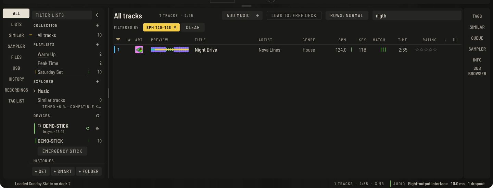

Der Browser ist in Prepare und Perform derselbe. Links liegen deine Quellen und Listen, in der Mitte die Tracks, rechts eine Leiste mit Panels.



## Die Quellen links

Die schmale Leiste schaltet, was der Baum zeigt: **ALLE** (die ganze Sammlung), **LISTEN** (Playlists, Sets und Smart-Listen), **PASST** (passende Tracks), **SMPL** (das Sampler-Panel in Perform), **DATEIEN** (der Explorer), **USB** (deine Sticks), **VERL** (Verläufe), **REC** (Aufnahmen) und **TAG** (die Tag-Liste).

## Nach Tonart sortieren (ab Version 0.6)

Klicke die Spalte **KEY**, um deine Tracks nach Tonart zu sortieren. Mit einem Rechtsklick auf die Spaltenüberschrift wählst du, wie:

- **Tonarten nach Quintenzirkel sortieren** geht in musikalischer Reihenfolge rund um das Rad: 1A, 1B, 2A, 2B und so weiter. Tracks nebeneinander lassen sich harmonisch mischen. Das ist die Voreinstellung.
- **Tonarten alphabetisch sortieren** sortiert einfach nach dem angezeigten Tonarten-Text.

Deine Wahl bleibt gespeichert. Die Spalte nutzt die Tonart-Schreibweise, die du unter **Einstellungen › Analyse** gewählt hast.

## Playlists, Sets, Smart-Listen und Ordner

Nimm **+ SET**, **+ SMART** und **+ ORDNER** unter dem Baum oder die Tasten: neue Playlist `⌘N`, Set `⇧⌘N`, Ordner `⇧⌘F`, Smart-Liste `⇧⌘M`.

- Klicke den Namen einer Liste an, um sie umzubenennen.
- Ziehe eine Liste auf einen Ordner, um sie hineinzuschieben, oder auf eine andere Liste, um sie davor einzusortieren. Jede Änderung lässt sich rückgängig machen.
- Um Tracks hinzuzufügen, wähle sie aus und drücke **+** neben der Liste, oder ziehe die Zeilen hinüber.
- Ziehe Zeilen zwischen die Zeilen einer nach **#** sortierten Liste, um sie umzuordnen.
- **LÖSCHEN** entfernt die geöffnete Liste (`⌘⌫`). Ausgewählte Tracks entfernst du mit `⌦` oder über das Zeilenmenü aus der Liste.

Für die Planung eines Abends nimm ein [Set](preparing-sets.md) statt einer Playlist: Es zeigt den Verlauf von Tempo, Tonart und Energie.

## Smart-Listen

Eine Smart-Liste füllt sich nach Regeln, die du eintippst. Bedingungen stehen durch Kommas getrennt; ein Track muss alle erfüllen. Lege eine mit **+ SMART** an, tippe in das Regelfeld und drücke Return:

```text
bpm 120-126, key 8A~, genre house, rating >= 3, added < 30d
```

- `bpm`, `rating`, `year`, `plays` und `duration` nehmen einen Wert (`128`), einen Bereich (`120-126`) oder einen Vergleich (`>= 3`).
- `key 8A` trifft genau; `key 8A~` trifft Tonarten, die gut passen (ein Schritt auf dem Kreis oder die Paralleltonart).
- `title`, `artist`, `album`, `genre`, `label`, `comment` und `format` treffen, wenn der Text das Wort enthält. Ein führendes `-` schließt aus (`-genre techno`).
- `added < 30d` vergleicht das Alter: `d` Tage, `w` Wochen, `m` Monate, `y` Jahre.

## Suchen und filtern

Drücke `⌘F` und tippe; die Liste wird beim Tippen enger. Die Filtertaste über der Liste (`⌘J`) öffnet eine Leiste mit BPM-Bereich, **Tonart passt zum Master**, **BPM ±%** um das Master-Deck (doppeltes und halbes Tempo zählen), einer Mindest-**BEWERTUNG** und einem **TAGS**-Wert. **ZURÜCKSETZEN** entfernt alle Bedingungen.

## Die MATCH-Spalte

Neben der Tonart bewertet **MATCH** jede Zeile gegen das, was gerade läuft: das Master-Deck, sonst ein spielendes Deck, sonst den ausgewählten Track. Bis zu drei Linien leuchten für Tonart und Tempo, und beim Überfahren erfährst du, warum. Sortierst du danach, stehen die besten Treffer oben; die Spalte folgt dem Master-Deck, während du spielst.

## Auto-Sortierung

**AUTO-SORTIERUNG** im Baum gruppiert deine analysierten Tracks nach **Tempo**, **Energie**, **Stimmung**, **Charakter** und **Genre**, berechnet auf deinem eigenen Rechner. Öffne eine Liste wie jede andere; sie lässt sich sortieren, laden und in Playlists ziehen.

## Passende Tracks

Das Panel **PASSEND** rechts zeigt, was nach dem gewählten Track passt: innerhalb ±6 % Tempo und mit passender Tonart. Doppelklick lädt auf ein freies Deck, **ALS LISTE ZEIGEN** öffnet dieselbe Auswahl als Liste. Im Baum macht **Passende Tracks** dasselbe für das Master-Deck oder ein gewähltes Deck 1 bis 4.

## Tags, Bewertung und Farbe

- Klicke die Sterne einer Zeile zum Bewerten; ein erneuter Klick löscht. Das Zeilenmenü hat dasselbe, und **Farbe** setzt eine von acht Markierungen.
- Das Panel **INFO** rechts zeigt alle Tags des gewählten Tracks; klicke ein Feld, tippe und speichere mit Return, auch den **KOMMENTAR**. Der Tab **COVER** zeigt das Cover.
- **TAGS** füllst du selbst: Im Panel tippst du `Kategorie: Wert` (zum Beispiel `Stimmung: Peak`) und drückst Return, um die Auswahl zu taggen, dann klickst du einen Wert zum Taggen oder Enttaggen. Filter und Spalte benutzen dieselben Werte.

## Die Tag-Liste

Sammle beim Stöbern Kandidaten: mit `⌥⌘T`, über das Zeilenmenü oder durch Ziehen auf **TAG-LISTE** im Baum. **ALS PLAYLIST SPEICHERN** macht eine Playlist daraus, **LEEREN** leert sie.

## Der Explorer

**DATEIEN** zeigt Ordner auf deiner Festplatte, ohne etwas zu importieren. Drücke **+** neben **EXPLORER**, um einen Ordner hinzuzufügen. **Unterordner einbeziehen** im Listenkopf zeigt alle Dateien darunter. Ein aus dem Explorer geladener Track kommt in die Sammlung und wird im Hintergrund analysiert.

## Spalten und Sortierung

Klicke eine Spaltenüberschrift zum Sortieren, ein zweiter Klick kehrt um. `⇧`-Klick fügt eine zweite und dritte Sortierspalte hinzu. Ziehe eine Überschrift auf eine andere Spalte, um sie zu verschieben, oder eine Spaltenkante, um die Breite zu ändern. Rechtsklick auf die Kopfzeile oder der Spaltenknopf am rechten Ende wählen die sichtbaren Spalten; **Standardspalten** setzt zurück.

Zeilen zeigen außerdem, wo ein Track geladen ist (eine Decknummer), einen Haken, sobald er in dieser Session insgesamt 30 Sekunden lief, und das Cover in der Spalte **ART**.

## Zeilenmenü

Ein Rechtsklick auf eine Zeile bietet alles Weitere: **Auf Deck laden**, **Analysieren**, **Analyse sperren / entsperren**, **Stems trennen**, die zuletzt benutzten Listen, **Zu Playlist hinzufügen**, **Zur Tag-Liste hinzufügen**, **Tags neu aus der Datei lesen**, **Datei exportieren…**, **Wiedergabezähler zurücksetzen**, **Memory Cues zu Hot Cues**, **Hot Cues nach Zeit sortieren**, **Cues wie bei meinen anderen setzen**, **Passende Tracks zeigen**, **Farbe**, **Bewertung**, **Aus dieser Liste entfernen**, **Info zeigen** und **Im Dateimanager zeigen**.

## Tracks laden

- Doppelklick auf eine Zeile: auf ein freies Deck in Perform, in den Player in Prepare. **LADEN → FREI** über der Liste legt fest, wohin ein Doppelklick lädt; ein Klick wählt ein festes Deck.
- Ziehe eine Zeile auf ein Deck oder einen Prepare-Player, aus der Liste, dem Explorer oder aus Finder und Dateimanager.
- `⇧←` / `⇧→` laden die Auswahl auf Deck 1 und 2, `⌥⇧←` / `⌥⇧→` auf Deck 3 und 4, und `Return` auf ein freies Deck.

## Ein zweiter Browser

**SUB** über der Liste öffnet einen zweiten Baum und eine Liste darunter, damit du Tracks zwischen Listen ziehen kannst, ohne deine Position zu verlieren.

## Verläufe

**VERLAUF** listet jede gespielte Session mit den Tracks in Reihenfolge. Sessions entstehen automatisch, egal ob du aufnimmst.

## Rückgängig

Jede Änderung lässt sich mit `⌘Z` rückgängig machen und mit `⇧⌘Z` wiederholen. Außerdem sichert die App deine Bibliothek automatisch; siehe **Einstellungen › Erweitert**.

## Verschobene Dateien

Benennst oder verschiebst du Musik auf der Festplatte, zeigen Tracks eine durchgestrichene Linie und oben steht **{n} VERSCHOBEN**. Drücke das (oder `⇧⌘L`) und zeige auf den neuen Ordner; die Tracks werden gefunden und neu verbunden.

## Duplikate und Aufräumen

**Ablage › Doppelte Tracks finden** (`⌥⌘Y`) listet Tracks, die mehrfach vorhanden sind. **AUSGEWÄHLTE ENTFERNEN** oder **JE EINEN BEHALTEN** nehmen Kopien aus der Sammlung; die Dateien bleiben auf der Festplatte.

**Ablage › Bibliothek zusammenführen…** kopiert jeden Track in einen gewählten Ordner (`<Ordner>/<Künstler>/…`) und stellt die Bibliothek auf die Kopien um, die Originale bleiben.

## Umzug auf einen neuen Rechner

**Ablage › Bibliotheksarchiv exportieren…** schreibt alles in eine Datei, mit oder ohne Audio. Auf dem neuen Rechner entpackt **Ablage › Bibliotheksarchiv wiederherstellen…** es in einen gewählten Ordner, der beim nächsten Start geöffnet wird.
