OpenDJDecks kann das Licht selbst fahren. Der Tab **LIGHTING** (`⌥⌘3`) arbeitet in zwei Modi, die du oben in seiner linken Spalte wählst:

- **SETUP** ist zum Einrichten des Rigs: links **RIG**, **AUSGANG** und **SICHERHEIT** mit der benutzten **LOCATION**, **EXTERN** (ein zweiter Controller und OSC) und ihren **DATEIEN**, in der Mitte **BÜHNE** (der Grundriss), **PATCH** und **KANÄLE**. **TEST** daneben startet den Ausgangstest (jeder Scheinwerfer nacheinander) und beendet ihn wieder, so ist eine neue Verbindung eine Taste entfernt.
- **SHOW** ist zum Spielen: links AUTO, EASY oder PRO, der Master, **FLASH**, **STROBE**, **NEBEL** und **TAP** mit einem großen **BLACKOUT** am Fuß der Spalte, immer sichtbar, wie weit die Spalte auch gescrollt ist, in der Mitte **BÜHNE** (die Live-Vorschau), **PADS**, **CUES** und **TRIGGER** (DJ-Ereignisse und woher die Musik kommt).

Ein leeres Rig öffnet sich in SETUP, ein Rig mit Scheinwerfern in SHOW.

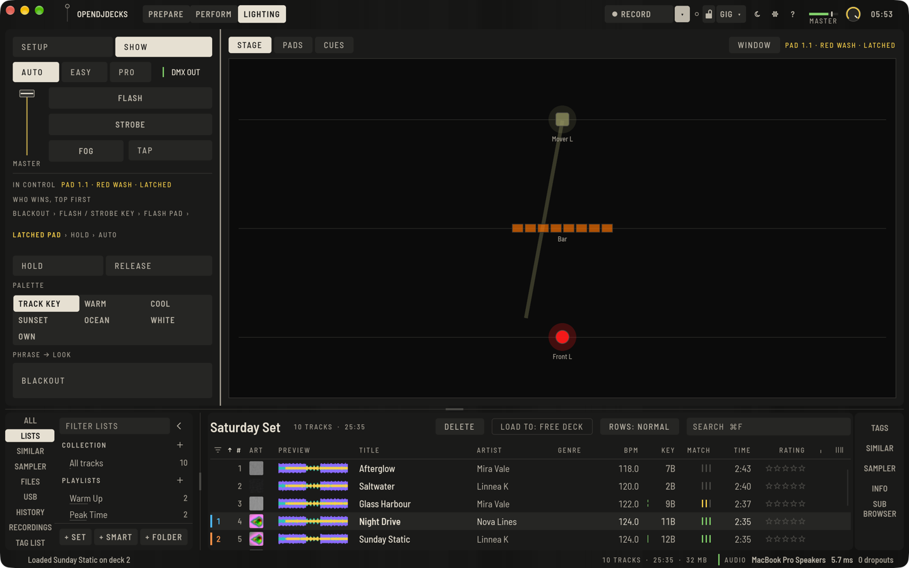

## Lampen patchen

In **RIG** wählst du einen eingebauten Typ (PAR, Mover, Bar, Strobe, Blinder, Laser, Nebel), gibst einen **Namen** und eine **Gruppe** an und drückst **HINZUFÜGEN**:

- **ANZAHL** fügt mehrere Scheinwerfer des Typs nacheinander hinzu, benannt "Name 1", "Name 2" und so weiter.
- **UNIVERSUM** und **START** legen fest, wo der erste hinkommt. Leer werden die ersten freien Adressen benutzt. Passen die Scheinwerfer nicht hinein oder würden sie einen schon gepatchten überschneiden, wird keiner hinzugefügt; die Statuszeile nennt den Scheinwerfer, der im Weg ist.
- **SCHEINWERFER-DATEI IMPORTIEREN…** patcht eine Definition aus der Open Fixture Library (`.json`) mit allen ihren Modi.

**PATCH** in der Mitte listet jeden Scheinwerfer. **UNIV**, **ADRESSE** und **KAN** (Kanalzahl) änderst du, indem du einen Wert eintippst und Enter drückst; **MODUS** schaltet durch die Modi des Typs. Eine Kanalzahl, zu der es einen Modus gibt, wechselt in diesen Modus; jede andere Zahl behält die Belegung und füllt die zusätzlichen Kanäle mit null ("Custom"). In Dateien musst du nichts ändern.

Teilen sich nach einer Änderung zwei Scheinwerfer Kanäle, bleibt die Änderung stehen, damit du ein Rig Schritt für Schritt umadressieren kannst. Beide Zeilen bekommen eine durchgestrichene Linie und nennen den Scheinwerfer, den sie überschneiden; ein Scheinwerfer, dessen Kanäle über 512 hinausgehen, sagt das ebenfalls.

**ID** lässt einen Scheinwerfer 1,5-mal pro Sekunde blinken, damit du ihn an der Traverse findest. Noch einmal drücken beendet es.

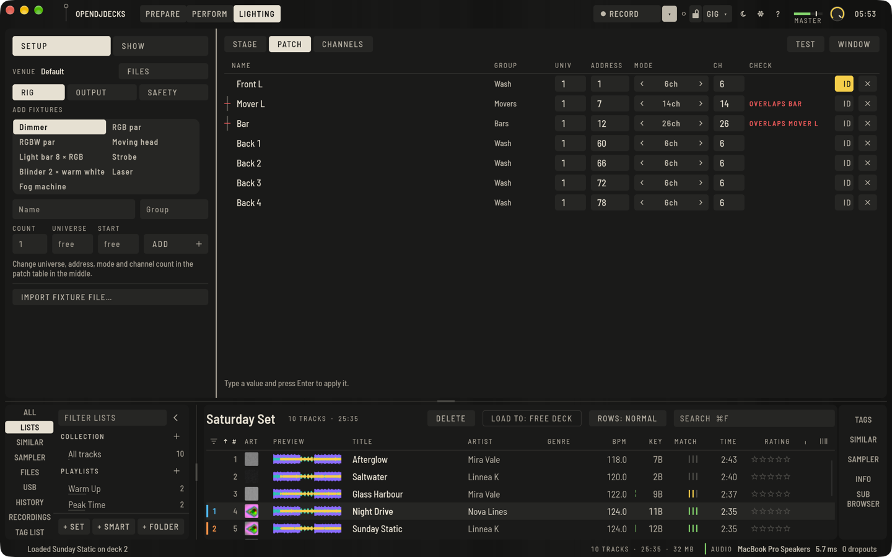

## Scheinwerfer auf dem Grundriss platzieren

**BÜHNE** in SETUP ist ein Grundriss von oben, das Publikum unten. Jeder Scheinwerfer steht dort, wo seine Art hingehört, bis du ihn platzierst: Moving Heads an der hinteren Traverse, Bars und Effekte in der Mitte, Washes vorn.

- Zieh einen Scheinwerfer dorthin, wo er hängt. Mit **RASTER** rastet er auf einem Raster aus Zwanzigsteln der Bühne ein.
- Klick einen Scheinwerfer an, um ihn neben dem Plan zu öffnen: **DREHUNG** richtet ihn in Schritten von 15° aus (0° zum Publikum), **HÖHE** legt fest, wie hoch er hängt, **GRUPPE** verschiebt ihn in eine andere Gruppe (Namen eintippen und Enter drücken). **STANDARDPLATZ** stellt ihn zurück an den Platz seiner Art.
- Die Positionen bestimmen die Bühnenvorschau und die Effekte, die über die Bühne laufen: Ein Lauflicht schaltet von links nach rechts, wie die Scheinwerfer stehen, ein Sweep fächert nach Position auf, der Phasenversatz eines Effekts folgt derselben Reihenfolge, und eine Bar, die nach hinten gedreht ist, lässt ihre Zellen andersherum laufen.

Unter **PROGRAMMIERUNG** lässt sich jeder Scheinwerfer einzeln einstellen:

- **PAN VON** / **PAN BIS** und **TILT VON** / **TILT BIS** (Moving Heads) legen den Teil des Weges fest, den die Looks nutzen, in Schritten von 5 %, für einen Moving Head, der nicht ins Publikum oder an eine Wand leuchten soll.
- **PAN UMKEHREN** und **TILT UMKEHREN** spiegeln die Bewegung für einen Moving Head, der andersherum oder kopfüber hängt.
- **ROT**, **GRÜN** und **BLAU** heben oder senken eine Farbe um bis zu 50 %, damit Scheinwerfer verschiedener Hersteller dasselbe Weiß und dasselbe Rot geben.
- **DIMMERKURVE** legt fest, wie das Licht dem Pegel folgt: **LINEAR**, **QUADRAT** (dunkler unten, für Scheinwerfer, die früh hochspringen), **WURZEL** (heller unten) oder **WEICH**.

Die Einstellung wirkt, wenn ein Look zu DMX wird, vor den Sicherheitsgrenzen: Eine angehobene Farbe oder eine hellere Kurve kommt trotzdem nicht über die Pegelgrenze einer Gruppe oder die Strobe-Grenze. Plätze und Einstellungen werden mit dem Rig gespeichert.

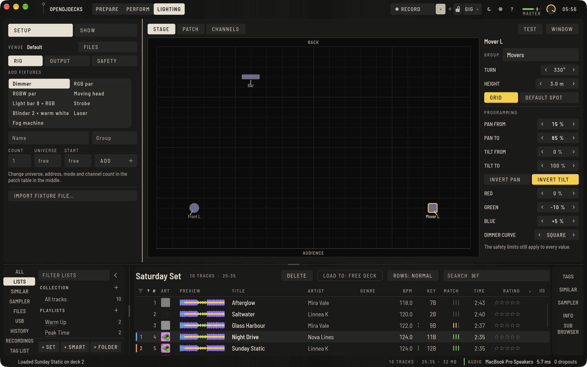

## Ein Interface verbinden

**GEFÜHRTE EINRICHTUNG** in **AUSGANG** führt dich in vier kurzen Schritten durch eine Verbindung:

1. Wie das Licht verbunden ist: **ART-NET-NODE**, **SACN-EMPFÄNGER** oder **USB-DMX-INTERFACE**.
2. Welches: Für Art-Net fragt die App das Netzwerk, welche Nodes da sind, und listet sie mit Name, Adresse und Universen, oder du tippst eine Adresse ein; für USB-DMX wählst du den seriellen Anschluss; sACN braucht keine Wahl.
3. Welches Universum dorthin geht (1 bei einem kleinen Rig; die Patch-Tabelle zeigt das Universum deiner Scheinwerfer).
4. **SETZEN UND TESTEN** setzt den Ausgang, schaltet DMX AUS an und startet das Testmuster. **JA, ES FOLGT** beendet den Test und schließt die Einrichtung; **NICHTS PASSIERT** zählt der Reihe nach auf, was du prüfen kannst.

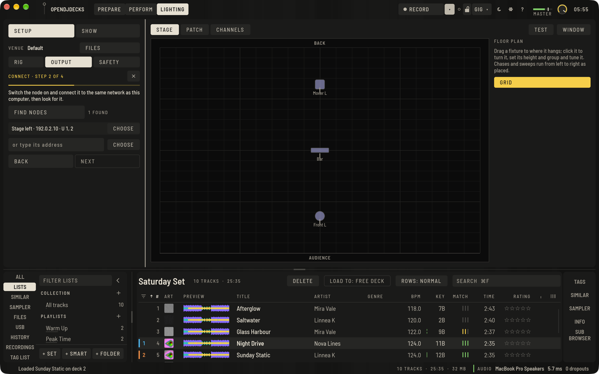

Dieselben Teile gibt es einzeln in **AUSGANG**:

- **NODES SUCHEN** (mit ART-NET gewählt) schickt ein ArtPoll, die "Wer ist da?"-Nachricht des Art-Net-Protokolls, an die Broadcast-Adresse des lokalen Netzwerks und listet jeden Node, der in etwa 1,5 Sekunden antwortet. **NUTZEN** schickt das Universum, das daneben eingetippt ist, an diesen Node. Ein Node mit mehreren Ausgängen bekommt das Universum auf dem Ausgang mit derselben Nummer, sonst auf seinem ersten.
- Mit **USB-DMX** gewählt listet **ANSCHLÜSSE** die seriellen Geräte, die nach USB-Adaptern aussehen (unter macOS `/dev/cu.usbserial…` und `/dev/cu.usbmodem…`, unter Linux `/dev/ttyUSB…`, `/dev/ttyACM…` und `/dev/serial/by-id`, unter Windows die vorhandenen COM-Anschlüsse). **AKTUALISIEREN** sucht nach dem Einstecken erneut; **NUTZEN** schickt das Universum an diesen Anschluss.
- **Mehrere Universen**: Gib jedem Universum eine eigene Zeile. An denselben Art-Net-Node geht Universum 1 an seine Port-Adresse 0, Universum 2 an 1 und so weiter; sACN ohne Nummer sendet Universum 1 als sACN-Universum 1, Universum 2 als 2 und so weiter.
- **TESTMUSTER**: **EINZELN** lässt einen Scheinwerfer nach dem anderen leuchten, je eine Sekunde; **FARBEN** schaltet das ganze Rig durch Rot, Grün, Blau und Weiß; **VOLL** lässt alles leuchten. Es ersetzt die Show bis **AUS**, mit 80 %, und geht wie alles andere durch die Sicherheitsgrenzen: Es kann nicht schneller blitzen als die Strobe-Grenze, die Pegelgrenze einer Gruppe nicht überschreiten und weder Nebel noch Laser öffnen.

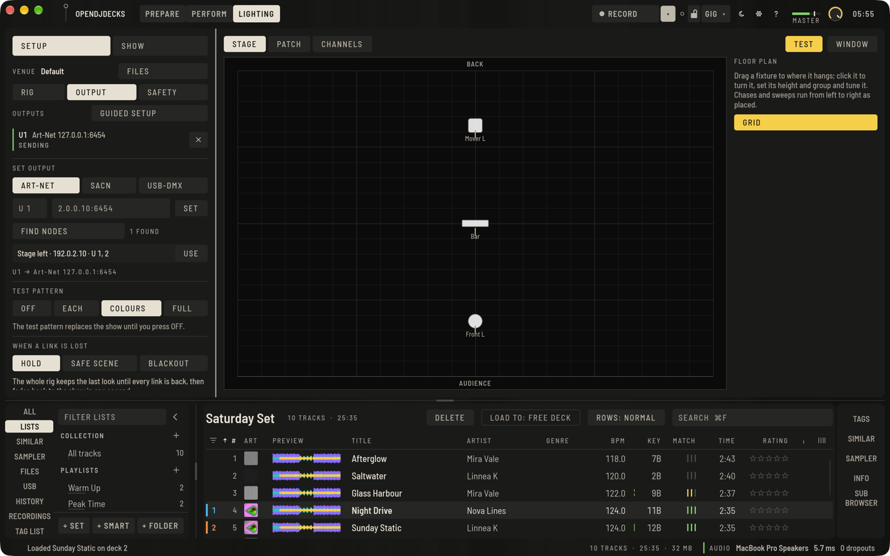

Node-Suche, Anschlusswahl und Einrichtung sind mit einem Stellvertreter-Node auf der eigenen Loopback-Adresse des Rechners und vorgegebenen Testgeräten getestet. **Mit einem echten Art-Net-Node, sACN-Empfänger oder USB-DMX-Interface sind sie noch nicht ausprobiert.** Nodes, die nur an Port 6454 antworten, während ein anderes Lichtprogramm auf demselben Rechner diesen Port belegt, erscheinen eventuell nicht; tippe dann ihre Adresse ein.

## Ausgänge und eine verlorene Verbindung

**AUSGANG** wählt, wie jedes Universum den Rechner verlässt: Art-Net, sACN oder ein USB-DMX-Interface (serielles Gerät). Tippe das Universum (leer ist Universum 1) und das Ziel ein und drücke **SETZEN**; mehrere Universen sind möglich.

Jeder Ausgang hat eine Statuslinie: durchgehend grün, solange er sendet, durchgestrichen mit **VERLOREN** in Rot, wenn die Verbindung weg ist, gestrichelt für 20 Sekunden, nachdem sie zurückkam. Eine Verbindung, die ausfällt, wird jede Sekunde neu versucht. Ein Interface, das wieder eingesteckt wird oder erst nach dem Start der App, wird so von selbst gefunden. Perform zeigt denselben Zustand neben DMX in der Lichtleiste, und in der oberen Leiste, solange eine Verbindung fehlt und die Leiste ausgeblendet ist.

**WENN EINE VERBINDUNG FEHLT** entscheidet, was das ganze Rig zeigt, solange irgendeine Verbindung fehlt:

- **HALTEN** behält den letzten Look.
- **SICHERE SZENE** blendet in zwei Sekunden auf ein ruhiges warmes Licht mit 30 %: kein Strobe, kein Nebel, keine Laser.
- **BLACKOUT** wird sofort dunkel.

Sind alle Verbindungen zurück, blendet das Rig in einer Sekunde zurück zur Show.

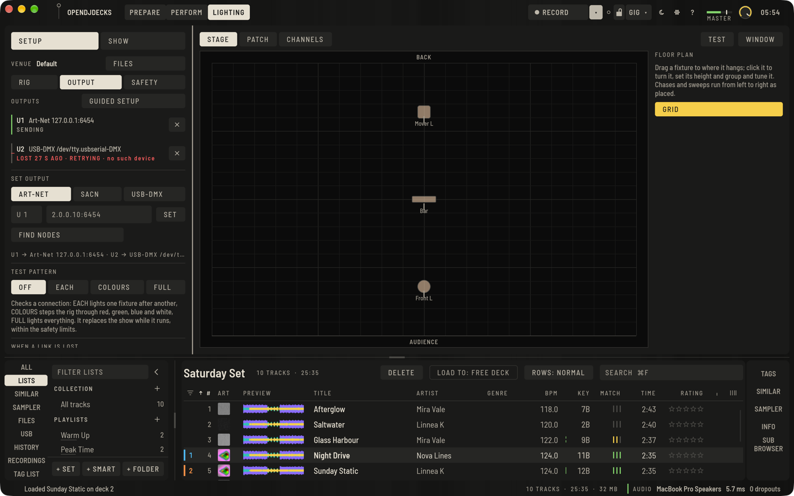

**KANÄLE** zeigt die 512 Werte eines Universums so, wie sie gesendet werden, nach den Sicherheitsgrenzen.

### Was passiert, wenn die App abstürzt

- Fällt die Show selbst innerhalb der App aus, fängt der Licht-Thread das ab und sendet ab dann die Failsafe-Szene.
- Wird die App normal beendet, senden **SICHERE SZENE** und **BLACKOUT** diese Szene als letztes Bild. **HALTEN** sendet nichts mehr.
- Wird die App hart beendet oder bleibt der Rechner stehen, kann die App nichts tun. Was das Licht dann macht, entscheidet die Hardware: Die meisten USB-DMX-Interfaces mit eigenem Prozessor und die meisten Art-Net-Nodes wiederholen das letzte Bild, das sie bekommen haben; sACN-Empfänger halten meist einige Sekunden und folgen dann ihrer eigenen Einstellung. Stelle das Verhalten bei DMX-Verlust an Interface und Scheinwerfern ein, wenn es darauf ankommt.

Verlust und Wiederkehr sind mit einer simulierten Verbindung getestet. Mit einem echten Interface, das abgezogen wird, sind sie noch nicht ausprobiert.

## Sicherheitsgrenzen

**SICHERHEIT** setzt Grenzen, die jeder Look einhalten muss. Sie wirken auf das fertige DMX-Bild direkt vor dem Senden, also gehen automatische Looks, Tasten, Cues, Track-Cues, die Fernsteuerung und das Identifizieren alle hindurch.

- **GRENZE FÜR STROBE UND BLITZE**: höchstens so viele Blitze pro Sekunde, voreingestellt 3, 0 für gar keinen Strobe. Schnell blitzendes Licht kann bei Menschen mit fotosensitiver Epilepsie Anfälle auslösen; Richtlinien für Fernsehen und Veranstaltungen sehen das Risiko ab etwa 3 Blitzen pro Sekunde, daher ist 3 oder weniger die sichere Voreinstellung. Die Grenze wirkt auf zwei Wegen. Strobe-Kanäle werden auf die erlaubte Rate gesenkt; dabei wird angenommen, dass der schnellste Strobe-Wert eines Scheinwerfers 25 Blitze pro Sekunde sind, der übliche Bereich. Ein Scheinwerfer, der schneller strobt, kann also etwas schneller als die Grenze blitzen. Und jeder Anstieg des Pegels eines Scheinwerfers um etwa ein Fünftel des Maximums oder mehr zählt als Blitz, egal wie dunkel der Look ist und welche Pegelgrenze die Gruppe hat. Ein Scheinwerfer darf erst wieder so ansteigen, wenn seit seinem letzten Blitz eine Periode der Grenze vergangen ist. Das deckt schnelle Lauflichter und Effekte auf Scheinwerfern ohne Strobe-Kanal ab.
- **SPERRE**: Nebelmaschinen und Laser bleiben auf null, bis du **NEBEL SCHARF SCHALTEN** oder **LASER SCHARF SCHALTEN** drückst. Das wird nicht gespeichert: Jeder Start der App beginnt gesperrt. **NEBEL** in SHOW tut nichts, solange Nebel gesperrt ist.
- **PEGELGRENZE PRO GRUPPE**: der höchste Pegel, den eine Gruppe erreichen darf, in Schritten von 10 %.
- **SETUP-PIN**: 4 bis 8 Ziffern. Mit einer PIN schließt **SPERREN** das Setup: Patch, Ausgänge, Grenzen, der Grundriss und die Dateien brauchen die PIN, SHOW bleibt für Gäste frei. Die PIN steht in `lighting.json` neben der Bibliothek; sie hält Gäste aus dem Setup heraus und ist kein Passwort gegen jemanden mit Zugriff auf den Rechner.

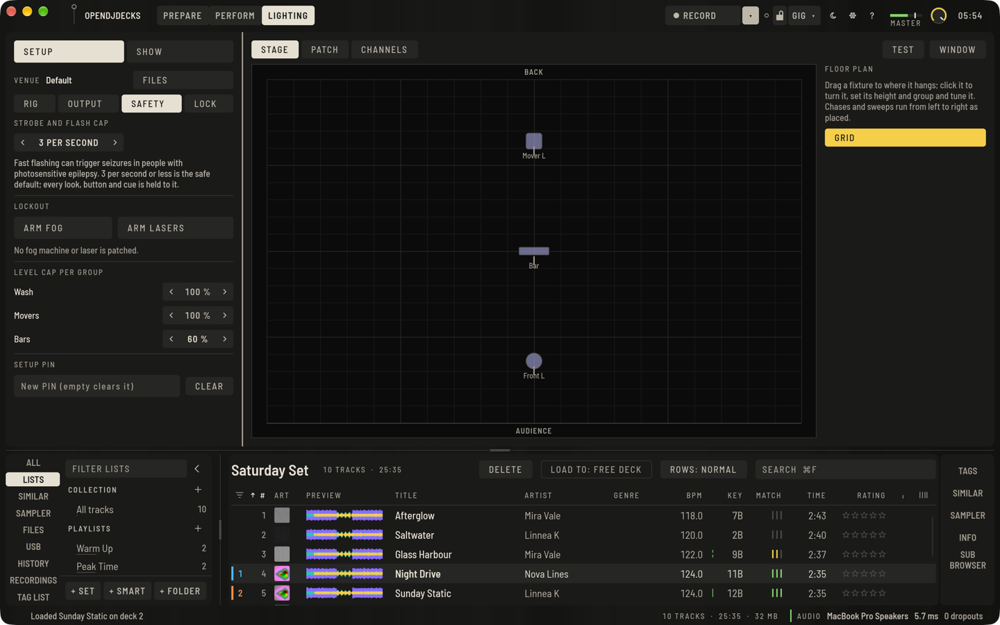

## Unbeaufsichtigt an einer festen Location

Für eine Bar, einen Laden oder einen Clubraum, in dem das Licht laufen soll, ohne dass jemand am Computer sitzt, sperrt **UNBEAUFSICHTIGT** am Ende von **SICHERHEIT** die Show und lässt sie von selbst laufen:

- **UNBEAUFSICHTIGT LAUFEN LASSEN** braucht zuerst eine Setup-PIN; mit ihr übernimmst du die Show wieder. Löschst du die PIN, endet der unbeaufsichtigte Betrieb.
- Sobald du **SPERREN** drückst, zeigen SHOW und das Lichtpanel in Perform **UNBEAUFSICHTIGT** mit dem, was die Show gerade tut, und ein PIN-Feld statt der Bedienung. **BLACKOUT** bleibt, als die eine Taste, die jeder drücken darf. Der Licht-Controller, OSC, die Deck-Pads im Modus LIGHTING und die Live-Befehle des MCP-Servers bewirken nichts. **ÜBERNEHMEN** mit der PIN öffnet Show und Setup wieder.
- Die Show folgt der Musik so, wie sie eingestellt ist (AUTO, EASY oder PRO, deine Pads, Licht-Cues und Trigger, die Musikquelle). Die Tasten FLASH, STROBE und NEBEL werden losgelassen, und Nebel und Laser bleiben gesperrt, was auch immer sie scharf schalten will. Jede Sicherheitsgrenze gilt.
- **MIT DER APP STARTEN**: Jeder Start der App öffnet LIGHTING in SHOW mit eingeschalteter **DMX AUS**-Ausgabe. Alles steht in `lighting.json`, so kommt die Show nach einem Stromausfall oder Neustart so zurück, wie sie war, und bleibt gesperrt. Die App selbst muss der Computer starten: Füge OpenDJDecks den Anmeldeobjekten hinzu (macOS: Systemeinstellungen › Allgemein › Anmeldeobjekte; Windows: der Autostart-Ordner; Linux: der Autostart deines Desktops). Das übernimmt OpenDJDecks nicht für dich.
- **RUHIG NACH**: Spielt so lange (10 s bis 5 min) keine Musik, blendet das Rig in vier Sekunden in ein ruhiges, warmes Licht mit 30 % über, ohne Strobe, ohne Nebel und ohne Laser. Kommt die Musik zurück, blendet es innerhalb einer Sekunde zurück zur Show.

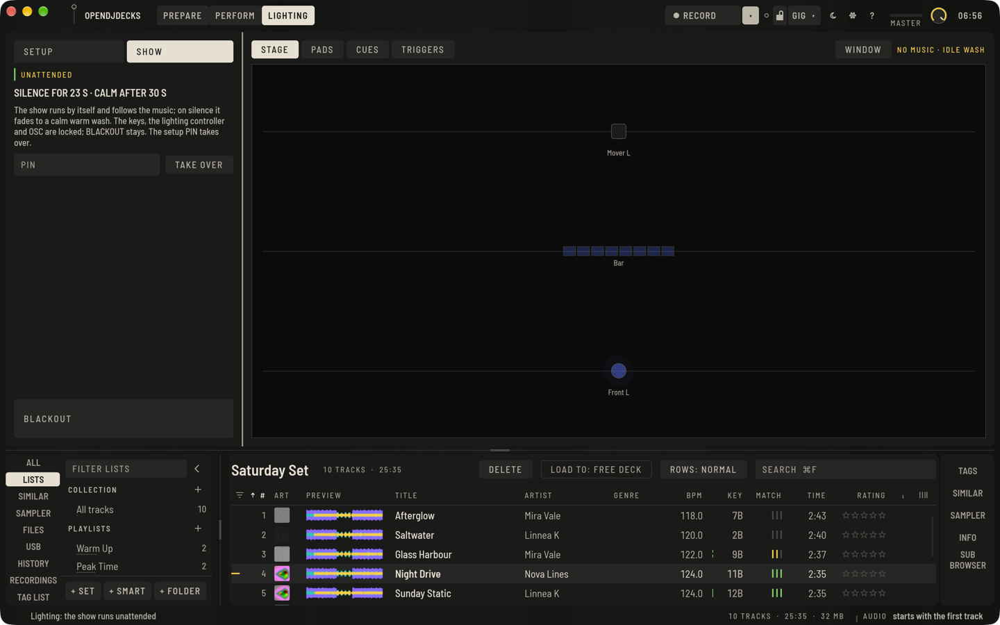

Der unbeaufsichtigte Betrieb ist mit einem simulierten Ausgang und einem Neustart in UI-Tests getestet; tagelang an einer echten Location gelaufen ist er noch nicht.

## Die Show fahren

**DMX AUS** sendet die Show an deine Ausgänge. Wähle, wie sie läuft:

- **AUTO** folgt Phrasen, Beat und Energie. Intros atmen, Build-ups jagen schneller und enden im Strobe, Choruses schwenken die Moving Heads im Takt, Breakdowns beruhigen sich, Outros blenden aus. Im Mix verschmelzen die Looks beider Tracks je nach Lautstärke, und Phrasenwechsel blenden über einen Takt.
- **EASY** ist ein **LOOK** für das ganze Rig, im Takt, mit Farbfeldern, Master-Dimmer, **BLACKOUT** und **FLASH**, **STROBE** und **NEBEL**, solange gehalten. **TAP** setzt das Tempo, wenn kein Deck läuft.
- **PRO** setzt pro Gruppe ein Programm (**MUSIK** folgt der Musik, oder einer der Looks), eine Farbe und einen Attribut-Effekt (Sinus, Säge, Rechteck, Zufall auf Dimmer, Pan, Tilt; Phasenversatz; im Takt), einen XY-Programmer für Pan und Tilt, und einen **CUE-STACK** mit **GO**, **ZURÜCK** und **SPEICHERN** mit Fades in Beats.

Am Deck legt der Pad-Modus **LIGHTING** dir deine eigenen Pads der aktuellen Seite auf die Pads, oder die Looks A bis F, Strobe (G) und Flash (H), wo ein Pad leer ist. Jedes Licht-Bedienelement lässt sich auch auf MIDI legen.

## Eigene Looks und Lauflichter

**PADS** in der Mitte von SHOW hält deine eigenen Looks auf vier Seiten mit je acht Pads (**SEITE 1** bis **4**). Ein Pad zeigt seine Nummer (Seite und Pad, etwa 1.3), seinen Namen, ob es ein Lauflicht oder ein Flash-Pad ist, und eine Linie aus den Farben, die es setzt, eine pro Gruppe. Das Pad, das gerade steuert, ist grün gefüllt.

- Drücke ein Pad, um es zu spielen. Ein **RASTEN**-Pad bleibt an, bis du es erneut drückst oder **FREIGEBEN** drückst; ein **FLASH**-Pad ist an, solange du es hältst.
- **EDIT** macht die Pads zum Editor: Klicke ein Pad an, um es zu öffnen. Ein leeres Pad bietet **NEUER LOOK** (jede Gruppe weiß und ruhig als Anfang), **NEUES LAUFLICHT** und **AUS PRO** (die Gruppeneinstellungen aus dem PRO-Modus).
- Ein Look setzt Gruppen: pro Gruppe ein Programm (**MUSIK** folgt der Phrase), eine Farbe (**TRACK** nimmt sie aus der Palette von AUTO oder vom Track) und einen Pegel (**—** überlässt ihn dem Programm). **×** lässt eine Gruppe aus; Gruppen, die ein Look auslässt, behalten, was darunter läuft. Die Farblinie des Pads folgt jeder Änderung sofort.
- Ein Lauflicht schaltet im Takt durch Looks. **SCHRITTE HINZU**, dann die Looks in ihrer Reihenfolge anklicken; der Stepper legt fest, wie lange jeder Schritt dauert (eine Viertel-Zählzeit bis zwei Takte). Ein Lauflicht folgt dem Deck, das du hörst, oder **TAP** ohne Musik.
- **GRUPPEN-MASTER** neben den Pads setzen den Pegel jeder Gruppe über allem, auch über dem Master-Dimmer.

Looks, Lauflichter, Seiten und Gruppen-Master werden mit dem Rig in `lighting.json` gespeichert. Welches Pad eingerastet oder gehalten ist, wird nicht gespeichert.

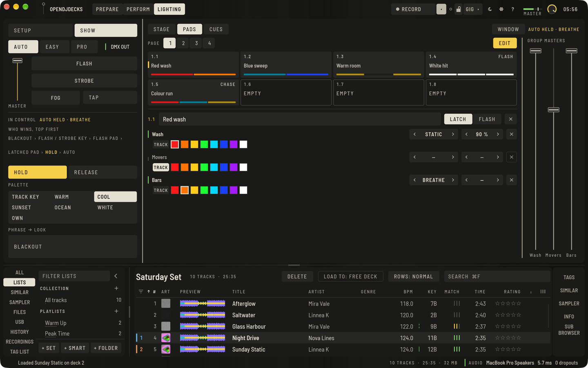

Am Deck spielt der Pad-Modus **LIGHTING** die acht Pads der aktuellen Seite mit den Pads A bis H; ein Pad der Seite ohne Look behält die eingebauten Looks A bis F, Strobe (G) und Flash (H). In einem Mapping erreichen `lighting.pad`, `lighting.page`, `lighting.page_next`, `lighting.page_prev` und `lighting.group_master` sie von einem Controller, und MIDI-Learn kann sie lernen (wähle Pad, Seite oder Gruppe unter **Pad, Seite oder Gruppe**).

## Licht-Cues eines Tracks

Ein Licht-Cue ist an einem Track gespeichert und beginnt an einem seiner Takte, jedes Mal, wenn der Track läuft, in jedem Modus: Er spielt einen Cue des Stacks, den Look eines Pads oder einen Chase bis zum nächsten Licht-Cue. **CUES** in SHOW listet die Licht-Cues des Tracks, den du hörst (läuft kein Deck, die des Tracks im Prepare-Player):

- **CUE AM PLAYHEAD** fügt einen an dem Takt hinzu, in dem der Playhead steht, mit dem eingerasteten Pad, sonst dem Cue, den der Stack zeigt, sonst dem ersten Cue oder Pad.
- **BEI** setzt ihn einen Takt früher oder später, **NAME** benennt ihn um (eintippen und Enter drücken), **SPIELT** schaltet durch die Cues des Stacks, die Pads mit einem Look und die Chases, und **ÜBERBLENDUNG** legt die Überblendung in ihn fest, von sofort bis 16 Beats (ein Cue des Stacks beginnt mit seiner eigenen Überblendung, ein Pad mit einem Beat). **×** entfernt ihn.
- Der Cue, der gerade wirkt, trägt den Natrium-Strich.

In Prepare liegen die Licht-Cues des Tracks auf einer Spur unter den Phrasen, jeder eine Natrium-Linie mit seinem Namen an seinem Takt. Zieh einen auf einen anderen Takt; er landet auf der nächsten Taktlinie. Die Spur erscheint, solange der Track Licht-Cues hat.

Ein Pad oder Chase eines Licht-Cues übernimmt nur die Gruppen, die sein Look setzt, wie ein eingerastetes Pad; ein Pad, das du einrastest oder hältst, gewinnt weiter darüber. Licht-Cues gehen wie alles andere durch die Gruppen-Master und die Sicherheitsgrenzen. Licht-Cues werden mit der Show gespeichert.

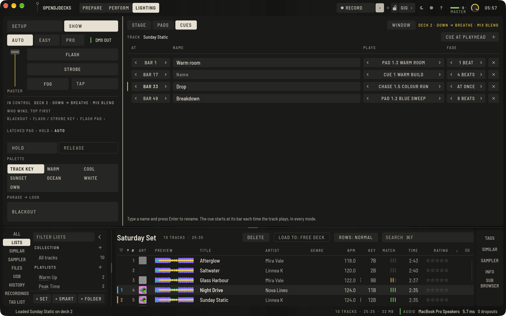

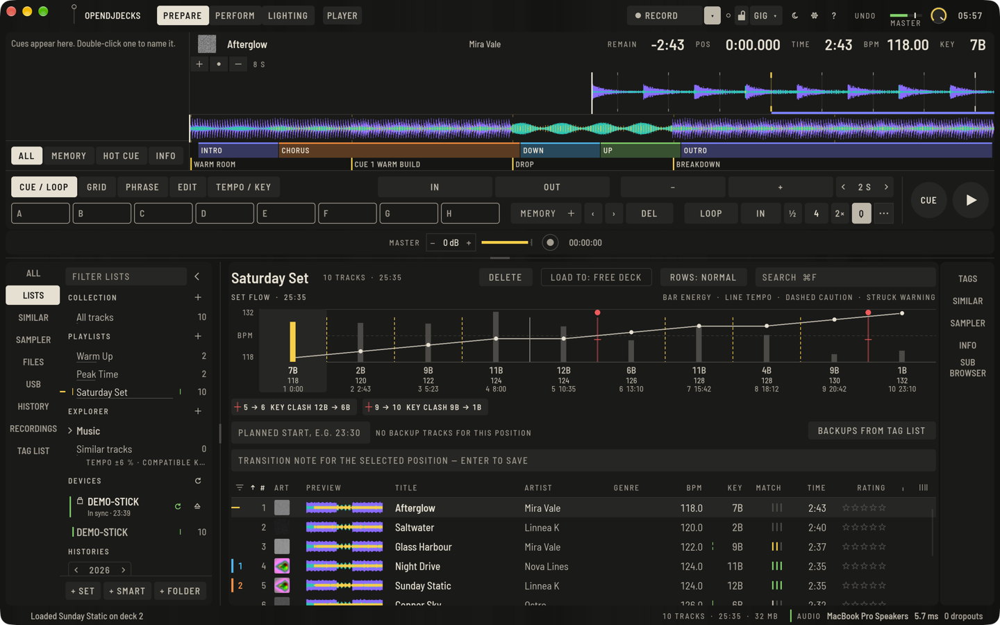

## DJ-Ereignisse als Trigger

**TRIGGER** in SHOW verbindet Momente des Mixes mit deinen Pads und Cues. Eine Zeile pro Ereignis:

- **TRACK GELADEN**: Ein Track wird auf ein Deck geladen.
- **PLAY STARTET**: Ein Deck beginnt zu spielen.
- **PHRASE WECHSELT**: Das Deck, das du hörst, geht in eine andere Phrase.
- **DROP** und **BREAKDOWN**: Es geht in einen Chorus oder Drop oder in einen Breakdown oder eine Bridge. Sie gewinnen gegen **PHRASE WECHSELT**, wenn beide gesetzt sind.
- **CROSSFADER LINKS** und **CROSSFADER RECHTS**: Der Crossfader erreicht eine Seite. Er muss erst wieder Richtung Mitte, bevor dieselbe Seite erneut auslöst.
- **TRACKENDE NAH**: Ein spielender Track hat noch 30 Sekunden oder weniger.

**SPIELT** wählt der Reihe nach nichts, **FREIGEBEN** (beendet den laufenden Trigger), die Cues des Stapels und deine Pads mit einem Look oder Chase. **DAUER** legt fest, wie lange es spielt: bis zum nächsten Ereignis oder 4, 8, 16, 32 oder 64 Beats. Die Zeile des laufenden Triggers trägt den Natriumstrich, **ZULETZT** nennt das letzte Ereignis, und **STEUERT** zeigt es als „TRIGGER · DROP · PAD 1.5 …“.

Ein Trigger spielt über AUTO, EASY, PRO, HALTEN und den Licht-Cues des Tracks, unter einem Pad, das du einrastest oder hältst, und nimmt nur die Gruppen, die sein Look setzt. Er blendet über einen Beat ein und geht wie alles andere durch die Gruppen-Master und die Sicherheitsgrenzen. Trigger werden mit der Show gesichert.

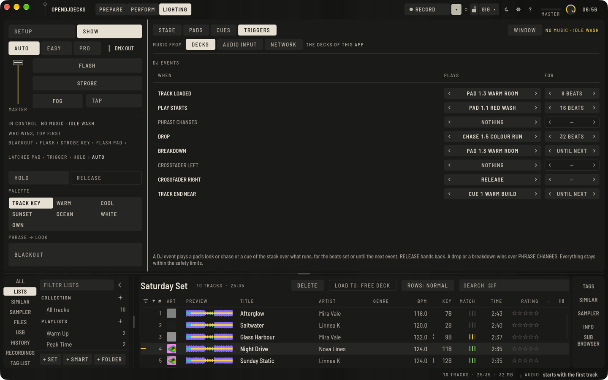

## Musik von außerhalb der Decks

**MUSIK VON** oben in **TRIGGER** wählt, wem die Show folgt:

- **DECKS**: den Decks dieser App (Standard).
- **AUDIOEINGANG**: dem Standard-Audioeingang des Computers, Line-In oder Mikrofon, für eine Band, das Mischpult eines anderen DJs oder Musik von einem anderen Computer. Die Show findet den Beat (70 bis 180 BPM) und nimmt die Energie aus dem Pegel; eine halbe Sekunde unter −50 dBFS gilt als Stille. Sie findet sich in ein paar Sekunden ein und kennt keine Phrasen, also spielt AUTO seinen Look für die Strophe und die Phrasen-Trigger lösen nicht aus. Die Zeile daneben zeigt den Eingang und das gefundene Tempo.
- **NETZWERK**: einem anderen OpenDJDecks im lokalen Netzwerk (siehe unten). Beat, Phrase und Energie des dort gehörten Decks treiben diese Show; nach zwei Sekunden ohne Nachricht gilt das als Stille.

Die Tempo-Suche ist mit erzeugten Kicks zwischen 96 und 140 BPM getestet. Mit einem echten Mikrofon im Raum oder einem Clubmischpult ist sie noch nicht ausprobiert.

## Locations, Rigs und Shows

**DATEIEN** neben der **LOCATION** in SETUP hält benannte Dateien im Ordner `lighting` neben der Bibliothek:

- **RIGS**: der Patch mit den Ausgängen.
- **SHOWS**: die Looks, Pads, Chases, der Cue-Stack, die Licht-Cues, die AUTO-Tabelle und die Palette.
- **LOCATIONS**: Eine Location verbindet ein Rig mit einer Show, zusammen mit den Sicherheitsgrenzen und dem Failsafe. Bei der Ankunft wählst du die Location und drückst **LADEN**: Rig, Show und Grenzen kommen auf einmal.

Wähle eine Zeile und drück **LADEN**, **SICHERN** (was gerade läuft, unter diesem Namen), **DUPLIZIEREN** oder **LÖSCHEN**; tippe einen Namen ein und drück **UMBENENNEN** oder **NEU SICHERN**. Eine neue Location behält das benutzte Rig und die benutzte Show, wenn sie so gesichert sind, wie sie sind, und bekommt sonst ein eigenes Rig und eine eigene Show, so ändert das Sichern einer Location nie eine andere. **IN BENUTZUNG** markiert, was gerade läuft. **IMPORTIEREN…** öffnet eine Location mit Rig und Show aus einer Datei, **EXPORTIEREN…** schreibt die benutzte Location mit Rig und Show in eine Datei, für einen anderen Rechner oder als Sicherung.

Das laufende Rig bleibt in `lighting.json`; der erste Start nach diesem Schritt macht es zur Location, zum Rig und zur Show "Default". Laden braucht die Setup-PIN wie der Rest von SETUP.

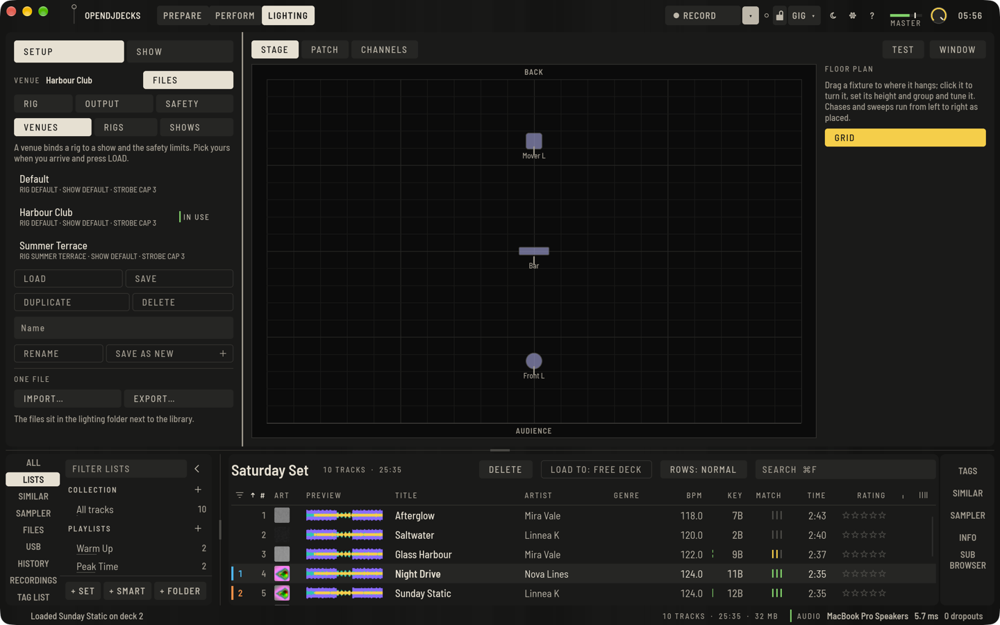

## Ein zweiter Licht-Operator

Wenn jemand anders das Licht fährt, gibt **EXTERN** in SETUP ihm eine eigene Bedienung:

- **LICHT-CONTROLLER** listet die angeschlossenen MIDI-Controller. **FÜRS LICHT** gibt einen dem Licht: Er spielt es dann mit dem Licht-Layout, während ein anderer Controller die Decks behält. **ZURÜCKGEBEN** gibt ihn seinem eigenen Mapping zurück. Das Layout (`mappings/lighting/lighting-operator.toml`) nutzt allgemeine MIDI-Nummern auf Kanal 1, so lassen sich die meisten Pad-Controller und Fader-Boxen in ihrem eigenen Editor darauf einstellen:

| MIDI | Spielt |
|---|---|
| Noten 36–43 | Pads 1–8 der aktuellen Seite |
| Noten 44–47 | Seiten 1–4 |
| Noten 48, 49 | Seite zurück, Seite weiter |
| Noten 50–53 | BLACKOUT, FLASH, STROBE, NEBEL |
| Noten 54–56 | FREIGEBEN, HALTEN, TAP |
| Noten 57, 58 | Cue ZURÜCK, Cue GO |
| Noten 60–62 | AUTO, EASY, PRO |
| Controller 20–27 | Gruppen-Master 1–8 |
| Controller 28 | Master-Dimmer |

- **OSC-EINGANG** (standardmäßig aus) hört auf einem UDP-Port, 9300, wenn du keinen anderen setzt. Solange er an ist, kann jedes Gerät im lokalen Netzwerk das Licht spielen, schalte ihn also nur in einem Netzwerk ein, dem du traust. Die Adressen spiegeln die Lichtaktionen; Nummern zählen ab 1, ein fehlender „an“-Wert heißt an:

| Adresse | Werte | Bewirkt |
|---|---|---|
| `/opendjdecks/light/pad` | Pad 1–8, an | spielt ein Pad der aktuellen Seite |
| `/opendjdecks/light/page` | Seite 1–4 | zeigt eine Seite |
| `/opendjdecks/light/page/next`, `…/page/prev` | | nächste oder vorige Seite |
| `/opendjdecks/light/group` | Gruppe, Pegel 0–1 | ein Gruppen-Master |
| `/opendjdecks/light/master` | Pegel 0–1 | der Master-Dimmer |
| `/opendjdecks/light/blackout` | an | Blackout an oder aus; ohne Wert schaltet er um |
| `/opendjdecks/light/flash`, `…/strobe`, `…/fog` | an | die Haltetasten |
| `/opendjdecks/light/look` | Look 1–6 | ein EASY-Look |
| `/opendjdecks/light/mode` | `auto`, `easy`, `pro` | der Modus |
| `/opendjdecks/light/cue/go`, `…/cue/back` | | der Cue-Stapel |
| `/opendjdecks/light/release`, `…/hold`, `…/tap` | | FREIGEBEN, HALTEN, TAP |
| `/opendjdecks/music` | BPM, Beat, spielt, Energie, Phrase, Farbton, verbleibende Sekunden | die Musik, die eine andere Instanz sendet |

- **MUSIK SENDEN** sendet Tempo, Beat, Phrase und Energie des Decks, das du hörst, 20-mal pro Sekunde an die eingegebene Adresse (`host:port`). Auf einem zweiten Computer, auf dem OpenDJDecks das Licht fährt, schaltest du **OSC-EINGANG** ein und wählst unter **MUSIK VON** **NETZWERK**: Seine Show folgt deinem Mix, während sein Operator dort Pads, Cues und Trigger spielt.

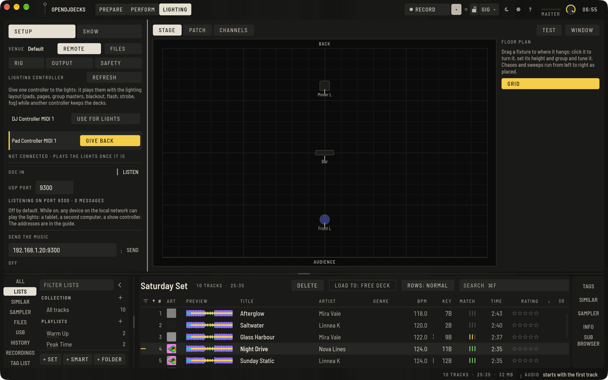

Das Licht-Layout ist mit simuliertem MIDI getestet, OSC und die zweite Instanz mit einem Sender auf der Loopback-Adresse desselben Computers. Ein echter zweiter Controller und ein zweiter Computer in einem echten Netzwerk sind noch nicht ausprobiert. Es gibt keinen eigenen Startmodus nur fürs Licht und keine automatische Suche nach dem anderen Computer: Du gibst seine Adresse ein.

## AUTO lenken

Mit **AUTO** gewählt lenkt die SHOW-Spalte es:

- **PALETTE** wählt die Farben von AUTO: **TONART** (aus der Tonart des Tracks, wie bisher), **WARM**, **KÜHL**, **ABENDROT**, **MEER**, **WEISS** oder **EIGENE** mit den Farbfeldern, die du ankreuzt. Die Farbe wechselt alle acht Takte, in Phrasen mit hoher Energie jedes zweite Taktpaar zur nächsten Farbe.
- **PHRASE → LOOK** legt fest, was AUTO für Intro, Strophe, Aufbau, Drop (Chorus), Breakdown und Outro spielt: ein eingebautes Programm oder eines deiner Pads. Die Phrase, die gerade läuft, ist markiert.
- **HALTEN** behält den Look, den AUTO gerade spielt, über Phrasenwechsel hinweg, bis du es erneut drückst oder **FREIGEBEN** drückst.

**Wer gewinnt.** Von oben:

1. **BLACKOUT**.
2. Die Tasten **FLASH** und **STROBE**, solange gehalten.
3. Ein Flash-Pad, solange gehalten (das zuletzt gedrückte).
4. Das eingerastete Pad.
5. Ein Trigger eines DJ-Ereignisses.
6. **HALTEN**.
7. AUTO (oder EASY oder PRO), mit den Licht-Cues des Tracks.

Ein Pad übernimmt nur die Gruppen, die sein Look setzt; die anderen folgen weiter der Ebene darunter. Gruppen-Master und Master-Dimmer skalieren danach das Ergebnis, und die Sicherheitsgrenzen wirken zuletzt auf jedes Bild. **FREIGEBEN** gibt an AUTO zurück: Das eingerastete Pad und HALTEN enden, mit einer Überblendung über eine Zählzeit; ein Flash-Pad endet sofort beim Loslassen. Die Reihenfolge steht unter **WER GEWINNT, OBEN ZUERST**, die steuernde Ebene leuchtet, und **STEUERT** nennt sie, etwa "PAD 1.1 · RED WASH · EINGERASTET".

## Wo du es siehst

- Der Knopf **LICHTLEISTE** (`⌥⌘K`, in schmaleren Fenstern **LEISTE**) öffnet das Lichtpanel in Perform und Club. Es nimmt den Platz des Browsers ein, so behalten Decks, Wellenformen und Mixer ihre Größe; **LICHTLEISTE** bringt den Browser zurück. Es enthält die Bühnenvorschau (ab 1360 px Breite), Seiten und Pads, Master- und Gruppenfader, AUTO / EASY / PRO, DMX AUS, HALTEN und FREIGEBEN, wer gerade steuert (oder eine verlorene Verbindung) und BLACKOUT, FLASH, STROBE und NEBEL. Jede Taste, jedes Pad und jeder Fader ist mindestens 44 px groß für Touch, mit dunklen Flächen und heller Schrift für eine dunkle Kabine.
- **FENSTER** öffnet die Lichtansicht in einem eigenen Fenster, für einen zweiten Bildschirm.

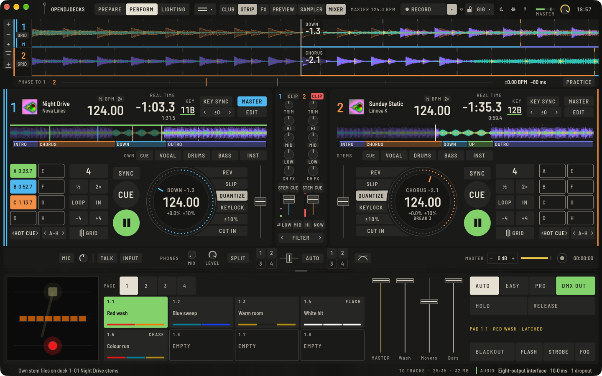

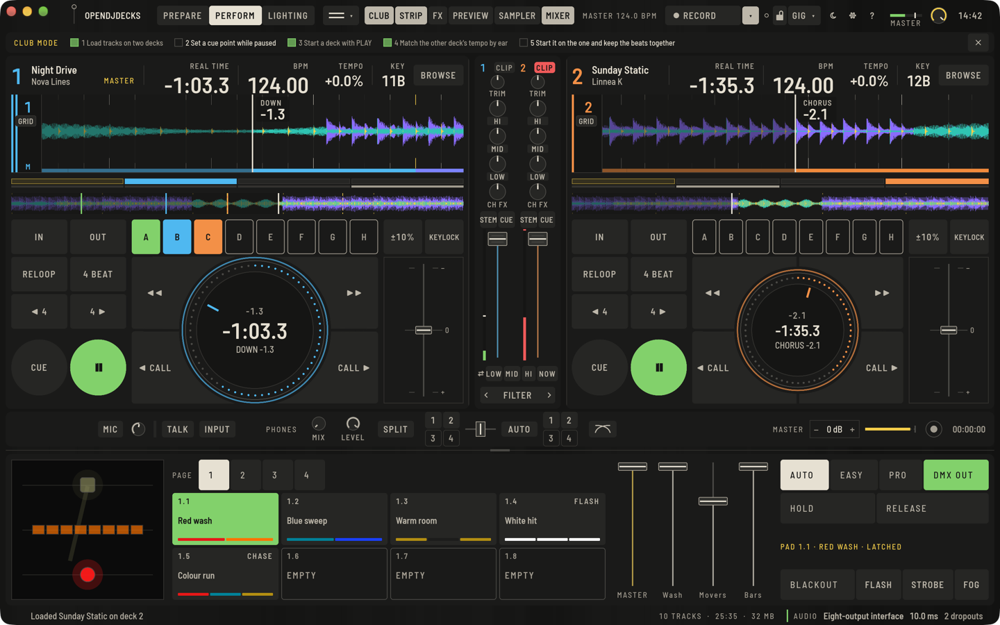

Das Panel ist mit der Maus und in UI-Tests bei 1440 × 900 und 1280 × 800 ausprobiert; auf einem echten Touchscreen noch nicht.

Grundriss, Scheinwerfer-Einstellungen, Licht-Cues und Location-Dateien sind in UI-Tests und mit einem simulierten Ausgang getestet. **An einem echten Rig ist davon noch nichts ausprobiert**: Ob ein Pan-Bereich oder ein Farbabgleich zu einem bestimmten Scheinwerfer passt, zeigt sich nur an diesem Scheinwerfer.
