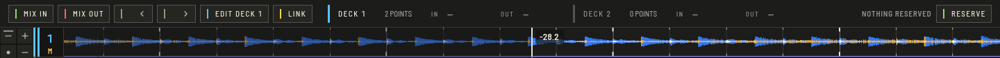

Mix-Vorschau startet das wartende Deck in dem Moment, in dem das spielende seinen Ausstiegspunkt erreicht. Drücke **VORSCHAU** in der oberen Leiste (`⌥⌘P`), um das Panel über den Wellenformen zu zeigen.

## Punkte setzen

1. **DECK … BEARBEITEN** wählt das Deck, an dem du arbeitest. Drücken wechselt es.
2. Bewege dieses Deck dorthin, wo es einsteigen oder aussteigen soll, und drücke **MIX IN** oder **MIX OUT**. Die Punkte werden beim Track gespeichert.
3. **◀** und **▶** schalten durch die Punkte des Decks: Memory Cues und Mix-Punkte.

## Verknüpfen

Drücke **LINK**: Passiert das spielende Deck seinen Mix-Out-Punkt, startet das andere an seinem Mix-In-Punkt. Ein zweiter Druck beendet das Verknüpfen.

## Die nächsten Tracks vormerken

**VORMERKEN** merkt die in der Liste ausgewählten Tracks vor. Ist ein Deck im Panel leer oder hat es ausgespielt, während das andere läuft, lädt der nächste vorgemerkte Track dorthin und wartet an seinem Mix-In-Punkt auf den nächsten Link. **ALS NÄCHSTES** zeigt, was kommt, und **LEEREN** leert die Warteschlange. **NICHTS VORGEMERKT** heißt, sie ist leer.
