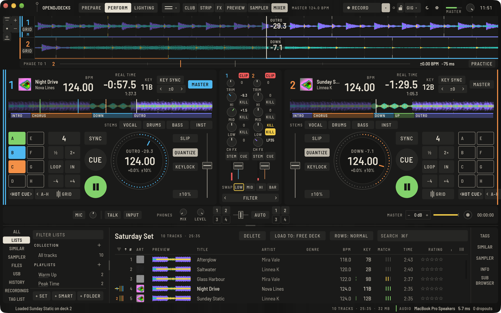
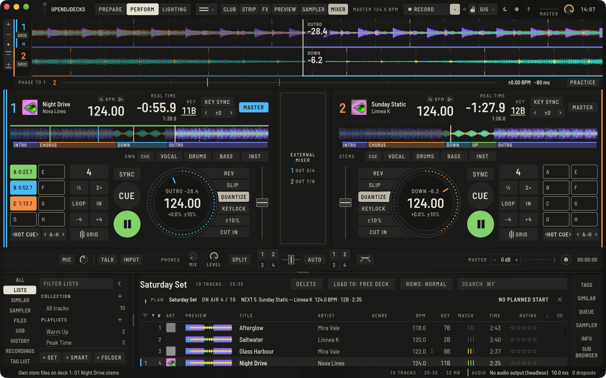

Der Mixer steht zwischen den Decks. Drücke **MIXER** in der oberen Leiste (`⌥⌘M`), um ihn auszublenden, wenn dein Controller das übernimmt; die Decks treffen sich dann in der Mitte.

## Ein Kanal

Von oben nach unten: die Kanalnummer mit ihrer **CLIP**-Lampe, **TRIM**, **HI**, **MID**, **LOW**, **CH FX** (der Channel-FX-Regler), **STEM** und **CUE** nebeneinander und der Kanalfader mit seiner Anzeige. Alle Regler und der Fader stehen auf der Mittellinie des Kanals, und der Name jedes Reglers steht direkt darunter. Zieh einen Regler nach oben oder unten, um ihn zu drehen; Doppelklick (oder doppeltes Tippen) setzt ihn auf die Mitte zurück.

Während du einen Regler drehst, zeigt der Name darunter seinen Wert, und beim Loslassen wieder den Namen: TRIM und EQ in dB (**AUS**, wenn ein Isolator-Band ganz heruntergedreht ist), CH FX als Seite und Stärke des Filters (**LP40** ist ein Tiefpass bei 40 %, **HP25** ein Hochpass bei 25 %), andere Channel FX als Prozent mit Vorzeichen.

- **TRIM** stellt den Kanalpegel ein. **Auto Gain** unter **Einstellungen › Controller › Mixer** gleicht Tracks vorher nach ihrer analysierten Lautheit an. Jeder Track lässt sich in 0,5-dB-Schritten im [GRID-Panel](beatgrid.md#ein-grid-korrigieren-waehrend-der-track-laeuft) korrigieren.
- Die **EQ**-Regler sind standardmäßig ein Isolator. **Einstellungen › Controller › Mixer › EQ** wechselt zwischen **ISOLATOR** und **KLASSISCHER EQ**.
- **CH FX** steuert den gewählten Channel FX; siehe [Effekte](effects.md#channel-fx).
- **STEM** macht aus HI, MID und LOW des Kanals Regler für die Vocals, die Instrumente und die Drums dieses Tracks. Die Mitte ist voller Pegel; der normale EQ bleibt, wie du ihn gelassen hast. Siehe [Stems](stems.md).
- **CLIP** leuchtet rot, sobald der Kanal vor dem Fader (nach Trim und EQ) über Vollaussteuerung gegangen ist, und bleibt an, damit du es auch siehst, wenn du gerade woanders hingeschaut hast. Dreh den Trim herunter und klick auf die Lampe, um sie zu löschen; der Klick löscht alle Übersteuerungsanzeigen, auch die des Masters.

## Regler, Fader und Pegel

Jeder Drehregler zeichnet seinen Wert als Bogen auf seinem Ring: von der kleinen Marke oben bei **TRIM**, den EQ-Reglern und **CH FX**, die von der Mitte aus in beide Richtungen drehen, und vom Anfang bei **MIX** und **LEVEL**. Während du einen Regler ziehst, steht sein Wert darüber und in der Beschriftung darunter (`−6.0`, `LP35`). Die Faderkappen haben eine Mittellinie zum Ablesen.

Die Kanalpegel und der **MASTER**-Pegel in der oberen Leiste halten ihre Spitze: Ein kurzer Strich bleibt etwa anderthalb Sekunden am höchsten Pegel der letzten Zeit und fällt dann zurück. Nahe oben wird er gelb, beim Übersteuern rot. Die Pegel werden nie geglättet: Sie zeigen den Klang so, wie er ist.

## Basswechsel

Die Namen **HI**, **MID** und **LOW** unter den EQ-Reglern sind Kill-Tasten: Tippe darauf, um das Band herauszunehmen (die Taste wird gelb und zeigt **KILL**), tippe erneut, um es zurückzuholen. Der Regler bleibt, wo er ist; lässt du den Kill los, kommt das Band mit dem Wert des Reglers zurück. Mit dem Isolator-EQ ist ein gekilltes Band stumm, mit dem klassischen EQ steht es auf der tiefsten Stellung des Reglers (−26 dB). Mit **STEM** schalten dieselben Tasten den Teil stumm, den ihr Regler steuert (Vocals, Instrumente, Drums), und zeigen **KILL**, solange er stumm ist; so bleiben die Kills in jedem Modus unter deinen Fingern.

Die Tauschreihe unter den Kanälen (mit zwei gegenläufigen Pfeilen markiert) tauscht mit einem Tippen ein Band zwischen den zwei Decks im Mix:

1. Kille das LOW des kommenden Decks (oder dreh es herunter), während das spielende Deck seinen Bass hat.
2. Tippe in der Tauschreihe auf **LOW**. Die beiden Decks tauschen LOW-Regler und Kill: Das kommende Deck bekommt den Bass, das gehende verliert ihn. **MID** und **HI** machen dasselbe für ihre Bänder.

Die Taste am Ende der Reihe bestimmt, wann getauscht wird: **SOFORT**, **BEAT** (auf dem nächsten Beat) oder **TAKT** (auf der nächsten Eins), gezählt am Beatgrid des Master-Decks. Klick sie an, um durch die drei zu schalten. Solange ein Tausch auf seinen Beat oder Takt wartet, zeigt seine Taste einen Rahmen; tippst du erneut darauf, wird er abgebrochen. Spielt kein Deck, gibt es keinen Beat, auf den gewartet werden kann, und der Tausch passiert sofort.

Der Tausch wirkt auf die zwei lautesten spielenden Decks. Spielt nur ein Deck, tauscht es mit dem nächsten Deck, auf dem ein Track geladen ist; spielt keins, mit Deck 1 und 2. Bei vier Decks nennt die Reihe das Paar (zum Beispiel **2/3**).

Ein Controller kann beides: Lege `mixer.eq_kill` (mit `band = "low"`, `"mid"` oder `"high"`) auf eine Taste eines Kanals und `eq_swap` (mit einem `band`) auf eine beliebige Taste; siehe [Controller-Mappings](controllers.md). Die geführte Controller-Einrichtung fragt die Kill-Tasten mit ab (alle drei Bänder bei den Vorlagen für zwei Decks, HI und LOW bei der Battle-Vorlage, LOW bei vier Decks); überspringe, was dein Controller nicht hat. Die beiden mitgelieferten Controller-Mappings nutzen sie nicht, und an einem echten Controller wurden sie noch nicht ausprobiert; getestet sind sie nur in der Software.

## Crossfader

Unter dem Mixer blendet der Crossfader zwischen seinen Seiten. Die kleinen Tasten **1** / **2** / **3** / **4** links und rechts legen ein Deck auf Seite A oder B; ein erneuter Druck legt es wieder durch.

**AUTO** neben dem Crossfader schaltet Auto Fader ein: Der Crossfader tauscht auch die Bässe der beiden Seiten und hält die Decks darauf im Master-Tempo.

Die Taste rechts neben der Seite B zeigt die **Crossfader-Kurve** als kleine Zeichnung: zwei Bögen für konstante Leistung (weiche Übergänge), zwei gerade Linien für linear und zwei steile Ecken für Cut (Scratchen: beide Seiten voll bis auf die letzten Prozent). Ein Klick schaltet zur nächsten Kurve. Es ist dieselbe Einstellung wie die **Crossfader-Kurve** in **Einstellungen › Controller › Mixer**, wo auch die **Kanalfader-Kurve** (linear, weich, steil) liegt; eine Controller-Taste schafft es mit `crossfader_curve`. In schmalen Fenstern unter 1000 px bleibt die Kurve den Einstellungen überlassen.

**CUT IN** an einem Deck (siehe [Perform](perform-basics.md#reverse-und-cut-in)) lässt einen Kanal durch, als stünde der Crossfader auf seiner Seite offen, solange du die Taste hältst.

## Kopfhörer und Master

**KOPFHÖRER** hat den **MIX** zwischen Cue und Master und den **PEGEL**. Drücke **CUE** an einem Kanal, um ihn vorzuhören. Am Controller hört die Master-Cue-Taste den Master vor.

**SPLIT** (Split Cue) legt den Cue auf dein linkes Ohr und den Master auf das rechte, beide in Mono, damit du beides auf einem Kopfhörer hörst; **MIX** wirkt dann nicht, **PEGEL** schon. Eine Controller-Taste schaltet es mit `split_cue`. Getestet ist es mit erzeugten Signalen, auf einem Gig noch nicht. Mit nur einem Stereo-Ausgang schickt **Einstellungen › Audio › Ein Stereo-Ausgang** genau das auf die Ausgänge 1/2 ([Routing](preferences.md#routing)).

## Externes Mischpult

Mit **Einstellungen › Audio › Mixer: EXTERN** spielt jedes Deck auf eigenen Ausgängen in ein externes Mischpult, und der Mixer der App tritt zur Seite: Statt der Kanalzüge steht eine Platte, die **EXTERNES MISCHPULT** sagt und die Ausgänge jedes Decks nennt (zum Beispiel Deck 1 auf **AUSG. 3/4**). Trim, EQ, Fader, Crossfader und Kanal-**CUE** liegen dann am externen Mischpult. Siehe [Routing](preferences.md#routing).

**MASTER** stellt den Ausgangspegel mit **−** und **+** oder dem Regler ein, hat eine Anzeige und einen Sicherheits-Limiter, der immer an ist. Daneben liegen die Aufnahmetaste und die Zeit; siehe [Aufnahme](recording.md). Den Booth-Ausgang stellst du mit dem Booth-Regler am Controller ein.

## Mikrofon und Aux

**MIC** in der Leiste unter dem Mixer schaltet einen Eingang ein, mit Pegel, Anzeige und Auswahl des Eingangsgeräts. **TALK** duckt die Musik, während du sprichst. Das Mikro läuft durch den Mixer, Tempo FX und die Aufnahme bekommen es also mit.
