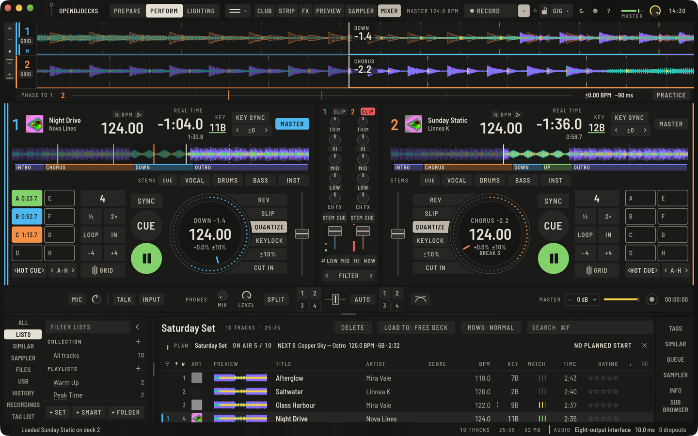
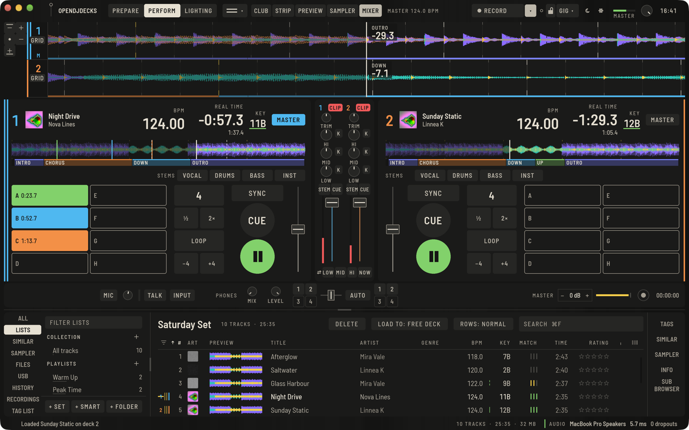
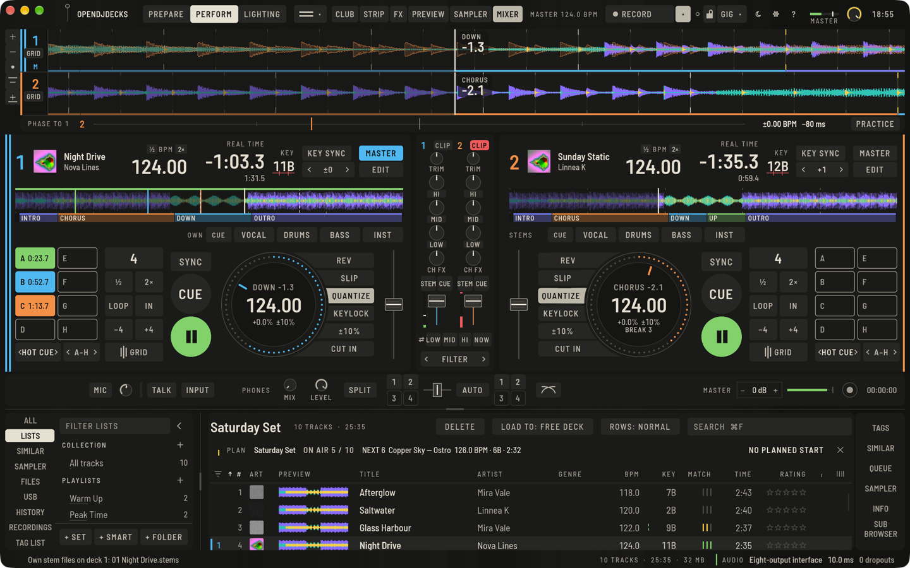
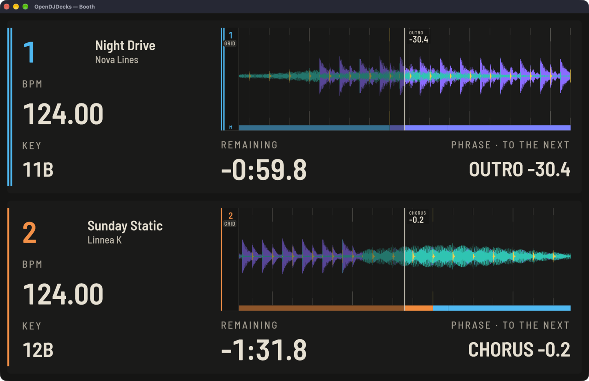

Perform ist der Live-Modus: Decks, Mixer und Browser in einer Ansicht.

## Laden und spielen

Doppelklicke einen Track im Browser, ziehe ihn auf ein Deck oder nutze `⇧←` und `⇧→`. **Play** und **CUE** funktionieren wie an einem Player: CUE im Stillstand setzt den Cue-Punkt, CUE während der Wiedergabe springt zurück, gehaltenes CUE spielt, bis du loslässt.

## Deck-Anzeigen

Der Deck-Kopf zeigt Nummer, Cover, Titel und Artist, **BPM**, Rest- oder verstrichene Zeit, **TONART** und den Sync-Zustand. Der Platter darunter zeigt das Tempo, den Taktzähler und die aktuelle Phrase mit Countdown, und unter dem Tempo die Takte bis zum nächsten Drop und Break ([Phrasen](phrases.md#auf-der-phrase-mixen)). **½** und **2×** neben **BPM** halbieren oder verdoppeln das Grid des Tracks ([Beatgrids](beatgrid.md#schnelle-musik-und-halb-oder-doppelt-am-deck)).

Die schmale Wellenform in jedem Deck ist der ganze Track mit Hot Cues und Phrasen. Ein Klick springt dorthin (Needle Search); am Controller tut das der Touch Strip.

Über den Decks zeigt der breite Bereich eine scrollende Wellenform pro Deck. Das Mausrad über einer Spur zoomt dieses Deck, Doppelklick setzt zurück, und die Tasten links gelten für alle Decks: eine Spalte mit Hineinzoomen, Herauszoomen, Zoom zurücksetzen, dann ein kleinerer und ein größerer Wellenform-Bereich. Sind die Spuren zu niedrig für alle fünf, wandern die letzten Tasten hinter **⋯**. Die Abspielmarke steht in der Fenstermitte, auf einer Linie mit dem Mixer darunter; die vergangene Seite einer Spur ist daher etwas schmaler als die kommende.

### Eine Wellenform ziehen

Ziehe eine Spur mit der Maus (über einer Spur mit Track wird der Zeiger zur Hand):

- **Deck in Pause:** Die Wellenform folgt dem Zeiger eins zu eins im aktuellen Zoom, und der Track bleibt, wo du ihn hinlegst. Nach links ziehen geht weiter in den Track.
- **Laufendes Deck:** Nichts springt. Die Geschwindigkeit deines Ziehens verbiegt das Tempo kurz, wie eine Hand auf dem Plattenteller, so schiebst du die Beats übereinander; eine ruhige Hand lässt das Deck laufen, und beim Loslassen spielt es wieder in seinem Tempo. Mit **SLIP** springt es beim Loslassen dorthin, wo der Track ohne dich wäre.

Beim Ziehen zeigt eine kleine Anzeige an der Abspielmarke den Versatz in Sekunden (Pause) oder die Tempobiegung in Prozent (laufend). Ein Klick ohne Bewegung tut, was er vorher tat, und die Performance-Sperre blockiert beides nicht.

### Ruhige Wellenform

**Einstellungen › Ansicht › Ruhige Wellenform** zeichnet die großen Wellenformen ruhiger: eine scharfe, dünne Abspielmarke zwischen zwei dunklen Kanten, zarte Beatlinien (einfache Beats nur als kurze Striche an den Rändern) und sanftere Bandfarben. In der Voreinstellung ist sie aus.

## Die Mitte des Decks

Der Plattenteller steht mittig in den Reihen des Decks, mit **SLIP**, **QUANTIZE**, **KEYLOCK** und dem Tempobereich als ein Block an seiner inneren Seite. Ihre inneren Kanten folgen dem Ring mit einem Tastenabstand, und **SYNC**, **CUE** und **PLAY** stehen auf derselben Achse. In einem größeren Fenster wächst der Plattenteller bis zu einer Grenze und die Tasten mit ihm; übriger Platz geht nach oben und unten, nie zwischen die Tasten. Auf den Player-Screens im Club-Modus umschließen die Tasten ◀◀ / ◀ CALL und ▶▶ / CALL ▶ das Jogwheel auf dieselbe Weise.

## Regler, Fader und Pegel

Ein Drehregler zeigt seinen Wert als Bogen auf seinem Ring. Regler, die von einer Mitte in beide Richtungen drehen (Trim, EQ, Filter, der FX-Parameter), haben oben eine kleine Marke und zeichnen den Bogen von dort. Während du einen Regler ziehst, steht sein Wert darüber; beim Tempofader steht das Tempo neben der Kappe, zum Deck hin. Der Tempofader hat bei 0 eine Mittenrast-Marke, und jede Faderkappe hat eine Mittellinie zum Ablesen. Zu den Pegeln siehe [Der Mixer](mixer.md#regler-fader-und-pegel).

## Layout und Ansichten

Der Ansichts-Knopf oben in Perform öffnet ein Menü mit einem Bild jeder Ansicht: **2 Decks** oder **4 Decks**, jeweils **horizontal** oder **vertikal**, und **Browse**, das die Decks klein hält und dem Browser den Platz gibt. Kurzbefehle: `⌥⌘V` für vertikale Wellenformen und `⌥⌘B` für Browse. Ein Vierdeck-Controller schaltet automatisch auf vier Decks.

Die obere Leiste hat drei Zonen. Links stehen die Arbeitsmodi, in der Mitte das, was der aktuelle Modus zeigt, rechts das, was gerade läuft: Master-Tempo, Aufnahme, Controller und Master-Ausgang. **FX**, **VORSCHAU**, **SAMPLER** und **MIXER** blenden Panels ein und aus, dazu **CLUB** und **LICHTLEISTE**. **AUFNAHME** startet eine Aufnahme und wird rot mit der laufenden Zeit; die kleine Taste daneben zeigt oder verbirgt den Aufnahmebereich. **UNDO** erscheint in Prepare, wo du bearbeitest. Ziehe die Trennbalken zwischen den Bereichen, um die Größe zu ändern; Doppelklick setzt zurück.

## Deck-Layouts

Wie viel jedes Deck zeigt, bestimmst du. Wähle im Ansichtsmenü oben in Perform, unter **Ansicht › Deck-Layout** oder in der Checkliste beim ersten Start:

- **Einfach** ist ein ruhiges Deck mit etwa 25 großen Bedienelementen: Hot-Cue-Pads A–H, der Loop (**½**, **2×**, **LOOP**) und Beat Jump, **SYNC**, **CUE** und **PLAY**, der Tempo-Fader, die Stems und **MASTER**. Setup-Tasten, Plattenteller, Phasenleiste und Effekte bleiben weg, und die Pads spielen immer Hot Cues. BPM und Zeit bleiben groß im Kopf des Decks.
- **Standard** ist das Deck, wie es diese Seite beschreibt.
- **Voll** zeigt alles, mit offenem Tempo-FX-Bereich.

Unter **ZEIGEN** im selben Menü lassen sich ganze Gruppen aus- und wieder einblenden: **PADS**, **LOOPS**, **STEMS**, **FX** (der Tempo-FX-Bereich und seine Taste, die CH-FX-Regler), **MIXER** (die Mixerspalte, dasselbe wie **MIXER** in der oberen Leiste), **PHASE** (die Phasenleiste) und **SETUP-TASTEN** (SLIP, QUANTIZE, KEYLOCK, der Tempobereich, GRID, KEY SYNC, Key Shift und ½ / 2× an der BPM). Eine ausgeblendete Gruppe ist ganz weg, auch die Tastatur landet nicht mehr darauf. Der Pad-Modus bleibt bei den Pads.

Um ein Layout zu behalten, tippe unter **GESPEICHERTE LAYOUTS** einen Namen ein und drücke **SPEICHERN**. Ein Druck auf den Namen holt es zurück, **×** löscht es. Ein gespeichertes Layout merkt sich das Deck-Layout, die ausgeblendeten Gruppen, die Mixerspalte und den Tempo-FX-Bereich und bleibt in deinen Einstellungen. Speichern unter einem vorhandenen Namen ersetzt es.

Der Kiosk auf dem Raspberry Pi behält sein eigenes Deck und der Club-Modus seine Player-Ansichten, egal welches Layout gilt. Einfach und Voll wurden noch nicht auf einem Touchscreen ausprobiert.

## Tempo und Sync

- Der **Tempo-Fader** ändert die Geschwindigkeit; oben ist langsamer, wie am Player. Die Bereichstaste bei den Setup-Tasten neben dem Fader schaltet durch **±6 %**, **±10 %**, **±16 %** und **WIDE**. Der Standard kommt aus **Einstellungen › Controller › Decks**, und im Feld auf dem Platter kannst du eine BPM eintippen.
- **SYNC**, über **CUE** und **PLAY**, koppelt ein Deck an das **MASTER**-Deck, nach Tempo und Taktposition. `⇧Q` und `⇧Y` machen Deck 1 und 2 zum Master. Unter **Einstellungen › Controller › Decks › Sync** wählst du Beat-Sync, nur Tempo oder Phrasen-Sync. Ein Rechtsklick auf **PLAY** startet ein gecuetes Deck auf der nächsten Phrase des Masters ([Phrasen](phrases.md#auf-der-phrase-mixen)).
- **Q** (Quantisieren) lässt Cues, Loops und Sprünge auf dem Beat landen.
- **KEY SYNC** bringt das Deck in die Tonart des Master-Decks.
- **‹ ±0 ›** im Deck-Kopf verschiebt die Tonart um je einen Halbton; Klick auf den Wert setzt zurück.
- **KEYLOCK** hält die Tonart, wenn sich das Tempo ändert (auch bekannt als Master Tempo).
- Bend per Tastatur: `W` / `E` und `U` / `I`, solange gehalten.

### Tonart gegenüber den anderen Decks

Ab Version 0.8 ist die **TONART** im Kopf jedes Decks unterstrichen, solange ein anderes Deck spielt. So siehst du auf einen Blick, ob die beiden Tonarten zusammenpassen:

- eine durchgehende grüne Linie: die Tonarten **passen** (dieselbe Tonart, ein Schritt im Quintenzirkel oder die parallele Dur- bzw. Molltonart);
- eine gestrichelte gelbe Linie: ein **Energiewechsel** (ein Ganzton oder Halbton nach oben oder unten, oder ein Schritt mit getauschtem Dur und Moll), ein Wechsel, der die Stimmung bewusst hebt oder senkt;
- eine rote Linie, mit zwei Strichen durchgestrichen: die Tonarten **beißen sich**.

Verglichen wird die Tonart, die du hörst: Die Tonverschiebung zählt mit, und ohne **KEYLOCK** auch das Tempo (auf den nächsten Halbton). Spielen mehr Decks, zeigt die Linie die schlechteste Paarung. Fahr mit der Maus über die Linie, dann steht es in Worten da, etwa „Beißt sich mit Deck 1 (11B)“. War sich die Analyse bei einer Tonart unsicher, steht der Prozentwert gelb darunter; siehe [Wie sicher die Analyse ist](beatgrid.md#wie-sicher-die-analyse-ist). Die Farben sind unsere eigenen und folgen dem Rest der App: Grün passt, Gelb will bedacht sein, Rot warnt.

## Phase und Tempo zwischen den Decks

Die Leiste unter den Wellenformen vergleicht jedes Deck mit dem **Bezugsdeck**: dem Sync-Master, sonst dem Deck, das spielt. **PHASE ZU 1** nennt es.

- Das Lineal reicht einen halben Beat zu jeder Seite. Die Mitte ist der Beat des Bezugsdecks; die eigene Linie des Decks (in seiner Farbe, neben seiner Ziffer) steht dort, wo sein Beat fällt. Links der Mitte ist hinterher, rechts voraus.
- Rechts daneben: der Tempounterschied in BPM und die Phase in Millisekunden.
- Stimmen Tempo und Phase beide (auf 0,05 BPM und 2 % eines Beats), wird die Mitte eine durchgehende grüne Linie, und die Anzeige sagt **SYNCHRON**.

Zum Angleichen von Hand bringst du den Tempounterschied mit dem Tempo-Fader auf ±0.00 und schiebst dann mit dem Jogwheel oder den Bend-Tasten nach, bis die Linie in der Mitte steht.

**ÜBEN** rechts in der Leiste schaltet SYNC auf allen Decks aus und lässt es aus, damit du ohne üben kannst. Ein weiterer Klick gibt SYNC wieder frei.

## Booth-Ansicht

**Ansicht › Booth-Ansicht** (`⌥⇧⌘B`, unter Linux und Windows `Strg+Alt+Umschalt+B`) öffnet die Decks in einem eigenen Fenster, so groß, dass man sie aus ein paar Metern lesen kann: die Wellenform, BPM, Tonart, die Restzeit und die Phrase mit dem Countdown zur nächsten. Stell es auf einen zweiten Bildschirm in der Kabine, oder doppelklicke für Vollbild. Alles wächst mit dem Fenster: Auf einem 1080p-Bildschirm sind BPM und Zeit etwa dreimal so groß wie am Deck. Es zeigt, was Perform zeigt, Bild für Bild; im letzten Zehntel eines laufenden Tracks wird seine Zeit gelb.

Die Booth-Ansicht ist ein Fenster der Desktop-App; der Raspberry-Pi-Kiosk hat kein zweites Fenster.

## Jogwheels

Am Controller scratcht, bendet oder sucht das Jogwheel. Der Vinyl-Modus wird pro Deck und unter **Einstellungen › Controller › Decks › Jogwheel** geschaltet. Der Platter auf dem Bildschirm zeigt, wo du bist. Auf den Player-Screens suchen ◀◀ und ▶▶, solange gedrückt; sie und die CALL-Tasten umschließen das Jogwheel ([Die Mitte des Decks](#die-mitte-des-decks)).

## Slip und Censor

**SLIP** lässt dich loopen, cuen oder scratchen, während der Track im Hintergrund weiterläuft; lässt du los, ist er dort, wo er wäre.

**Censor** gibt es am Controller und als Pad-Modus **CENSOR** (siehe unten): Das Deck spielt mit Slip rückwärts und läuft dann dort weiter, wo es wäre. Ein Controller kann ein Deck auch rückwärts spielen.

## Loops und Beat Jump

**LOOP** startet einen Loop der angezeigten Länge, **½** und **2×** ändern sie; **IN** / **OUT** / **EXIT** machen einen manuellen. Mehr in [Cues und Loops](cues-and-loops.md).

**−** und **+** (mit der Sprungweite auf der Taste) springen um Beats; die Weite stellst du im Pad-Modus **BEAT JUMP** ein, von 1/8 bis 64 Beats.

## Pads und Pad-Modi

Die sechzehn Pads links an jedem Deck ändern mit dem Modus ihre Bedeutung. Wähle einen Modus mit **‹ ›** neben seinem Namen, oder klicke den Namen für die Liste. `⇧⌘D` und `⇧⌘S` schalten bei Deck 1 durch, `⇧⌘;` und `⇧⌘K` bei Deck 2. Am Controller leuchten die Pad-Modus-Tasten für den aktuellen Modus; Pads leuchten bei Aktivität, dunkler wenn belegt.

| Modus | Die Pads |
|---|---|
| **HOT CUE** | Hot Cues A bis H anspringen oder setzen; Bank mit ‹ › |
| **BEAT LOOP** | So viele Beats loopen; erneut drücken beendet |
| **BEAT JUMP** | Um so viele Beats springen; ‹ › stellt die Weite |
| **SAMPLER** | Sampler-Slots spielen: ungerade Decks Pads 1–8, gerade Decks 9–16 |
| **HOLD FX** | Beat- und Release-Effekte, solange gehalten; zwei Seiten mit ‹ › |
| **KEYBOARD** | Den gewählten Hot Cue bei −3 bis +4 Halbtönen spielen |
| **KEY SHIFT** | Die Tonartverschiebung von −3 bis +4 setzen |
| **SLICER** | Einen von acht Slices spielen, solange gehalten; Bereich 4 bis 64 Beats |
| **STEMS** | Die getrennten Stems stummschalten und formen, siehe [Stems](stems.md) |
| **MEMORY CUE** | Die Memory Cues des Tracks anspringen |
| **CENSOR** | ¼ bis 32 Beats zensieren, dann dort weiterlaufen, wo es wäre |
| **PATTERN** | Sampler-Sequenzen speichern und abrufen |
| **LIGHTING** | A–F Looks, G Strobe, H Flash, siehe [Lichtshow](light-show.md) |
| **ROLL** | 1/32 bis 4 Beats rollen, solange gehalten; SICHERN behält ihn, siehe [Loop Roll](cues-and-loops.md#loop-roll-und-sichern) |

Die **GRID**-Taste neben dem Modus tauscht die Pads gegen das Grid- und Gain-Panel; siehe [Beatgrids](beatgrid.md#ein-grid-korrigieren-waehrend-der-track-laeuft).
