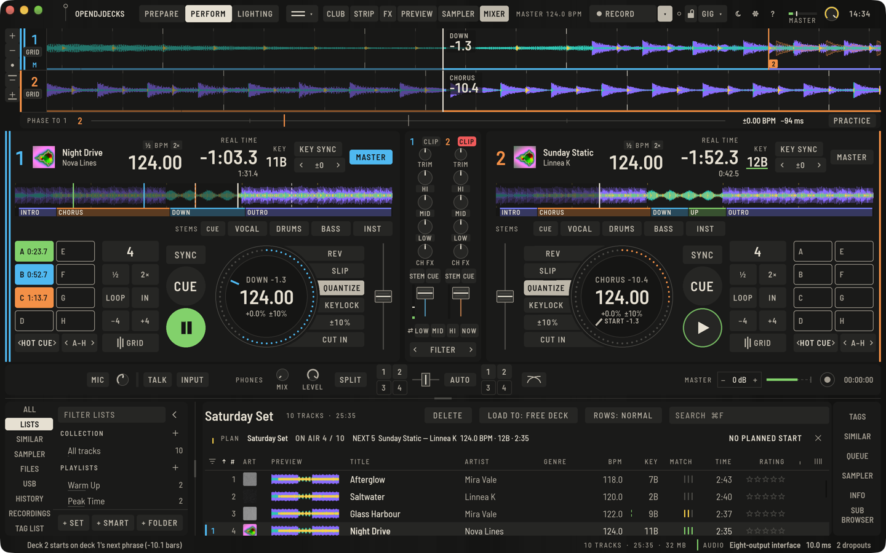
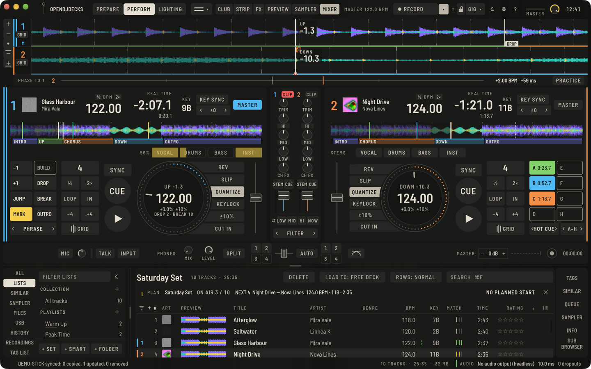

Phrasen sind die Abschnitte eines Tracks: Intro, Chorus, Up, Down, Outro. Die Analyse findet sie für dich und zeichnet sie als farbigen Balken unter die Übersicht in Prepare und auf jedem Deck, damit du auf einen Blick siehst, was kommt.

## Wie Phrasen gefunden werden

Die Analyse hört den Track Takt für Takt auf dem Beatgrid an:

- **Wie jeder Takt klingt:** wie laut er ist, wie viel in Tiefen, Mitten und Höhen liegt, ob eine Kick schlägt, ob ein Bass darunter steht, wie viele Schläge pro Beat es gibt, wie hell er ist und welche Töne klingen.
- **Wo sich die Musik ändert:** Jeder Takt wird mit jedem anderen verglichen. Wo die Takte vor einer Stelle anders klingen als die danach, kann ein Abschnitt beginnen. Kleine Änderungen (unter etwa 3 dB) zählen nicht.
- **Wo die Abschnitte liegen:** Die Grenzen kommen dorthin, wo sich die Musik am stärksten ändert, bevorzugt in den Längen, aus denen Tracks gebaut sind: 8, 16 und 32 Takte, beginnend auf einer 4-Takt-Gruppe. Andere Längen (4, 12, 24 Takte, ein ungerader Fill) sind erlaubt, wenn die Musik es klar sagt; nichts unter 4 Takten.
- **Was jeder Abschnitt ist:**
  - **Intro** und **Outro** sind die beatgeführten Enden, auf denen du mixt: der Beat ohne Bass, alles vor dem ersten Beat und ein Ende ohne Beat.
  - **Down** ist ein Breakdown: Die Kick fällt weg.
  - **Up** ist ein Build-up: Energie, Schläge oder Helligkeit steigen, und gleich danach kommt der Beat zurück.
  - **Chorus** ist der Drop: Kick und Bass, aus einem Breakdown oder Build-up heraus, nahe am lautesten Teil des Tracks. Ein Abschnitt, der wie ein Drop klingt, ist auch einer.
  - **Verse** ist der Groove vor dem ersten Drop.
  - **Bridge** ist ein Groove nach einem Drop, der nicht wie er klingt.

Ein Track ohne Breakdown oder Build-up bekommt keinen Drop: Ein langer Groove bleibt Intro, Verse und Outro.

## Wie sicher die Analyse ist

Jede Phrase, die die Analyse findet, bekommt einen Prozentwert: wie klar ihre Grenzen sind und wie klar sie der Typ ist, den sie bekommen hat, je nachdem, was schwächer ist. Unter 50 % gilt sie als unsicher. Auf der Phrasenleiste in Prepare hat eine unsichere Phrase an ihrem Anfang eine **halbhohe Natriumlinie** (dieselbe Marke wie bei einer unsicheren Tonart) und zeigt ihren Prozentwert beim Darüberfahren; steht der Cursor in ihr, sagt der Tab **PHRASE** **UNSICHER 41 %**.

Prüfe eine unsichere Phrase mit dem Ohr. Stimmt sie, klicke sie an und wähle den Typ, den sie schon hat: Das bestätigt sie, und die Marke verschwindet. Teilen, Verbinden oder eine ihrer Kanten verschieben bestätigt sie auch. Selbst gesetzte, importierte Phrasen und Phrasen aus einer früheren Version der Analyse haben keinen Prozentwert und gelten als sicher; **NEU ANALYSIEREN** (im Tab **INFO**) findet sie mit der aktuellen Analyse neu.

Auf 31 erzeugten Tracks (House, Techno, Drum & Bass, Breakbeat, Half-Time, Tracks ohne Drop, lange Intros, Abschnitte mit 4 und 12 Takten) setzt die Analyse 99 % der Grenzen auf höchstens einen Takt genau, gibt 99 % der Takte den richtigen Typ und findet keinen Drop, wo keiner ist; die frühere Analyse kam auf 79 %, 73 % und 21 falsche Drops. Mit anderen Mischungen, Sättigung, Rauschen und dem erkannten statt dem exakten Grid bleiben es 100 %, 99 % und keiner. Das sind erzeugte Tracks mit bekannter Struktur, keine Platten: Echte Musik ist weniger aufgeräumt, also prüfe die Phrasen, bevor du dich auf einem Gig auf sie verlässt.

## Eine Phrase korrigieren

Öffne den Track in Prepare und wähle den Tab **PHRASE**.

- **Typ ändern:** Klicke eine Phrase auf der Leiste an und wähle einen Typ (oder `⇧P`). In einer Lücke entsteht eine neue Phrase.
- **Grenze verschieben:** Ziehe die Kante zwischen zwei Phrasen; sie rastet auf Takten ein. **GRENZE ZUM CURSOR** (`⇧B`) verschiebt die nächste Grenze zum Cursor.
- **Phrase teilen:** **TEILEN** (`⇧X`) am Cursor, auf dem nächsten Takt.
- **Zwei Phrasen verbinden:** **VERBINDEN** (`⇧J`).
- **LÖSCHEN** entfernt alle Phrasen des Tracks.

Eine neue Analyse ersetzt deine Änderungen. Jede Änderung ist ein Rückgängig-Schritt, bestätigt die Phrasen, die sie berührt, und erreicht deine Sticks.

## Wie Phrasen angezeigt werden

Unter **Einstellungen › Ansicht** schaltest du Phrasen auf den vergrößerten Wellenformen und die Leiste unter den Übersichten getrennt, und wählst **NAMEN** oder **NUR FARBEN** für die Typen. Der Platter zeigt die aktuelle Phrase mit Countdown; siehe [Perform](perform-basics.md#deck-anzeigen).

## Auf der Phrase mixen

- **Takte bis zum Drop und Break:** Unter dem Tempo auf jedem Platter zählt **DROP 8 · BREAK 24** ganze Takte bis zum nächsten Drop (ein Chorus nach etwas anderem) und zum nächsten Breakdown (eine Down- oder Bridge-Phrase), das nähere zuerst. Die Takte bis zur nächsten Phrase stehen weiter oben auf dem Platter und auf der Wellenform.
- **Auf der nächsten Phrase starten:** Cue den kommenden Track und **klicke rechts auf PLAY**. Die Taste bekommt den Bereit-Rahmen, der Platter zählt **START -Takte.Beats**; das Deck startet, wenn das Master-Deck seine nächste Phrase erreicht (ohne Phrasen die nächste 16-Takt-Marke). Ein zweiter Rechtsklick, **PLAY** oder **CUE** brechen ab. Am Controller: `deck.phrase_start`.
- **Sync auf die Phrase:** Unter **Einstellungen › Controller › Decks › Sync** wählst du **PHRASE**. Drückst du **SYNC** an einem laufenden Deck, springt es zusätzlich um ganze Beats, sodass es so weit vor einer seiner Phrasen steht wie das Master-Deck vor seiner nächsten. Beat-Sync hält die Phase wie bisher.
- **Der kommende Track über dem laufenden:** Die Spur des Masters zeichnet die Wellenform des anderen Decks als Kontur in dessen Deckfarbe, im selben Zeitmaßstab. Läuft es, siehst du, wo seine Beats liegen; ist es gecuet, beginnt die Kontur an seinem Cue, gesetzt auf die nächste Phrase des Masters, mit einer Marke mit der Decknummer. **Einstellungen › Ansicht › Kommender Track** schaltet sie aus.

Der Start landet in Tests mit erzeugten Tracks innerhalb eines Audioblocks (wenige Millisekunden) an der Phrasengrenze. Auf einem Gig oder mit einem Hardware-Controller ist das noch nicht ausprobiert, und es ist nur so richtig wie die Phrasen und das Grid: Prüfe sie vorher in Prepare.

## Phrasensprünge und der Drop

Der Pad-Modus **PHRASE** springt in Phrasen:

- **A** (−1) geht zurück an den Anfang der Phrase, in der du bist, oder an die davor, wenn du in ihrem ersten Takt bist; **B** (+1) geht weiter zur nächsten Phrase.
- **C** (JUMP) springt zum markierten Drop.
- **D** (MARK) markiert den Drop.
- **E** bis **H** (BUILD, DROP, BREAK, OUTRO) springen zum nächsten Build-up, Drop, Breakdown und Outro.

Jeder Sprung landet im Takt: Das Deck springt um ganze Beats, sodass der Anfang der Zielphrase auf der nächsten Eins ankommt, genau dann, wenn der nächste Takt begonnen hätte. Der Abspielpunkt behält seine Stelle im Takt, ein synchrones Deck bleibt synchron. Ohne Beatgrid gibt es nichts zum Landen, und die Statusleiste sagt es. Ohne Phrasen zählen die 16-Takt-Marken. Am Controller: `deck.phrase_jump` (mit `forward = false` für zurück).

**Den Drop markieren** geht mit Pad D, mit **DROP MARKIEREN** im Cue-Bereich von [CUE-EDIT](cues-and-loops.md#hot-cues-in-perform-bearbeiten) oder mit `deck.drop_mark` am Controller: Er wird auf die Eins gesetzt, die dem Abspielpunkt am nächsten liegt; erneut innerhalb eines Takts der Marke gedrückt, wird er entfernt, anderswo versetzt. Der Drop erscheint als helle Linie mit **DROP** auf der Wellenform und als Linie in der Übersicht des Decks. Die Phrasen folgen ihm: Die Phrase, in die er fällt, wird dort geteilt, der Teil ab dem Drop wird ein **CHORUS** (der Drop) und der Teil davor der Build-up (**UP**). So nutzen **DROP 8** auf dem Plattenteller, der Drop-Look der Lichtshow und die Phrasen-Pads den Drop, den du markiert hast. Es ist ein Rückgängig-Schritt; er bleibt in der Bibliothek und kommt nicht auf die Sticks.

Die Phrasenrechnung ist mit erzeugten Grids getestet; auf einem Gig oder an einem echten Controller wurde sie noch nicht ausprobiert.
