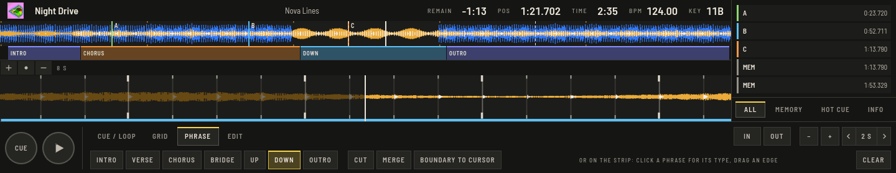

Phrasen sind die Abschnitte eines Tracks: Intro, Chorus, Up, Down, Outro. Die Analyse findet sie für dich und zeichnet sie als farbigen Balken unter die Übersicht in Prepare und auf jedem Deck, damit du auf einen Blick siehst, was kommt.

## Eine Phrase korrigieren

Öffne den Track in Prepare und wähle den Tab **PHRASE**.

- **Typ ändern:** Klicke eine Phrase auf der Leiste an und wähle einen Typ (oder `⇧P`). In einer Lücke entsteht eine neue Phrase.
- **Grenze verschieben:** Ziehe die Kante zwischen zwei Phrasen; sie rastet auf Takten ein. **GRENZE ZUM CURSOR** (`⇧B`) verschiebt die nächste Grenze zum Cursor.
- **Phrase teilen:** **TEILEN** (`⇧X`) am Cursor, auf dem nächsten Takt.
- **Zwei Phrasen verbinden:** **VERBINDEN** (`⇧J`).
- **LÖSCHEN** entfernt alle Phrasen des Tracks.

Eine neue Analyse ersetzt deine Änderungen. Jede Änderung ist ein Rückgängig-Schritt und erreicht deine Sticks.

## Wie Phrasen angezeigt werden

Unter **Einstellungen › Ansicht** schaltest du Phrasen auf den vergrößerten Wellenformen und die Leiste unter den Übersichten getrennt, und wählst **NAMEN** oder **NUR FARBEN** für die Typen. Der Platter zeigt die aktuelle Phrase mit Countdown; siehe [Perform](perform-basics.md#deck-anzeigen).
