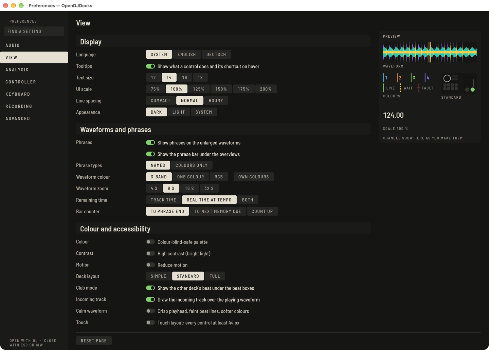

Öffne die **Einstellungen** mit dem Zahnrad oben, oder `⌘,` auf dem Mac und `Strg+,` auf Windows und Linux. `Esc` schließt das Fenster. **EINSTELLUNG FINDEN** oben durchsucht alle Seiten.

## Audio

Das **Ausgabegerät** ist standardmäßig das Audio-Interface des Controllers, falls einer angeschlossen ist. Die **Puffergröße** reicht von 64 bis 1024 Samples: kleiner reagiert schneller, größer ist auf einem langsamen Rechner sicherer. **Kopfhörer (Cue)** kann automatisch, auf Ausgängen 3/4 oder aus sein. Audioeinstellungen gelten ab dem nächsten Audiostart, markiert mit **GILT NACH NEUSTART**.

Unter Windows läuft Audio über WASAPI, unter macOS über CoreAudio und unter Linux über ALSA, JACK oder PipeWire, was du hier wählst.

## Ansicht

**GIG** in der oberen Leiste ist ein Preset fürs Spielen: Ein Klick stellt hohen Kontrast, die Palette für Farbenblinde und eine größere Oberfläche zugleich ein, ein zweiter Klick stellt deine Werte wieder her. Der Pfeil daneben stellt die einzelnen Teile ein. Die leere Bibliothek bietet beim ersten Start denselben Knopf **GIG-PRESET**.

Sprache, Tonart-Schreibweise (**Camelot**, **Open Key** oder **musikalisch**), die Darstellung (dunkel, hell oder wie das System), **Skalierung** von 75 bis 200 % (gilt sofort) und die **Wellenform-Farbe**: 3 Bänder, einfarbig oder RGB. Unter **EIGENE FARBEN** wählst du die Farben für Tiefen, Mitten und Höhen selbst; **STANDARDFARBEN** stellt die vorgegebenen wieder her.

- **Palette für Farbenblinde** und **Hoher Kontrast (helles Licht)** gelten sofort.
- **Bewegung reduzieren** beruhigt die Oberfläche.
- **Waveform-Zoom** legt fest, wie viele Sekunden eine Wellenform beim Öffnen eines Tracks zeigt; das Mausrad zoomt weiterhin.
- Unter **Browser** stellst du **Schriftgröße** und **Zeilenabstand** der Liste ein.

## Analyse, Aufnahme

Siehe [Beatgrids](beatgrid.md#wenn-das-tempo-immer-wieder-falsch-ist) für den **BPM-Bereich** und [Aufnahme](recording.md) für die Aufnahmeseite.

Der **BPM-Bereich** (ab Version 0.6) sagt der Tempoanalyse, in welchem Bereich deine Musik liegt. Tracks, die mit halbem oder doppeltem Tempo erkannt würden, werden in den gewählten Bereich verschoben:

- **70–180** ist die Voreinstellung und passt für die meiste Musik.
- **58–115** für langsame Musik wie Reggae oder Downtempo.
- **98–195** für schnellere Genres, bei denen ein Track nicht als halbes Tempo erscheinen soll.
- **118–236** für sehr schnelle Musik wie Drum and Bass oder Hardcore.
- **150–300** für Musik über 200 BPM wie Gabber oder Speedcore; siehe [Beatgrids](beatgrid.md#schnelle-musik-und-halb-oder-doppelt-am-deck).

Der Bereich gilt für alle Tracks, die ab jetzt analysiert werden. Um einen analysierten Track zu ändern, wähle in seinem Menü im Player oder in der Liste **Erneut analysieren**.

## Controller

**Decks** enthält die Standards, die an jedes Deck gehen: Tempobereich, Quantisieren, Sync-Modus (**BEAT**, **NUR TEMPO** oder **PHRASE**, siehe [Phrasen](phrases.md#auf-der-phrase-mixen)), Jog-Modus und Auto Cue. **Mixer** enthält EQ und Faderkurven. Den Rest findest du unter [Controller](controllers.md).

## Tastatur

Die Seite **Tastatur** listet jede Aktion mit ihrer Belegung. Suche nach Aktion, Id oder Taste.

1. Klicke eine Belegung an (oder wähle eine mit `↑` `↓` und drücke Return) und drücke die neuen Tasten. `Esc` bricht ab, Rücktaste entfernt die Belegung.
2. Ist eine Taste belegt, nennt die Seite die andere Aktion. **ERSETZEN** übernimmt die Taste, **ABBRECHEN** lässt beide unverändert.
3. **STANDARD** setzt eine Aktion zurück und **ALLE ZURÜCKSETZEN** alles. **IMPORTIEREN…** und **EXPORTIEREN…** lesen und schreiben die Belegung als Datei.

Die Standards folgen einem Layout, das DJs oft benutzen: Deck 1 und 2 liegen auf der linken und rechten Tastaturhälfte, zum Beispiel Play `Z` und `N`, Cue `A` und `H`, Sync `Q` und `Y`, Hot Cues auf den Zahlenreihen, Loop-In, -Out und -Exit auf `D F G` und `K L ;`. Deck 3 und 4 liegen auf `F1` bis `F11`. Ansichts- und Layout-Wechsel nutzen auf dem Mac `⌥⌘`.

Die vollständige Tabelle, pro Deck und Modus, steht auf der Seite [Keyboard shortcuts](../../keyboard.md).

## Erweitert

Backups, der Speicherort der Bibliothek, Zusammenführen und Neu zuordnen, und die Update-Prüfung. Updates lesen nur die öffentliche Release-Liste auf GitHub; es wird nichts über dich gesendet, geprüft wird nicht, während in Perform ein Deck spielt, und ein Update unterbricht nie eine Performance.
