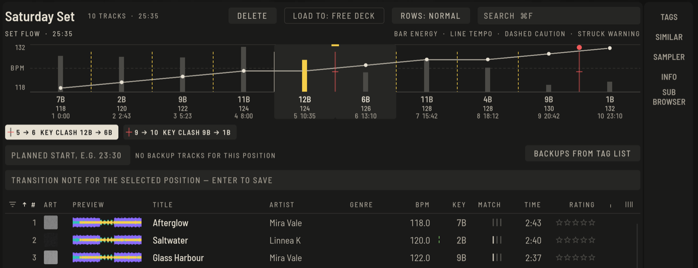

Ein Set ist eine geordnete Liste mit Extras für den Auftritt: Es zeigt, wie sich Tempo, Tonart und Energie von Track zu Track entwickeln, und du kannst dir für jeden Übergang Notizen hinterlassen.

## Ein Set anlegen

1. Drücke **+ SET** unter dem Baum (oder `⇧⌘N`) und klicke den Titel an, um ihn zu benennen.
2. Wähle Tracks unter **Alle Tracks** und drücke **+** neben dem Set, oder ziehe sie hinüber.
3. Ziehe Zeilen in der Liste, um die Reihenfolge zu ändern. Sortiere nach **#**, um die Spielreihenfolge zu behalten.

## Den Verlauf lesen

**SET-VERLAUF** ist ein Diagramm des Sets von links nach rechts, eine Spalte pro Track:

- der **Balken** ist die Energie des Tracks, auf das Set skaliert, damit die Stufen sichtbar werden;
- die **Linie** mit einem Punkt auf jedem Track ist das Tempo, links an der Achse stehen die niedrigsten und höchsten BPM des Sets;
- unter jeder Spalte stehen Tonart, BPM, Position und die Zeit, zu der der Track beginnt.

Zwischen zwei Tracks zeigt eine Marke, wie der Übergang passt:

- **durchgezogen**: er passt;
- **gestrichelt**: lohnt eine Probe, ein Temposchritt von mehr als 3 % oder ein Tonartwechsel, der die Energie hebt oder senkt;
- **halb**: Tempo oder Tonart sind noch nicht bekannt;
- **durchgestrichen** in Rot mit einem roten Punkt oben: eine Warnung.

Ein Übergang warnt, wenn das Tempo um mehr als 6 % springt (doppeltes und halbes Tempo zählen als dasselbe Tempo), wenn sich die Tonarten beißen (dieselbe Regel wie die Tonartlinie auf den Decks, siehe [Perform-Grundlagen](perform-basics.md)) oder wenn die Energie steil fällt oder springt. Jede Warnung steht mit ihrem Grund unter dem Diagramm, zum Beispiel `2 → 3` **TEMPO +9.1 %** oder `5 → 6` **TONART BEISST SICH 12B → 6B**; **ENERGIEABFALL** und **ENERGIESPRUNG** benennen die Energiestufen. Ohne Warnung sagt das die Zeile unter dem Diagramm. Halte den Zeiger über eine Marke, um den ganzen Übergang in einem Satz zu lesen.

Klicke eine Warnung oder eine Marke an, um den Übergang auszuwählen: Beide Tracks sind dann in der Liste gewählt, so kannst du sie nacheinander anhören, und die Übergangsnotiz gehört zu ihm. Klicke eine Spalte an, um eine Position auszuwählen. Notizen, Ersatz-Tracks und was du hörst beziehen sich auf die gewählte Position.

## Notizen und Ersatz

- Tippe in **ÜBERGANGSNOTIZ** und drücke Return, um eine Notiz für diesen Übergang zu behalten.
- **GEPLANTER START**, zum Beispiel `23:30`, fügt dem Verlauf echte Uhrzeiten hinzu.
- **ERSATZ AUS TAG-LISTE** macht die Tracks der Tag-Liste zu Ersatz-Tracks für die gewählte Position, falls das Publikum woanders hinwill. Der Knopf daneben entfernt sie wieder.

## Die richtige Reihenfolge finden

- Lies die **MATCH**-Spalte, während ein Kandidat läuft, oder öffne **PASSEND** für Vorschläge; siehe [Bibliothek](library.md#die-match-spalte).
- Hot Cues und Memory Cues, die du beim Vorbereiten setzt, sind automatisch auf dem Stick und in Perform.

## Einen Track in anderem Tempo oder anderer Tonart vorhören (ab Version 0.6)

Bevor du dich auf einen Übergang festlegst, kannst du einen Track wie gepitcht anhören: Öffne im Prepare-Player den Reiter **TEMPO / TONART**.

- Die Pfeile bei **TEMPO** ändern die Geschwindigkeit des Vorhörens (in Prozent); die Tonart bleibt gleich.
- Die Pfeile bei **TONART** verschieben ihn in Halbtonschritten nach oben oder unten.
- Neben den Pfeilen liest du Tempo und Tonart des Vorhörens ab; **ZURÜCKSETZEN** bringt alles zurück zum Original.

Das gilt nur fürs Hören: Der gespeicherte Track, sein Beatgrid und seine Analyse ändern sich nicht, und wenn du ihn auf ein Deck lädst, spielt er wie immer. Die Verschiebung endet von selbst, sobald du einen anderen Track vorhörst.

## Layouts zum Vorbereiten

Der Layout-Knopf oben in Prepare schaltet durch **PLAYER** (ein Player über dem Browser), **2 PLAYER** (ein voller Player und ein kompakter zweiter), **DUAL** (zwei kompakte Player nebeneinander), **EINFACH** (ein kompakter Player) und **GANZER BROWSER**. `⌥⌘4` bis `⌥⌘8` wählen direkt. Player 2 übernimmt den ausgewählten Track mit **LADEN** oder eine gezogene Zeile; praktisch, um einen Übergang zu prüfen.
