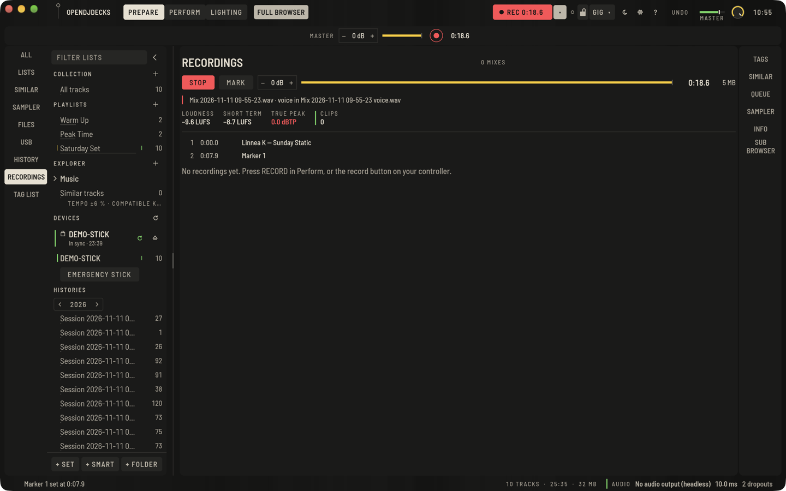
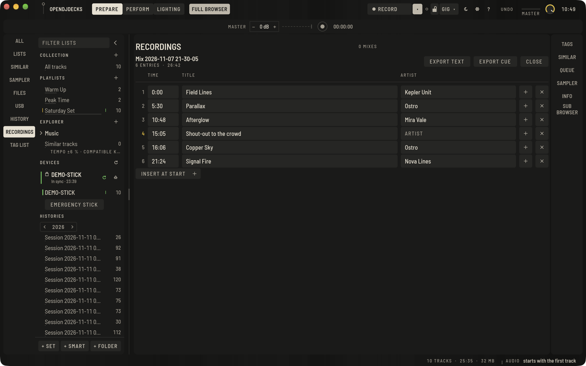

Drücke den runden Aufnahmeknopf neben dem Master-Pegel (oder `⌘Return`, oder die Aufnahmetaste am Controller), um den Master-Ausgang aufzunehmen. Ein zweiter Druck stoppt.

## Während der Aufnahme

**AUFNAHME** in der oberen Leiste startet und stoppt eine Aufnahme; sie wird rot mit der laufenden Zeit. Die kleine Taste daneben zeigt den Aufnahmebereich: Pegel, Anzeige, verstrichene Zeit und Dateigröße, und die Trackliste, die mitwächst. Tracks kommen hinzu, sobald sie hörbar werden. Der Aufnahmepegel reicht von −12 bis +12 dB.

**MARKE** (oder `⇧⌘Return`) setzt eine Kapitelmarke an der aktuellen Stelle, für eine Ansage, einen Gast oder einen Stimmungswechsel. Sie kommt als *Marke 1*, *Marke 2* und so weiter in die Trackliste, und du kannst sie später benennen.

Unter dem Dateinamen zeigt der Aufnahmebereich, was in die Datei geht:

- **LAUTHEIT**: die integrierte Lautheit der bisherigen Aufnahme in LUFS, gemessen wie in EBU R 128 beschrieben (leise Stellen unter dem Gate ziehen sie nicht herunter).
- **KURZZEIT**: die Lautheit der letzten drei Sekunden.
- **TRUE PEAK**: die höchste Spitze in dBTP, auch Spitzen zwischen den Samples. Über −1 dBTP wird sie rot: Encoder und Streamingdienste wollen diesen Abstand.
- **CLIPS**: wie oft das Signal Vollaussteuerung erreicht hat. Die Linie davor ist durchgehend grün, solange es keine gibt, und rot durchgestrichen, sobald es welche gibt. Senke den Aufnahmepegel, wenn sie hochzählt.

Die Datei auf der Festplatte ist jederzeit ein vollständiges WAV und wird jede Sekunde nachgeführt. Stürzt die App oder der Rechner ab, behält die Aufnahme alles bis zum Absturz und erscheint beim nächsten Start von OpenDJDecks mit ihrer Trackliste unter Aufnahmen. Siehe [Sicher durch das Set](set-safety.md#nach-einem-absturz).

## Nach der Aufnahme

Öffne **Aufnahmen** über die Leiste **AUFNAHMEN**: Jeder Mix steht dort mit seiner Datei. Direkt dort:

- **TRACKLISTE** öffnet den Tracklisten-Editor (siehe unten).
- **DATEI ZEIGEN** öffnet sie im Dateimanager.
- **IN TRACKS TEILEN** schneidet sie in eine Datei pro gespieltem Track.

Unter Name und Länge zeigt jeder Mix seine Lautheit, den True Peak und die Clips, in Rot, wenn er übersteuert hat oder über −1 dBTP lag. Ein Mix mit Sprachspur sagt **SPRACHSPUR**.

## Format, Ordner und Automatik

Unter **Einstellungen › Aufnahme**:

- **Format**: WAV wird direkt aufgenommen; FLAC (bit-genau) oder MP3 (320 kbit) werden beim Stoppen encodiert.
- **Ordner** und **Dateiname**: Im Namen kannst du `{date}`, `{time}` und `{n}` (Nummer des Tages) nutzen.
- **Aufnahmepegel**, auch im Aufnahmebereich.
- **Teilen** in eine Datei pro Track beim Stoppen.
- **Sprachspur**: das Mikrofon zusätzlich allein aufnehmen (siehe unten).
- **Start**: Aufnahme starten, sobald Ton kommt. Der Master muss zwei Sekunden Ton führen. **Stopp** beendet sie nach 30 Sekunden Stille. Ein Stopp von Hand schaltet die Automatik bis zum nächsten App-Start aus.

## Die Trackliste

Jede Aufnahme bekommt die Trackliste auch als `.cue`-Datei und als Text, bereit zum Einfügen bei Mixcloud oder SoundCloud. Zeiten und Titel kommen aus dem, was wirklich hörbar war. Jeder Eintrag ist außerdem ein Kapitel in der Datei selbst: ein Cue-Punkt mit Namen im WAV, ein Kapitel in den Tags des MP3 und ein Kapitel-Kommentar im FLAC, so springen Player und Editoren, die Kapitel zeigen, von Track zu Track.

## Die Trackliste vor dem Veröffentlichen bearbeiten

**TRACKLISTE** bei einem fertigen Mix öffnet seine Trackliste als Zeilen aus Zeit, Titel und Künstler:

- Tippe einen neuen Titel oder Künstler; er wird beim Tippen gesichert.
- Tippe eine Zeit wie `12:34` (oder `1:02:03`) und drück Return, um einen Eintrag zu verschieben; die Liste bleibt in zeitlicher Reihenfolge. Eine Zeit außerhalb der Aufnahme wird mit einer Meldung abgelehnt.
- **+** fügt einen Eintrag auf halbem Weg zum nächsten ein, **AM ANFANG EINFÜGEN** einen vor dem ersten, **×** entfernt einen.
- **TEXT EXPORTIEREN** und **CUE EXPORTIEREN** schreiben den Text und das CUE-Sheet neben der Aufnahme neu und setzen die bearbeiteten Kapitel in ihre Dateien (das WAV oder FLAC und eine MP3-Kopie).
- **SCHLIESSEN** führt zurück zu den Aufnahmen.

Die bearbeitete Trackliste bleibt bei der Aufnahme (in einer kleinen `.json`-Datei daneben und in der Bibliothek), so schneidet auch **IN TRACKS TEILEN** nach ihr.

## Sprachspur

Mit **Einstellungen › Aufnahme › Sprachspur** wird das Mikrofon (der Eingang **MIC**) zusätzlich allein aufgenommen, in ein zweites WAV neben dem Mix mit dem Namen `… voice.wav`. Es startet und stoppt mit dem Mix und liegt Sample für Sample deckungsgleich, so kannst du die Stimme später angleichen, säubern oder ersetzen. Der Mix selbst behält die Stimme so, wie du sie gehört hast. Schalte den Mikrofoneingang unter **MIC** ein, damit etwas ankommt.
