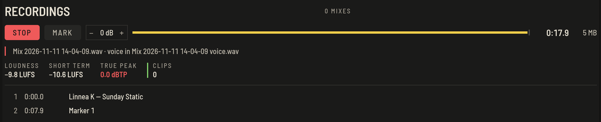

Drücke den runden Aufnahmeknopf neben dem Master-Pegel (oder `⌘Return`, oder die Aufnahmetaste am Controller), um den Master-Ausgang aufzunehmen. Ein zweiter Druck stoppt.

## Während der Aufnahme

**AUFNAHME** in der oberen Leiste startet und stoppt eine Aufnahme; sie wird rot mit der laufenden Zeit. Die kleine Taste daneben zeigt den Aufnahmebereich: Pegel, Anzeige, verstrichene Zeit und Dateigröße, und die Trackliste, die mitwächst. Tracks kommen hinzu, sobald sie hörbar werden. Der Aufnahmepegel reicht von −12 bis +12 dB.

Die Datei auf der Festplatte ist jederzeit ein vollständiges WAV und wird jede Sekunde nachgeführt. Stürzt die App oder der Rechner ab, behält die Aufnahme alles bis zum Absturz und erscheint beim nächsten Start von OpenDJDecks mit ihrer Trackliste unter Aufnahmen. Siehe [Sicher durch das Set](set-safety.md#nach-einem-absturz).

## Nach der Aufnahme

Öffne **Aufnahmen** über die Leiste **AUFNAHMEN**: Jeder Mix steht dort mit seiner Datei. Direkt dort:

- **DATEI ZEIGEN** öffnet sie im Dateimanager.
- **IN TRACKS TEILEN** schneidet sie in eine Datei pro gespieltem Track.

## Format, Ordner und Automatik

Unter **Einstellungen › Aufnahme**:

- **Format**: WAV wird direkt aufgenommen; FLAC (bit-genau) oder MP3 (320 kbit) werden beim Stoppen encodiert.
- **Ordner** und **Dateiname**: Im Namen kannst du `{date}`, `{time}` und `{n}` (Nummer des Tages) nutzen.
- **Aufnahmepegel**, auch im Aufnahmebereich.
- **Teilen** in eine Datei pro Track beim Stoppen.
- **Start**: Aufnahme starten, sobald Ton kommt. Der Master muss zwei Sekunden Ton führen. **Stopp** beendet sie nach 30 Sekunden Stille. Ein Stopp von Hand schaltet die Automatik bis zum nächsten App-Start aus.

## Die Trackliste

Jede Aufnahme bekommt die Trackliste auch als `.cue`-Datei und als Text, bereit zum Einfügen bei Mixcloud oder SoundCloud. Zeiten und Titel kommen aus dem, was wirklich hörbar war.
