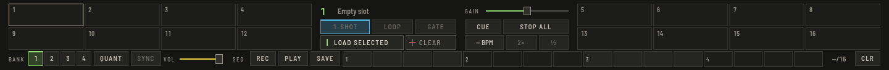

Drücke **SAMPLER** in der oberen Leiste (`⌥⌘S`), um das Panel zwischen Mixer und Browser zu öffnen.

Der Sampler bleibt sichtbar: Wenn einem kleinen Fenster der Platz für die unteren Bereiche von Perform ausgeht, weicht der Tempo-FX-Bereich oder die Mix-Vorschau (die Statusleiste sagt, welcher), nie der Sampler.

## Samples laden

Wähle einen Track im Browser und drücke **AUSGEWÄHLTEN LADEN** an einem Slot, oder ziehe einen Track auf ein Pad. Slots werden mit deiner Bibliothek gespeichert und sind beim nächsten Audiostart wieder da.

Es gibt sechs Banken mit je 16 Slots; **BANK** schaltet um (`⇧R` und `⇧T`). Die Banken 1 bis 4 gehören dir. **MELODY** enthält die aus CREATE gesendeten Töne und **DRUMS** das Kit und die Samples der Drum-Maschine; beide spielst du wie jede andere Bank.

## Spielen

Klicke ein Pad oder drücke die Tasten `X C V B M , . /` für Slots 1 bis 8. **ALLE STOP** (`⇧P`) stoppt alles.

Wähle einen Slot, um seinen Modus zu setzen:

- **1-SHOT** spielt einmal bis zum Ende.
- **LOOP** wiederholt bis zum Stoppen.
- **GATE** spielt nur, solange das Pad gehalten wird.

**QUANT** startet Pads auf dem nächsten Beat des Masters, **SYNC** folgt dem Master-Tempo (mit **÷2** und **×2** für einen Slot, der mit falschem Tempo erkannt wurde). **GAIN** gilt pro Slot, **VOL** für den ganzen Sampler. **CUE** schickt ihn auf den Kopfhörer.

Vom Deck spielt der Pad-Modus **SAMPLER** die Slots: ungerade Decks Pads 1 bis 8, gerade Decks 9 bis 16.

Der Pad-Modus **MELODY** spielt auf jedem Deck die aus CREATE gesendeten Töne: Die Pads A bis H spielen die acht Töne, und ‹ › neben dem Modus schaltet auf die Oktave darüber. **QUANT** startet einen Ton auf dem nächsten Beat; ein Ton behält bei jedem Master-Tempo seine Tonhöhe. Solange nichts gesendet wurde, bleiben die Pads umrandet und die Leiste sagt es.

## Sequencer

Die Zeile unten im Panel zeichnet das Pattern des gewählten Slots in 16 Schritten. Klicke Schritte an. **PLAY** (`⇧O`) startet es, am Master-Beat ausgerichtet, und **REC** nimmt Pads ins Pattern auf, während es läuft. **CLR** löscht das Pattern des gewählten Slots. Swing und halbes Tempo stellst du in der Drum-Maschine von CREATE ein; sie gelten für den ganzen Sequencer.

**SPEICHERN** legt die Patterns aller Slots mit Swing und halbem Tempo auf das nächste freie Pad des Pad-Modus **PATTERN**. Gespeicherte Patterns bleiben nach einem Neustart erhalten. In diesem Modus ruft ein belegtes Pad die Patterns ab und startet den Sequencer; **Umschalt** plus Pad löscht es.
