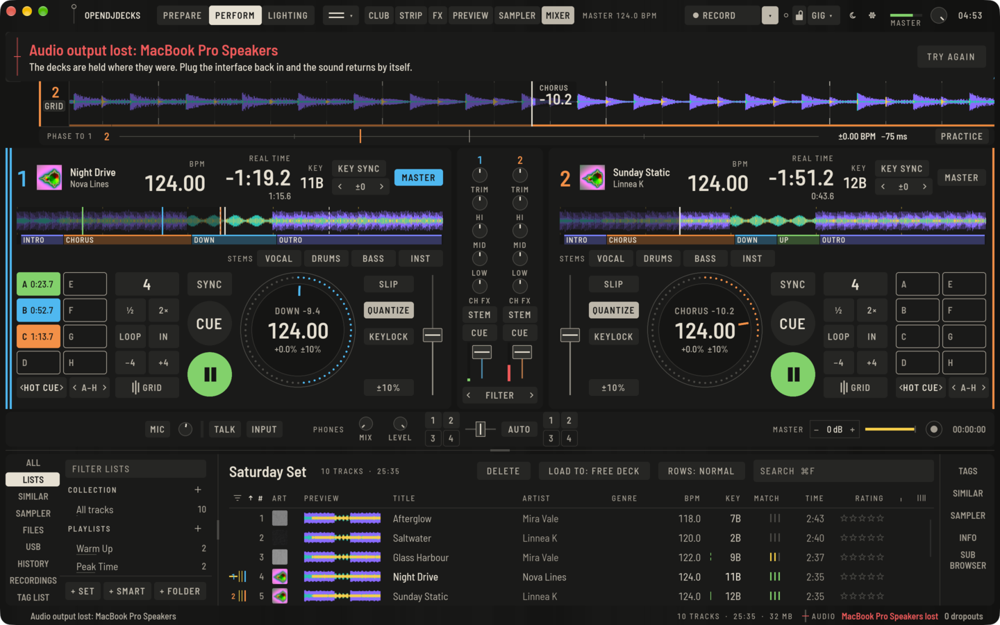
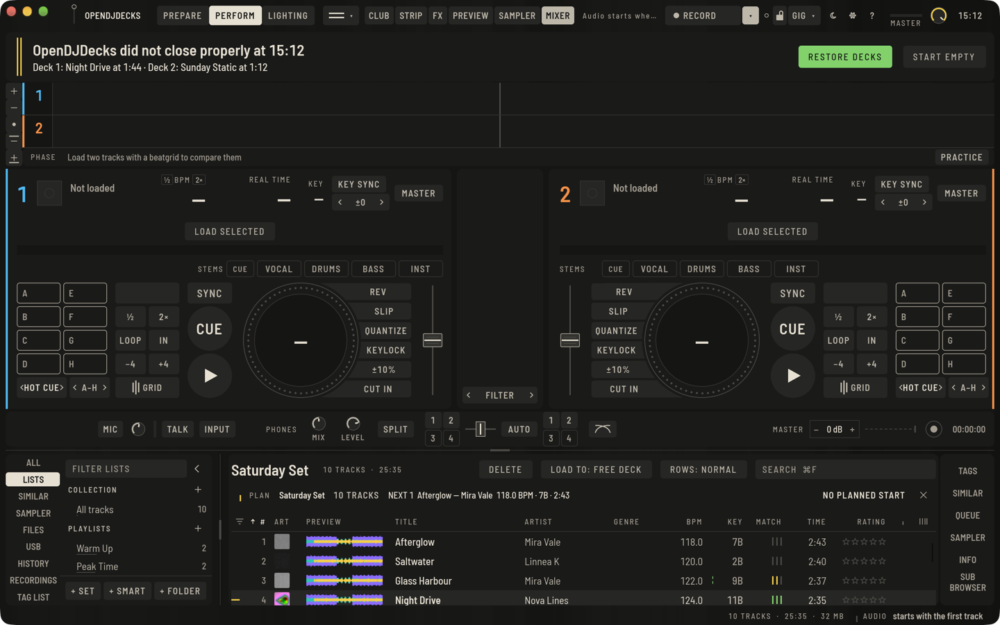
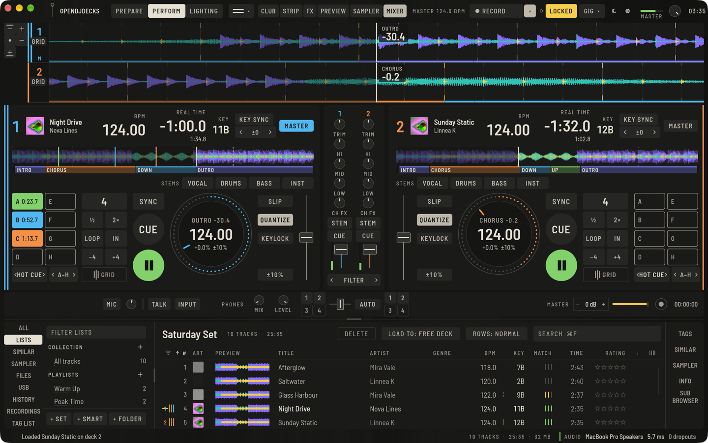

OpenDJDecks behält die Dinge im Blick, die ein Set vorzeitig beenden können. Diese Seite erklärt, was es zeigt und was du tun kannst.

## Die Audiozeile

Die Statusleiste unten rechts zeigt immer **AUDIO**, den Ausgang, der spielt, seine Latenz in Millisekunden und die bisherigen Aussetzer. Die Linie davor zeigt den Zustand auf einen Blick:

| Linie | Bedeutung |
|---|---|
| Durchgehend grün | Der Ton läuft ohne Aussetzer |
| Gestrichelt gelb | Ein Aussetzer in den letzten 20 Sekunden |
| Durchgestrichen | Das Gerät ist verloren |
| Halbe Höhe | Der Ton läuft noch nicht; er startet mit dem ersten Track |

Kommen immer wieder Aussetzer, erhöhe die Puffergröße unter **Einstellungen › Audio**. Gerät, Puffergröße und Kopfhörerausgang gelten dort sofort, ohne Neustart. Nur eine neue Samplerate wartet auf den nächsten Start.

## Wenn das Audiointerface verloren geht

Wird das Interface ausgesteckt oder hört es auf zu arbeiten, erscheint sofort ein rotes Band unter der oberen Leiste und nennt das Gerät. Die Decks warten, wo sie waren: Tracks, Positionen, Loops und der Mixer bleiben, wie sie sind.

- Steck das Interface wieder ein: Der Ton kommt von selbst auf demselben Gerät zurück.
- **AUSGANG WECHSELN** spielt sofort auf dem eigenen Ausgang des Rechners weiter.
- **NOCHMAL VERSUCHEN** öffnet das verlorene Gerät noch einmal.

Ein Gerät gilt als verloren, wenn das System es als weg meldet oder wenn es anderthalb Sekunden lang keinen Ton mehr angefordert hat.

Getestet wurde das mit einem simulierten Gerät, das so ausfällt wie ein ausgestecktes Interface. Mit einem echten Interface, das auf jedem System ausgesteckt wird, ist es noch nicht geprüft.

## Der Gig-Check

Öffne das Menü neben **GIG** in der oberen Leiste und drücke **GIG-CHECK STARTEN**, oder wähle **Ansicht › Gig-Check** (`⌥⇧⌘C`, unter Linux und Windows `Strg+Alt+Umschalt+C`). Ein Band zeigt vier Ergebnisse:

- **AUDIOAUSGANG**: das Gerät, seine Latenz, ob Master und Kopfhörer beide einen Ausgang haben, und die bisherigen Aussetzer.
- **CONTROLLER**: der verbundene Controller.
- **PLATZ FÜR AUFNAHME**: freier Platz dort, wo Aufnahmen landen, und wie viele Stunden Aufnahme etwa hineinpassen.
- **TRACKDATEIEN**: Tracks der Bibliothek, deren Datei fehlt.

Eine durchgehend grüne Linie ist bereit, eine gestrichelte ist einen Blick wert, eine durchgestrichene musst du vor dem Spielen beheben. **ERNEUT PRÜFEN** prüft noch einmal, **SCHLIESSEN** blendet das Band aus.

## Nach einem Absturz

Während du spielst, schreibt OpenDJDecks den Zustand der Decks einmal pro Sekunde neben deine Bibliothek: die Tracks, ihre Positionen, Tempo und Bereich, Keylock, Tonartverschiebung, Sync, Loops und den Mixer. Es schreibt eine neue Kopie und tauscht sie dann aus, sodass ein Absturz in jedem Moment einen vollständigen Zustand hinterlässt.

Wurde die App nicht richtig beendet, bietet der nächste Start ihn in einem Band unter der oberen Leiste wieder an:

- **DECKS WIEDERHERSTELLEN** lädt die Tracks dorthin, wo sie waren, mit Tempo, Loops und Mixer, und öffnet Perform. Die Decks warten auf **PLAY**.
- **LEER STARTEN** lässt die Decks leer.

Eine laufende Aufnahme bleibt in jedem Fall erhalten. Ihre Datei wird bis zum Moment des Absturzes vervollständigt und mit der bisherigen Trackliste unter Aufnahmen aufgeführt. Das Band sagt, wie lang sie ist.

## Die Sperre für das Set

**SPERREN** in der oberen Leiste (oder **Ansicht › Für das Set sperren**, `⌥⇧⌘K`, unter Linux und Windows `Strg+Alt+Umschalt+K`) wird zu einem gelben **GESPERRT**. Solange sie an ist:

- Auf ein spielendes Deck wird kein Track geladen. Ein gestopptes Deck lädt weiterhin, aus der Liste, per Ziehen oder vom Controller.
- Nichts wird gelöscht: keine Liste, keine Tracks aus einer Liste oder der Sammlung, kein Hot Cue oder Memory Cue, kein registrierter Stick.
- Kein Beatgrid ändert sich: Die Taste GRID öffnet nicht, und Grid-Tasten, Tap-Tempo und Analysesperre tun nichts.

Was gesperrt ist, sagt es in der Statuszeile. Ein Klick auf **GESPERRT** entsperrt.

## Während Decks spielen

Solange ein Deck in Perform spielt, und noch fünf Sekunden nachdem das letzte gestoppt hat:

- Rechner und Bildschirm bleiben wach. macOS und Windows werden direkt darum gebeten; unter Linux geschieht das über `systemd-inhibit`, und auf einem System ohne es kann der Bildschirm trotzdem dunkel werden, stelle die Energieeinstellungen dort von Hand ein.
- Hintergrundarbeit wartet: die automatische Analyse, das Trennen von Stems für einen Stapel Tracks und die automatische Stick-Synchronisation. Ein Track, den du von Hand analysieren lässt, läuft trotzdem, und die Stems eines Tracks auf einem Deck werden weiter getrennt.

Das gilt, ob die Sperre an ist oder nicht.
