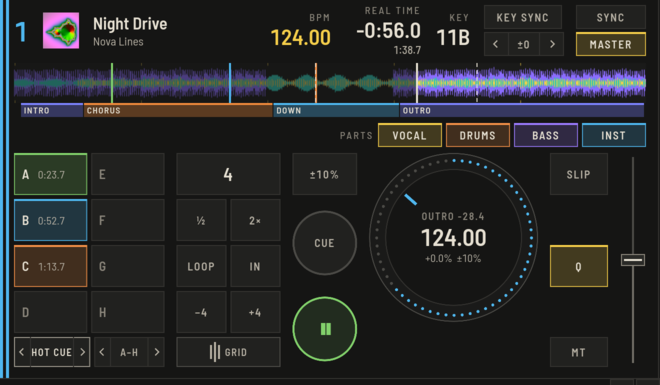
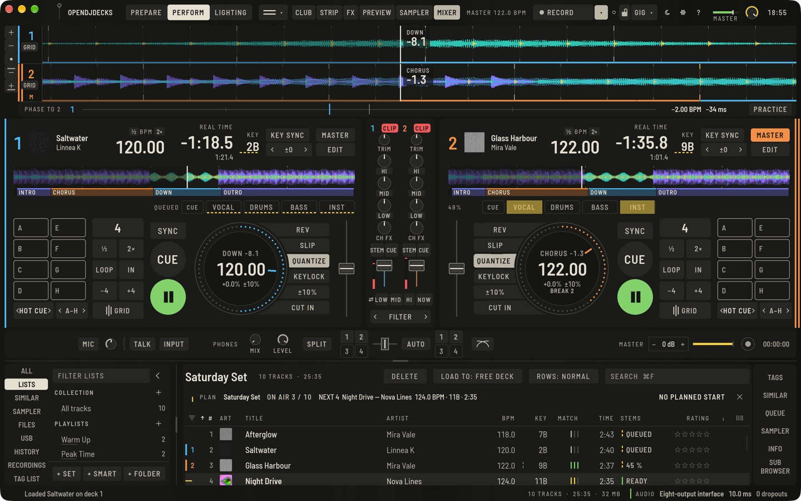
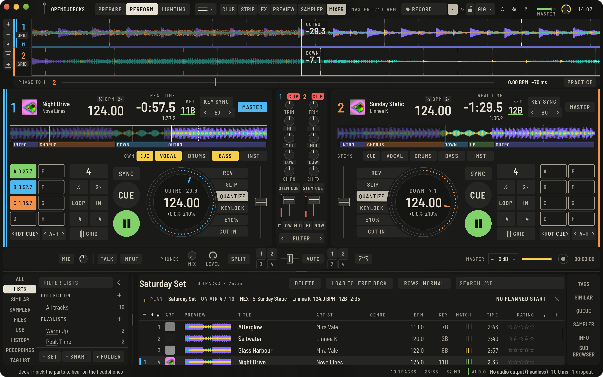

OpenDJDecks kann einen Track in vier Stems trennen: Vocals, Instrumente, Drums und Bass. Das passiert auf deinem eigenen Rechner, im Hintergrund, und nichts verlässt den Computer. Beim ersten Mal wird einmalig ein Modell geladen; danach geht es offline.

## Tracks trennen

Es gibt zwei Wege:

- **Beim Laden:** Sobald das [Modell installiert ist](#der-einmalige-download-des-modells), lade einen Track auf ein Deck. Er spielt wie immer; die Leiste über den Pads zeigt **SPLIT** und einen Prozentwert, während die Stems entstehen. Die Stem-Tasten bleiben an ihrem Platz, gedimmt, bis die Stems da sind, und du kannst die ganze Zeit spielen.
- **Im Voraus:** Wähle in Prepare Tracks, Rechtsklick, **Stems trennen** (`⌥⇧⌘S`). Das läuft im Hintergrund, und das Band unten zeigt den Fortschritt.

## Stems fertig vor dem Gig

Ab Version 0.8 bereitest du ein ganzes Set vor. Öffne die Playlist oder das Set, klicke einen beliebigen Track mit rechts an und wähle **Stems für die ganze Liste trennen**, oder nimm **Ablage › Stems für diese Liste trennen** (`⌥⇧⌘P`). Jeder Track der Liste kommt im Hintergrund in die Warteschlange; Tracks, die ihre Stems schon haben, werden übersprungen. Solange ein Deck spielt, wartet die Warteschlange, damit das Trennen nie mit deinem Mix konkurriert, und ein Track, der auf einem Deck liegt, wenn seine Stems fertig sind, übernimmt sie ohne Lücke.

Damit du siehst, wo jeder Track steht, schalte die Spalte **STEMS** ein (Rechtsklick auf die Spaltenköpfe):

- **BEREIT** mit einer durchgehenden grünen Linie: Die Stems sind auf diesem Rechner.
- **WARTET**, oder ein Prozentwert, während er getrennt wird, mit einer gestrichelten gelben Linie.
- **FEHLER**, durchgestrichen: Die Statuszeile sagt, warum.
- Leer: nicht getrennt.

Die Stem-Tasten am Deck sagen dasselbe: **WARTET** mit einer gestrichelten gelben Linie an jeder Taste, solange der Track auf seine Reihe wartet, und die Tasten füllen sich von links nach rechts, während er getrennt wird. Ein Track, den ein Deck selbst trennt, steht ebenfalls in der Spalte.

Lädst du einen Track ohne Stems dort, wo Stems in Gebrauch waren (der Track davor hatte welche, oder ein anderes Deck spielt mit Stems), warnt dich das Deck: Die Leiste sagt gelb **KEINE STEMS**, eine gelbe Linie liegt unter den Tasten, und die Statuszeile sagt, was zu tun ist. Drück eine Stem-Taste, um ihn sofort zu trennen, oder bereite die Liste vor dem nächsten Gig vor.

## Die Stems am Deck benutzen

Jedes Deck hat **VOCAL**, **INST**, **DRUMS** und **BASS** unter der Wellenform.

- Ein Klick schaltet den Stem stumm oder laut. Gefüllt heißt stumm.
- Ein Rechtsklick auf eine Taste schaltet sie **solo**: Die anderen Stems verstummen, und die Leiste sagt **SOLO**. Ein zweiter Rechtsklick bringt sie genau so zurück, wie sie waren. Auch ein Klick auf eine beliebige Stem-Taste beendet das Solo.
- ⇧-Klick auf eine Taste **behält nur diesen** Stem: Die anderen werden stumm und bleiben stumm, als hättest du jeden einzeln angeklickt.
- Das Mausrad über einer Taste stellt den Pegel des Stems ein; die Linie unter der Taste zeigt ihn.

Am Controller schaltet `deck.stem_solo` einen Stem solo, solange die Taste gehalten wird, `deck.stem_keep` behält nur diesen Stem und `deck.stem_cue` legt ihn auf den Kopfhörer ([Controller-Mappings](../../controller-mappings.md)). Solo und Nur-diesen sind in der App getestet, an einem Hardware-Controller noch nicht ausprobiert.

## Stems auf dem Kopfhörer vorhören

Ab Version 0.9 kannst du einen einzelnen Stem oder ein paar davon auf dem Kopfhörer vorhören, während der Master unverändert weiterläuft.

- **Am Deck:** Drücke **CUE** vor den Stem-Tasten. Die Stem-Tasten wählen dann, was du auf dem Kopfhörer hörst: Eine gefüllte Taste liegt auf dem Kopfhörer, allein und mit vollem Pegel, auch wenn dieser Stem auf dem Master stumm ist. Drücke **CUE** noch einmal, um wieder stummzuschalten; das Vorhören endet. Solange ein Deck Stems vorhört, tritt sein Kanal-**CUE** am Mixer dafür zurück. Die **CUE**-Taste sitzt auf der vollen Stem-Leiste; die kompakten Decks eines kleinen Fensters und vier Decks überlassen sie einem Controller (`deck.stem_cue` mit einem `stem`, ein Druck nimmt diesen Stem dazu oder weg).
- **In Prepare:** Der Player hat einen Reiter **STEMS**. Spiele den Track ab und drücke **VOCAL**, **DRUMS**, **BASS** oder **INST**, um ihn auf dem Kopfhörer zu hören. Die Zeile neben den Tasten sagt, woher die Stems kommen (**GETRENNT** oder **EIGENE DATEIEN** mit dem Ordner), und **TRENNEN** fordert sie an, wenn es keine gibt.

Dafür brauchst du einen Kopfhörerausgang ([Einstellungen › Audio](preferences.md#audio)); ohne einen sagt es die Statuszeile. Getestet in der Engine mit erzeugten Parts (der Master bleibt bis aufs Sample gleich, der Cue trägt nur die gewählten Stems) und in der App; mit einem Controller oder auf einem Gig noch nicht ausprobiert.

## Deine eigenen Stem-Dateien

Wenn du für einen Track schon Stems hast (aus einer Produktion, einem Remix-Paket oder einem Shop), nimmt OpenDJDecks sie, statt zu trennen. Lege sie neben den Track, entweder

- in einen Ordner, der wie der Track heißt: `Night Drive.stems`, `Night Drive stems`, `Night Drive_stems` oder `Night Drive (stems)`, mit Dateien, die nach ihrem Part heißen (`vocals.wav`, `Drums.flac`, `03 bass.wav`); oder
- neben den Track, beginnend mit seinem Namen: `Night Drive - Vocals.wav`, `Night Drive_drums.flac`, `Night Drive (bass).aiff`.

Die Part-Wörter sind vocals (auch vocal, vox, voice), drums (drum, percussion), bass und other (inst, instrumental, music, melody). Gelesen werden WAV, FLAC und AIFF. Vocals, Drums und Bass müssen alle da sein, mit der Abtastrate des Tracks und höchstens eine halbe Sekunde länger oder kürzer (etwas Kürzeres wird aufgefüllt, etwas Längeres gekürzt). Der vierte Stem bleibt der Track minus die anderen drei, wie bei getrennten Stems; eine "other"-Datei wird also geprüft, aber nicht gespielt.

Lädt ein Deck so einen Track, kommen seine Stems sofort aus deinen Dateien, die Leiste sagt **EIGENE** und die Statuszeile nennt den Ordner. Dateien, die nicht passen, bleiben weg, mit dem Grund in der Statuszeile (zum Beispiel `drums ist 4.0 s lang, der Track 9.0 s`), und der Track nimmt getrennte Stems, falls es welche gibt. Getestet mit erzeugten Dateien, nicht mit Stems aus einer echten Veröffentlichung.

Zum Mischen drücke **STEM** an einem Mixer-Kanal: **HI** wird zu den Vocals, **MID** zu den Instrumenten und **LOW** zu den Drums. Der Pad-Modus **STEMS** legt dir die Stem-Mutes und Stem-Effekte auf die Pads.

Auf der Übersicht sind Stellen, an denen gesungen wird, als Band oben gezeichnet, damit du siehst, wo du mischen kannst.

Einen Effekt nur auf einen Stem legen: siehe [Stem FX](effects.md#stem-fx).

## Stems auf dem Stick und am Raspberry Pi

Nutzt ein Stick das OpenDJDecks-Format, werden die Stems beim Sync mit kopiert. Tracks von diesem Stick benutzen sie, und so spielt der Raspberry Pi Stems, die auf dem Laptop getrennt wurden, ohne die Arbeit selbst zu machen.

## Der einmalige Download des Modells

Ab Version 0.7 fragt OpenDJDecks, bevor etwas heruntergeladen wird. Das Trennmodell (etwa 158 MB) ist nicht Teil der App. Wenn du ohne Modell zum ersten Mal eine Stem-Taste drückst, einen Mixer-Kanal auf **STEM** stellst oder **Stems trennen** wählst, sagt dir ein Dialog, was gebraucht wird, und bietet **JETZT LADEN** und **JETZT NICHT** an. Deine Musik bleibt auf deinem Computer; nur das Modell kommt einmalig herunter, danach funktionieren Stems ohne Internet.

Während ein Deck spielt oder ein Mix aufgenommen wird, deckt kein Dialog den Bildschirm zu. Ein schmaler Hinweis unter der oberen Leiste bietet den Download an, der Dialog folgt, sobald die Musik stoppt. **JETZT NICHT** gilt für den Rest der Sitzung: Von selbst fragt nichts mehr, und ein Druck auf eine Stem-Taste bringt den Hinweis mit dem Download zurück.

Der Download läuft im Hintergrund, der Fortschritt steht im selben Hinweis, und du kannst weiterspielen. **ABBRECHEN** stoppt ihn, das nächste **HERUNTERLADEN** macht an dieser Stelle weiter. Die Prüfsumme des Modells wird geprüft, bevor es benutzt wird. Alles Weitere steht unter **Einstellungen › Analyse › Stems**, auch die Größe auf der Festplatte und **MODELL ENTFERNEN**. Das Entfernen des Modells entfernt bereits getrennte Stems nicht.

Der Raspberry Pi und der Kiosk laden das Modell nicht herunter; ihre Stems werden auf einem Desktop-Computer getrennt und kommen über den Stick.

## Der Download ist abgebrochen und Stems funktionieren nicht

Ab Version 0.7 lässt ein abgebrochener Download Stems nicht dauerhaft kaputt zurück, und du musst nichts von Hand tun. Der Hinweis unter der oberen Leiste sagt, was passiert ist, und bietet **NOCHMAL** und **HILFE** an. Ist er weg oder gehen Stems weiterhin nicht:

1. Öffne **Einstellungen › Analyse**. Im Abschnitt **Stems** steht als Status **Unvollständig** oder **Beschädigt**.
2. Bei **Unvollständig** drücke **HERUNTERLADEN**: Der Download macht an der Stelle weiter, an der er stehen blieb.
3. Hilft das nicht oder steht dort **Beschädigt**, drücke **LÖSCHEN UND NEU LADEN**. Das entfernt zuerst jede unvollständige, beschädigte oder alte Modelldatei und beginnt von vorn.
4. Warte, bis als Status **Installiert** steht, und drücke dann noch einmal eine Stem-Taste. Tracks, die schon auf einem Deck liegen, werden automatisch getrennt.

Stand im Hinweis **Keine Internetverbindung**, prüfe zuerst dein Netzwerk. Stand dort, dass **nicht genug Platz** auf der Festplatte ist, schaffe Platz und drücke **NOCHMAL**. Das Entfernen oder erneute Laden des Modells rührt bereits getrennte Stems nie an.
