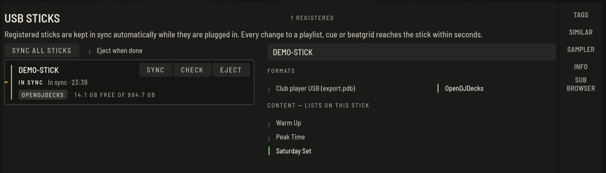
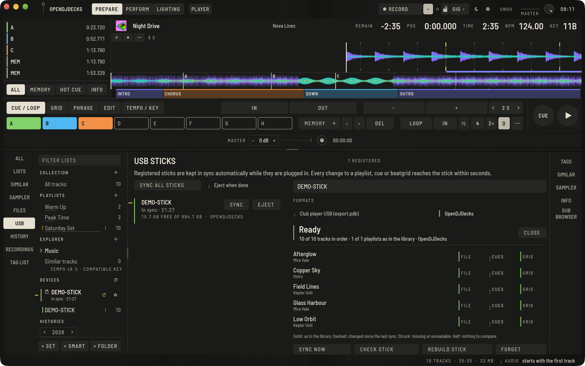

Der Stick ist ein Spiegel deiner Bibliothek. Registriere ihn einmal mit den Listen, die darauf gehören, und jeder geänderte Cue, jede Playlist und jedes Grid ist innerhalb von Sekunden auf dem Stick, solange er steckt. Es gibt keinen Export-Schritt, an den du denken musst.

## Einen Stick registrieren

1. Stecke den Stick ein. Er erscheint unter **GERÄTE** im Baum (oder in der Leiste **USB**).
2. Wähle die Playlist, das Set oder den Ordner aus, der darauf soll.
3. Drücke **MIT … REGISTRIEREN**. Der erste Sync schreibt alles einmal, danach nur Änderungen.

Das Stick-Board zeigt eine Zeile pro Stick:

- seinen **Namen**, mit einem Abzeichen für jedes Format, das er trägt: **CLUB-USB** (mit **WAV**, wenn maximale Kompatibilität an ist) und **OPENDJDECKS**;
- seinen **Sync-Zustand** in Worten neben seiner Linie: **SYNCHRON** (durchgezogen grün), **ÄNDERUNGEN OFFEN** (gestrichelt gelb), **SYNC LÄUFT 45 %** (die Linie füllt sich), **SYNC FEHLGESCHLAGEN** (durchgestrichen rot, mit dem Grund) oder **NICHT EINGESTECKT** (halbe Linie);
- den freien Platz und rechts seine Tasten.

Die Tasten eines eingesteckten Sticks:

- **SYNC** (`⌘S`) synchronisiert sofort. Von selbst startet der Sync ohnehin wenige Sekunden nach jeder Änderung.
- **PRÜFEN** liest den Stick zurück und vergleicht ihn mit deiner Bibliothek; siehe [Einen Stick vor dem Gig prüfen](#einen-stick-vor-dem-gig-pruefen).
- **AUSWERFEN** (`⌘E`) wirft ihn sicher aus. Warte darauf, bevor du ihn ziehst.

Ein Klick auf eine Zeile öffnet den Stick rechts, mit Name, Formaten und Listen. Dort:

- **STICK NEU SCHREIBEN** schreibt den ganzen Stick neu aus deiner Bibliothek.
- **VERGESSEN** beendet das Synchronisieren dieses Sticks.

## Alle Sticks auf einmal synchronisieren (ab Version 0.6)

Mehrere Sticks zu befüllen, etwa Backups für eine Tour? Stecke alle ein und öffne die Stick-Übersicht:

1. Drücke **ALLE STICKS SYNCHRONISIEREN**. Jeder eingesteckte Stick wird gleichzeitig synchronisiert, jeder mit einer eigenen Fortschrittslinie.
2. Mit **Nach dem Sync auswerfen** wirft sich jeder Stick selbst aus, sobald er fertig ist, so kannst du sie einzeln abziehen. Diese Einstellung bleibt, bis du sie wieder ausschaltest.

Läuft bei einem Stick etwas schief, zum Beispiel weil er voll ist, erscheint der Fehler nur bei diesem Stick, die anderen laufen weiter. Ein Stick mit Fehler wird nicht ausgeworfen, damit du die Meldung lesen und es erneut versuchen kannst.

Der kleine Sync-Pfeil neben **GERÄTE** im Baum macht dasselbe mit derselben Einstellung.

## Was auf dem Stick liegt

Unter **INHALT — LISTEN AUF DIESEM STICK** wählst du die Listen. Der Stick trägt deine Musik mit Cues, Beatgrids, Phrasen und, falls vorhanden, den getrennten Stems für Stems. Sticks werden von OpenDJDecks gelesen, etwa auf einem anderen Rechner oder der [Raspberry-Pi-Einheit](raspberry-pi.md). Damit ein Stick auch auf Club-Playern läuft, schalte unten das Club-Player-USB-Format ein.

## Direkt vom Stick spielen

Öffne einen Stick im Baum, um direkt von ihm zu stöbern und zu laden, schreibgeschützt. Das macht die Raspberry-Pi-Einheit den ganzen Tag.

## Auf Club-Playern spielen (Club-Player-USB)

Ab Version 0.6 kann ein Stick zusätzlich das Club-Player-USB-Format tragen, das mit Pioneer-DJ-Playern kompatibel ist. Das wählst du für jeden Stick einzeln: Stick auswählen und unter **FORMATE** **Club-Player-USB (export.pdb)** einschalten. Das eigene Format von OpenDJDecks bleibt standardmäßig an, beide können gleichzeitig aktiv sein.

Ist das Format an, schreibt jeder Sync zusätzlich die Datenbank und die Analyse, die die Player lesen, mit deinen Playlists, Cues, Beatgrids und Waveforms, und übernimmt deine Standard-Player-Einstellungen (Quantize, Auto Cue, Tempobereich, Jog-Modus, Sprache). Nur geänderte Tracks werden neu geschrieben. Ogg- und Opus-Dateien bleiben außen vor, weil Player sie nicht abspielen können.

### Maximale Kompatibilität für ältere Club-Player (ab Version 0.6)

Ältere Club-Player können FLAC und M4A (AAC, ALAC) oft nicht lesen. Hast du dafür einen Stick dabei, schalte für ihn **Maximale Kompatibilität (WAV für ältere Club-Player)** ein. Die Option erscheint unter **FORMATE**, sobald **Club-Player-USB** an ist, und gilt nur für diesen Stick.

Ist die Option an:

- Diese Tracks kommen als 16-Bit-WAV mit der Endung `.wav` auf den Stick. Sehr hochauflösende Tracks über 48 kHz werden dabei so verkleinert, dass sie überall laufen. MP3 und WAV bleiben, wie sie sind.
- Deine Originaldateien in der Bibliothek werden nie verändert.
- Ein Track wird nur einmal umgewandelt. Erneut umgewandelt wird er nur, wenn sich die Originaldatei ändert; wenn du Cues oder Beatgrid änderst, wird nur die Analyse auf dem Stick aktualisiert.
- Schaltest du die Option aus oder verlässt ein Track den Stick, wird seine WAV-Datei vom Stick entfernt.
- Eine WAV-Datei ist größer als das Original, plane also etwas mehr Platz auf dem Stick ein.

Trägt ein Stick zusätzlich das OpenDJDecks-Format, bleibt das Original neben der WAV-Datei liegen, sodass sich beim Abspielen in OpenDJDecks nichts ändert.

### Cues und Historien von den Playern

Ändert ein Player Cues auf dem Stick oder schreibt eine Historie, überschreibt OpenDJDecks das nicht. Beim nächsten Sync steht es auf dem Stick-Board unter **ÄNDERUNGEN AN PLAYERN — PRÜFEN**. **STICK-CUES ÜBERNEHMEN** holt die Cues des Players in deine Bibliothek, **BIBLIOTHEK BEHALTEN** behält deine und schreibt sie wieder auf den Stick; eine Historie kannst du als Playlist importieren oder verwerfen.

### Einen Stick von anderer Software importieren

Ab Version 0.6 liest **Ablage › Club-Player-USB importieren…** einen Club-Player-USB, den andere Software geschrieben hat: Tracks, Tags, Cues, Beatgrids, Phrasen, Playlists und die Historie. Wähle den Hauptordner des Sticks. Auf dem Stick ändert sich nichts; importierte Listen erscheinen in einem Ordner **Library import**.

## Einen Stick vor dem Gig prüfen

Wähle den Stick unter **Geräte** und drücke **STICK PRÜFEN**. OpenDJDecks liest den Stick zurück und vergleicht ihn mit deiner Bibliothek:

- für jeden Track: Die Audiodatei ist da und lässt sich als Audio öffnen (**DATEI**), die Cues sind deine (**CUES**), das Beatgrid ist deins (**GRID**);
- für den ganzen Stick: Jede Playlist enthält die Tracks der Bibliothek in deren Reihenfolge, die gewählten Formate sind da, und kein Sync wurde abgebrochen.

Beide Formate werden zurückgelesen, wenn der Stick sie trägt: die OpenDJDecks-Bibliothek und der Club-Player-USB-Export. Jede Markierung nutzt die Linienformen aus der Stick-Liste: durchgezogen heißt wie in der Bibliothek, gestrichelt heißt seit dem letzten Sync geändert, durchgestrichen heißt fehlt oder nicht lesbar, halb heißt es gibt nichts zu vergleichen (ein Track ohne Cues). Probleme stehen oben. Die Prüfung endet mit **Bereit** oder **Nicht bereit**; eine gestrichelte Markierung oder eine abweichende Playlist verschwindet mit **SYNC**.

Die Prüfung sagt dir, ob der Stick enthält, was die Bibliothek sagt. Ob ein bestimmtes Player-Modell den Stick annimmt, kann sie nicht sagen; dazu der nächste Abschnitt.

## Kompatibilität nach Player-Familie

Was ein synchronisierter Stick für welche Art von Player enthält und wie weit das bestätigt ist. Das Club-Player-USB-Format wird nach öffentlicher Formatdokumentation geschrieben. **Nichts davon ist bisher auf echten Club-Playern bestätigt**; diese Prüfung steht auf der Roadmap noch aus. Bis dahin: Probiere einen Stick vor dem Gig auf den Playern aus, die du benutzen wirst.

| Player-Familie | Hot Cues | Memory-Punkte | Beatgrid | Playlists | Stand |
|---|---|---|---|---|---|
| OpenDJDecks auf einem Rechner oder dem Raspberry-Pi-Gerät (OpenDJDecks-Format) | ja, alle Bänke, mit Farben und Loops | ja | ja | ja, mit Ordnern | von OpenDJDecks selbst geschrieben und zurückgelesen, in automatischen Tests und von der Stick-Prüfung |
| Aktuelle Club-Player, die Club-Player-USB mit erweiterter Analyse lesen | ja, mit Farben (`.EXT`) | ja | ja | ja, mit Ordnern | nach Formatdokumentation geschrieben, nicht auf Playern bestätigt |
| Ältere Club-Player, die nur die Grundanalyse lesen | ja, ohne Farben (`.DAT`) | ja | ja | ja, mit Ordnern | nach Formatdokumentation geschrieben, nicht auf Playern bestätigt; FLAC- und AAC/ALAC-Dateien brauchen **Maximale Kompatibilität** |
| Andere Software, die Club-Player-USB importiert | wie die importierende Software sie liest | | | | der eigene Import von OpenDJDecks liest es in automatischen Tests zurück; andere Software nicht geprüft |
