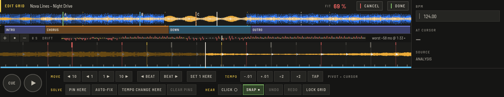
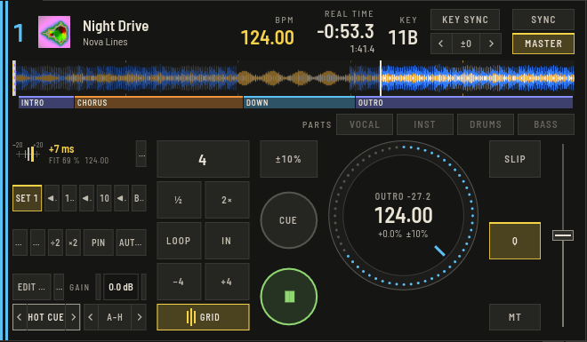

The analysis finds the tempo and the first beat of the bar automatically, and for most electronic music that is enough. When a grid is off, OpenDJDecks shows you where and fixes it with very little work.

## Quick fixes

In Prepare, the **GRID** tab of the player has the most common corrections:

- **÷2** and **×2** halve or double a wrong tempo.
- **SET 1 HERE** (`D`) makes the beat at the cursor the first beat of the bar.
- **◀ 1** and **1 ▶** nudge the grid by a millisecond.
- **LOCK GRID** (`L`) protects it from further changes and from a new analysis.
- Press `B` along with the beat to measure the tempo: from the fourth tap the grid follows.

## EDIT GRID

For anything harder, press **EDIT GRID** (`⇧G`), or **EDIT …** on the Perform deck's GRID panel. The player shows the detected kicks as long lines and the transients as short lines, and colours each beat tick by how far it is off them: within 5 ms, within 15 ms, or further.

The header shows a **FIT** score and a **DRIFT** strip across the whole track. Click the strip to jump there; the **worst** spot has its own link.

Everything in the session is undone together: **CANCEL** drops it and **DONE** keeps it as one undo step.

### Moving and tempo are separate

- **MOVE:** **◀ 10**, **◀ 1**, **1 ▶**, **10 ▶** nudge the whole grid in milliseconds; **◀ BEAT** and **BEAT ▶** shift it a beat; **SET 1 HERE** makes the beat at the cursor the 1 and sits it on its kick.
- **TEMPO:** **−.01**, **+.01**, **÷2**, **×2** and **TAP** change the tempo about the cursor, so the place you are looking at stays put.

You can also drag the grid with the mouse. It snaps to the kicks within 15 ms; hold `Alt` for no snap. Double-click a beat to make it the 1. The wheel scrolls and `⌘`-wheel zooms.

### Pins

A **PIN HERE** (`P`) says "this beat sits exactly here", snapped to its kick. One pin moves the whole grid. Put a second one far away, ideally near the end, and the tempo between them is solved. **CLEAR PINS** removes them and leaves the grid.

### AUTO-FIX

**AUTO-FIX** (`F`) corrects slip and tempo from the kicks of the section at the cursor. It also finds tempo jumps.

### Tempo changes

For live recordings and old records, **TEMPO CHANGE HERE** starts a new tempo at the cursor, measured from the kicks after it. Pins in between give piecewise tempos, and the bar count carries on. Tempo keys only change the section at the cursor.

### The click

**CLICK ●** (`C`) plays a metronome on the grid while the preview runs, higher on the 1. Listen in the headphones. **SNAP ●** (`S`) controls whether **SET 1**, **PIN** and dragging snap to the kicks.

### Keys in EDIT GRID

`←` `→` move by 1 ms, `⇧←` `⇧→` by 10 ms, `⌥←` `⌥→` by a beat; `↑` `↓` change the tempo by 0.01 BPM (`⇧` by 0.1); `1` sets the 1, `P` pins, `F` auto-fixes, `C` clicks, `S` snaps, `T` taps; `[` and `]` jump between problem spots; `Return` is **DONE**, `Esc` **CANCEL**, and `⌘Z` / `⇧⌘Z` undo within the session.

## Fix a grid while the track plays

Every Perform deck has a **GRID** key next to the pad mode. It swaps the pads for a panel that works while the track plays: a meter of how far the grid sits off the kicks (the median of the last eight beats), **FIT**, the tempo and **CLICK** in your headphones.

- **SET 1**: the kick you just heard (within ±60 ms) becomes the 1.
- **◀1 / 1▶ / ◀10 / 10▶ / ◀B / B▶** nudge and shift.
- **−.01 / +.01 / ÷2 / ×2** change the tempo about the playhead.
- **PIN** and **AUTO-FIX** work as in the editor. Two pins solve the tempo.
- **EDIT …** opens the track in the Prepare editor; **LOCK** protects it.
- **GAIN − / +** corrects the track's loudness by 0.5 dB.

Changes are stored at once and the decks follow without a gap; nudges within a second and a half are one undo step. On a controller the **TAP** button does the same as three taps: a constant grid at the tapped tempo.

## If the tempo keeps coming out wrong

Open **Preferences › Analysis › BPM range** and pick one that fits the music, then **Analyse** the track again. A locked grid is not touched by analysis.
