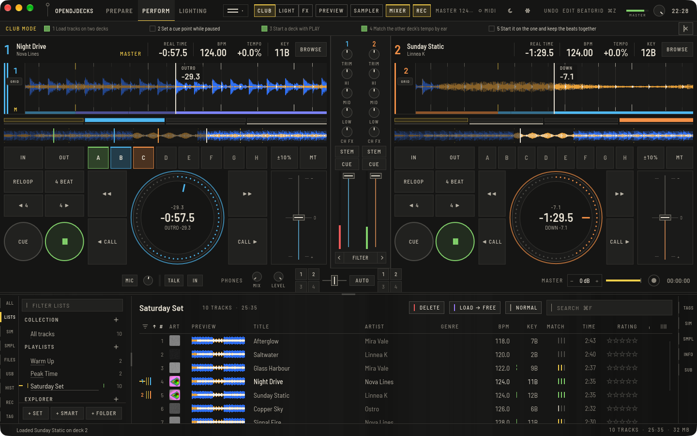

If you learned on a controller and want to be ready for club players, **CLUB** in the top bar (`⌥⌘J`) changes each deck into a player-style screen. On-screen sync is off, the players' cue rules apply, and a small checklist ticks itself off while you load, cue and beatmatch by ear.

## What is different

- Each deck shows a player screen: the waveform, an overview you can click to search, the jog display with the remaining time, bar counter and phrase, and a four-segment beat position below the waveform so you can line up two decks visually. **Preferences › View** can show the other deck's beat there too.
- **BROWSE** opens a player-style browser: source, then playlists, then tracks, from your library or a stick.
- Hot cues work with hold, memory cues are called with **CALL**, and **IN**, **OUT**, **RELOOP** / **EXIT**, **4 BEAT**, **JUMP**, the search keys ◀◀ and ▶▶, the tempo range and **MASTER TEMPO** are on screen.
- **No on-screen sync.** Tempo up is slower, as on a player.

## The checklist

**CLUB MODE** shows what to do next: load a track from the browser, set the cue, beatmatch by ear. Each step ticks when you have done it. **Hide the checklist** hides it.

This is a practice view: it trains the workflow you will use on a real club player.
