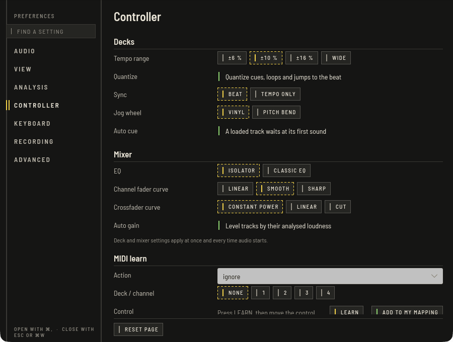
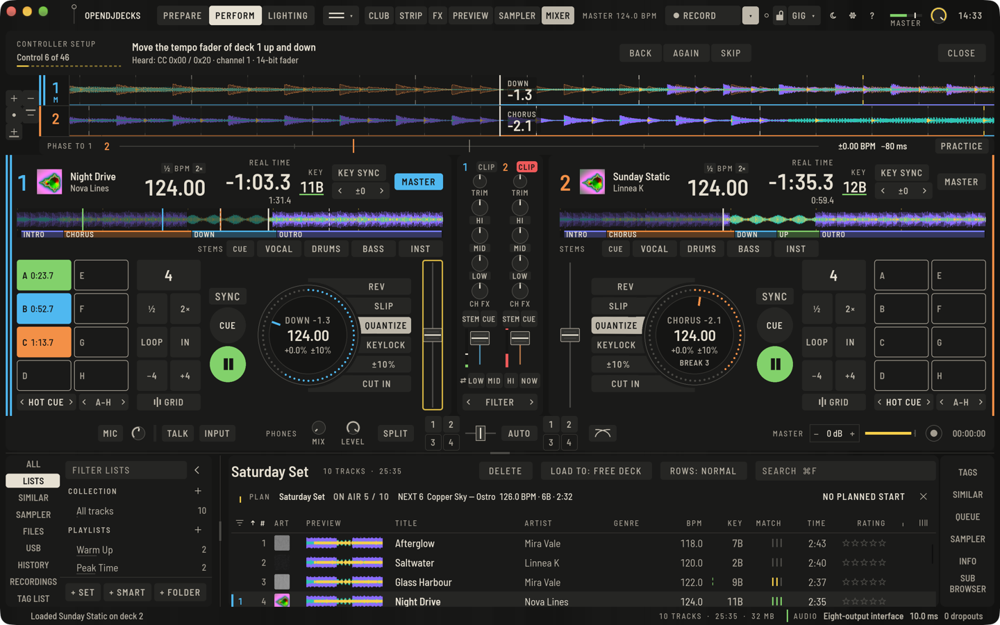
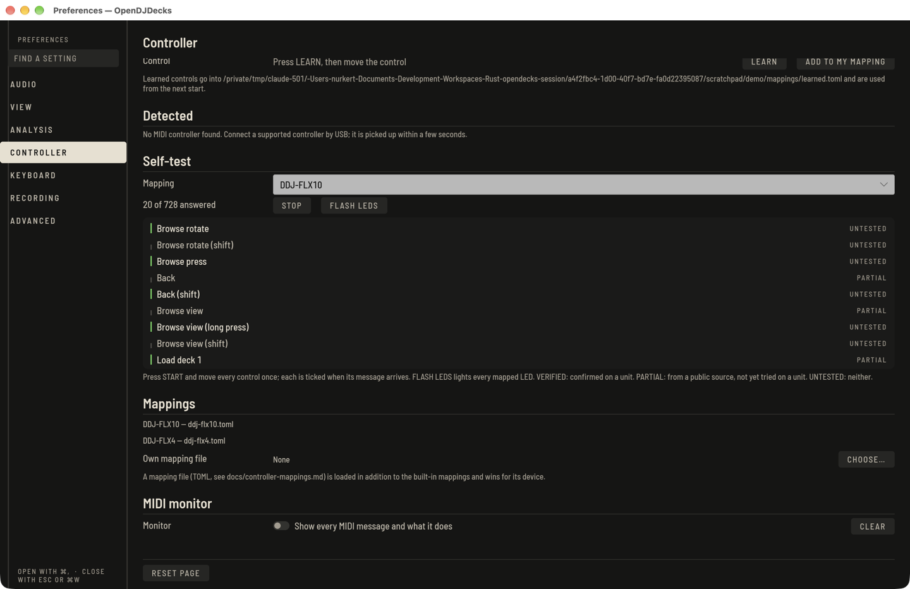

OpenDJDecks ships with mappings compatible with the Pioneer DJ DDJ-FLX10 and DDJ-FLX4, with LED feedback for play, cue, sync, master, key lock, slip, loop and the pads, and the VU meters. The mappings are not yet fully confirmed on real devices, so individual controls or LEDs may not work: try them before a gig. Connect a controller by USB; it is picked up within a few seconds, and its audio interface is used automatically (**Preferences › Audio › Output device**).

When you move a knob after a preset jumped, soft takeover makes sure the value only changes once the physical control has reached it.

## Controller list

Which controllers OpenDJDecks knows and how far each is confirmed. A model counts as **verified** only when every one of its controls has been confirmed on a real unit with OpenDJDecks. None has been yet: the DDJ-FLX10 row says **partly confirmed** for the controls checked on one unit, the others say **not confirmed**. Vendor and model names only say which hardware a mapping is meant to be compatible with.

<!-- controller-list:start (generated: cargo run -p od-controller --example hardware_status -- --write) -->

| Controller | Decks | Mapping | Recognised by | Status |
|---|---|---|---|---|
| compatible with DDJ-FLX10 | 4 | built in | MIDI port name `DDJ-FLX10` | partly confirmed: 12 verified, 117 partial, 147 untested |
| compatible with DDJ-FLX4 | 2 | built in | MIDI port name `DDJ-FLX4` | not confirmed: 0 verified, 126 partial, 47 untested |
| Any two-deck entry-level controller | 2 | guided setup, template `two-deck-entry` (76 controls) | the port of the unit you set up | not confirmed: your own capture, nobody else's unit |
| Any two-deck battle-style controller | 2 | guided setup, template `two-deck-battle` (74 controls) | the port of the unit you set up | not confirmed: your own capture, nobody else's unit |
| Any four-deck controller | 4 | guided setup, template `four-deck` (134 controls) | the port of the unit you set up | not confirmed: your own capture, nobody else's unit |
<!-- controller-list:end -->

Any other controller can be set up with the guided setup below, from one of three generic templates. More model mappings, for entry-level and battle-style controllers too, come from owners who capture their own unit with the guided setup and share the file. None of those is confirmed for other units yet. OpenDJDecks does not derive mappings from manufacturer manuals, MIDI charts, vendor software or other projects' mapping files.

## Guided setup for other controllers

For a controller without a mapping, press **SET UP A CONTROLLER** in **Preferences › Controller** (or **View › Controller Setup**). When you plug in a MIDI device OpenDJDecks has no mapping for, the status line names it and points here (not in CREATE, where a MIDI keyboard plays as it is). A band opens under the top bar:

1. Connect the controller by USB and choose what it is closest to: **2 DECKS · ENTRY LEVEL**, **2 DECKS · BATTLE** or **4 DECKS**. Press **START**.
2. The band asks for one control at a time: PLAY, CUE and SYNC, the jog wheel (touch, then turn), the tempo fader and LOAD of each deck, then the hot cue pads, the channel faders, TRIM and the EQ knobs, headphone CUE, the crossfader, the browse knob and the master and headphone levels. The matching control on screen gets the guide outline.
3. Move the control. **Heard** says what arrived; once the control rests for a moment the step is taken and the next one comes. A control that an earlier step already uses is refused with the number of that step. **SKIP** leaves out what your controller does not have, **BACK** goes one step back to learn it again, **AGAIN** forgets what arrived.
4. After the core controls the band asks whether to go on: **MORE CONTROLS** learns SHIFT, hot cue pads E to H, LOOP IN and OUT, the 4-beat loop, beat jump back and forward, KEY LOCK and SLIP of each deck, the CH FX knobs, the headphone mix, browse back and an effect on/off key and level, each one skippable. **SAVE NOW** goes straight to saving with the core controls.
5. At the end, give the controller a name and press **SAVE MAPPING**. The file is written next to your library in `mappings/`, becomes your own mapping file and is used from the next start. The battle-style template also sets the crossfader curve to **CUT**.

The file is an ordinary mapping file you can share. Every entry in it is marked as not confirmed (`verify = true`), because only your unit has been heard. While the setup, MIDI learn or the monitor runs, OpenDJDecks also opens MIDI inputs that no mapping knows; on some systems another program cannot use such a port at the same time. The guided setup has been tested with simulated MIDI messages, not yet with a real controller.

## Browse from the controller

Turn the browse encoder to move through the list. **BACK** moves the focus into the lists column, where turning steps through everything in it from top to bottom: the collection, playlists, the Explorer's folders, similar tracks, sticks, histories, recordings, the tag list, created tracks and AUTO SORT (hold shift to jump by eight). The column scrolls along. A press, or a deck's **LOAD**, goes one level in: a folder opens and its first entry is selected, a list hands over to its tracks. **BACK** goes one level out each time: from the tracks to their list, from an entry to the folder holding it, and an open folder closes. In the track list a press loads into a free deck, **LOAD** onto its deck, and shift-press adds to the tag list. A track you click with the mouse is the one **LOAD** loads. **VIEW** toggles the full browser in Prepare and the Browse layout in Perform.

When a controller with channel faders connects, its channels start closed, because the app cannot know where the faders are until they move: move each fader once. **PLAY** on a deck whose fader has not moved yet says so in the status line.

## MIDI learn

In **Preferences › Controller › MIDI learn**:

1. Choose an **Action** and, if it applies, a **Deck / channel**.
2. Press **LEARN**, then move the control.
3. The control is described and shown as a mapping line. Press **ADD TO MY MAPPING** to write it into your own mapping file, which is used from the next start.

**Own mapping file** adds a mapping on top of the built-in ones and wins for its device. `docs/controller-mappings.md` in the source describes the format; [the developer docs](../../controller-mappings.md) have the details.

## MIDI monitor

Turn on **Monitor** to see every incoming MIDI message and what it does, for example when you are working out what a control sends.

## Self-test before a gig

In **Preferences › Controller › Self-test**, check a controller before you rely on it:

1. Pick the controller under **Mapping**. A connected controller is picked for you.
2. Press **START** and move every control once: press each button and pad, turn each knob, move each fader and the jog wheels. Each control is ticked as soon as its message arrives. The count shows how many have answered.
3. Press **FLASH LEDS**. Every LED the mapping drives lights up for two seconds and then goes back to what the decks show. An LED that stays dark is not mapped correctly for your unit.

The self-test lists the controls of each deck separately, so its count is larger than the list below.

A control that stays unticked after you moved it does not reach OpenDJDecks the way the mapping expects. Turn on the **Monitor** to see what it sends instead, and report it with the monitor lines.

## Hardware status

Each mapped control has one of three states:

- **verified**: someone confirmed it on a real unit with OpenDJDecks.
- **partial**: the MIDI message comes from a public source, another project's working mapping, but nobody has tried it with OpenDJDecks on a unit yet.
- **untested**: there is no public source and no confirmation yet (`verify = true` in the mapping file).

A few DDJ-FLX10 controls are verified on one unit: browsing and loading, PLAY, headphone CUE, the channel fader, the platter and the deck switch. The other checks on real units are still open. For the four-deck mapping, the public source covers related models of the same family. The list below is generated from the mapping files, so it changes with them. The self-test above is how you find out for your own unit.

<!-- hardware-status:start (generated: cargo run -p od-controller --example hardware_status -- --write) -->

| Model | Controls | Verified | Partial | Untested |
|---|---|---|---|---|
| DDJ-FLX10 | 276 | 12 | 117 | 147 |
| DDJ-FLX4 | 173 | 0 | 126 | 47 |

### DDJ-FLX10

| Control | Kind | Status |
|---|---|---|
| Browse rotate | input | verified |
| Browse rotate (shift) | input | verified |
| Browse press | input | untested |
| Back | input | verified |
| Back (shift) | input | untested |
| Browse view | input | partial |
| Browse view (long press) | input | untested |
| Browse view (shift) | input | untested |
| Load deck 1 | input | verified |
| Load deck 2 | input | verified |
| Load deck 3 | input | partial |
| Load deck 4 | input | partial |
| Deck select | input | verified |
| Play/Pause | input | verified |
| Play/Pause (shift) | input | untested |
| Cue | input | partial |
| Cue (shift) | input | untested |
| Sync | input | partial |
| Sync (long press) | input | untested |
| Sync (shift) | input | untested |
| Key sync | input | partial |
| Key sync (long press) | input | partial |
| Key sync (shift) | input | partial |
| Tempo reset | input | partial |
| Tempo reset (shift) | input | partial |
| Shift | input | partial |
| Quantize | input | partial |
| Quantize (shift) | input | untested |
| Slip | input | partial |
| Slip (shift) | input | untested |
| Slip reverse | input | partial |
| Slip reverse (shift) | input | untested |
| Beat jump back | input | partial |
| Beat jump forward | input | partial |
| Beat jump back (shift) | input | partial |
| Beat jump forward (shift) | input | partial |
| Search back (long press) | input | partial |
| Search forward (long press) | input | partial |
| Memory cue call back | input | partial |
| Memory cue call forward | input | partial |
| Memory cue call back (shift) | input | partial |
| Memory cue call forward (shift) | input | partial |
| Mix point / part buttons | input | partial |
| Stem button 1 | input | untested |
| Stem button 2 | input | untested |
| Stem button 3 | input | untested |
| Tempo fader | input | untested |
| Tempo fader (shift) | input | untested |
| Jog touch | input | verified |
| Jog touch (shift) | input | untested |
| Jog scratch | input | untested |
| Jog top bend | input | verified |
| Jog side bend | input | verified |
| Jog search (shift) | input | untested |
| Loop in | input | partial |
| Loop in (loop active) | input | untested |
| Loop out | input | partial |
| Loop out (loop active) | input | untested |
| Loop out (shift) | input | partial |
| 4 beat loop | input | partial |
| 4 beat loop (shift) | input | untested |
| Trim | input | partial |
| EQ high | input | partial |
| EQ mid | input | partial |
| EQ low | input | partial |
| Part isolator vocals | input | untested |
| Part isolator inst | input | untested |
| Part isolator drums | input | untested |
| Channel fader | input | verified |
| CH FX knob | input | partial |
| Crossfader | input | untested |
| Master level | input | untested |
| Booth level | input | untested |
| Headphone mix | input | untested |
| Headphone level | input | untested |
| Headphone cue | input | verified |
| Headphone cue (shift) | input | untested |
| Master cue | input | untested |
| Master cue (shift) | input | untested |
| Crossfader assign A | input | untested |
| Crossfader assign THRU | input | untested |
| Crossfader assign B | input | untested |
| Input select / fader start 1 | input | untested |
| Input select / fader start 2 | input | untested |
| Input select / fader start 3 | input | untested |
| Fader start (play) | input | partial |
| Fader start (cue) | input | untested |
| CH FX select 1 | input | untested |
| CH FX select 2 | input | untested |
| CH FX select 3 | input | untested |
| CH FX select 4 | input | untested |
| CH FX select 5 | input | untested |
| CH FX select 6 | input | untested |
| CH FX select (shift) 1 | input | untested |
| CH FX select (shift) 2 | input | untested |
| CH FX select (shift) 3 | input | untested |
| CH FX select (shift) 4 | input | untested |
| CH FX select (shift) 5 | input | untested |
| CH FX select (shift) 6 | input | untested |
| FX part select 1 | input | partial |
| FX part select 2 | input | partial |
| FX part select 3 | input | partial |
| FX part select 4 | input | partial |
| FX part select 5 | input | partial |
| FX part select 6 | input | partial |
| Sampler volume | input | partial |
| Sampler cue | input | untested |
| Tempo FX beat down | input | untested |
| Tempo FX beat up | input | untested |
| Tempo FX auto beat (shift) | input | untested |
| Tempo FX tap (shift) | input | untested |
| Tempo FX select 1 | input | partial |
| Tempo FX select 2 | input | partial |
| Tempo FX select 3 | input | partial |
| Tempo FX select 4 | input | partial |
| Tempo FX select 5 | input | partial |
| Tempo FX select 6 | input | partial |
| Tempo FX select 7 | input | partial |
| Tempo FX select 8 | input | partial |
| Tempo FX select 9 | input | partial |
| Tempo FX select 10 | input | partial |
| Tempo FX select 11 | input | partial |
| Tempo FX select 12 | input | partial |
| Tempo FX select 13 | input | partial |
| Tempo FX select 14 | input | partial |
| Tempo FX channel 1 | input | partial |
| Tempo FX channel 2 | input | partial |
| Tempo FX channel 3 | input | partial |
| Tempo FX channel 4 | input | partial |
| Tempo FX channel master | input | partial |
| Tempo FX channel mic/sampler 1 | input | partial |
| Tempo FX channel mic/sampler 2 | input | partial |
| Tempo FX level | input | partial |
| Tempo FX on | input | untested |
| Tempo FX release (shift) | input | untested |
| Pad mode hot cue | input | untested |
| Pad mode keyboard (shift) | input | partial |
| Pad mode hold FX 1 | input | untested |
| Pad mode hold FX 2 (shift) | input | untested |
| Pad mode beat jump | input | untested |
| Pad mode beat loop (shift) | input | untested |
| Pad mode sampler | input | partial |
| Pad mode key shift (shift) | input | untested |
| Pad page left 1 | input | untested |
| Pad page left 2 | input | untested |
| Pad page left 3 | input | untested |
| Pad page left 4 | input | untested |
| Pad page right 1 | input | untested |
| Pad page right 2 | input | untested |
| Pad page right 3 | input | untested |
| Pad page right 4 | input | untested |
| Sampler bank down | input | untested |
| Sampler bank up | input | untested |
| Hot cue pad 1 | input | partial |
| Hot cue pad 2 | input | partial |
| Hot cue pad 3 | input | partial |
| Hot cue pad 4 | input | partial |
| Hot cue pad 5 | input | partial |
| Hot cue pad 6 | input | partial |
| Hot cue pad 7 | input | partial |
| Hot cue pad 8 | input | partial |
| Hot cue pad (shift) 1 | input | partial |
| Hot cue pad (shift) 2 | input | partial |
| Hot cue pad (shift) 3 | input | partial |
| Hot cue pad (shift) 4 | input | partial |
| Hot cue pad (shift) 5 | input | partial |
| Hot cue pad (shift) 6 | input | partial |
| Hot cue pad (shift) 7 | input | partial |
| Hot cue pad (shift) 8 | input | partial |
| Hold FX 1 pad 1 | input | partial |
| Hold FX 1 pad 2 | input | partial |
| Hold FX 1 pad 3 | input | partial |
| Hold FX 1 pad 4 | input | partial |
| Hold FX 1 pad 5 | input | partial |
| Hold FX 1 pad 6 | input | partial |
| Hold FX 1 pad 7 | input | partial |
| Hold FX 1 pad 8 | input | partial |
| Beat jump pad 1 | input | untested |
| Beat jump pad 2 | input | untested |
| Beat jump pad 3 | input | untested |
| Beat jump pad 4 | input | untested |
| Beat jump pad 5 | input | untested |
| Beat jump pad 6 | input | untested |
| Beat jump pad 7 | input | untested |
| Beat jump pad 8 | input | untested |
| Sampler pad 1 | input | untested |
| Sampler pad 2 | input | untested |
| Sampler pad 3 | input | untested |
| Sampler pad 4 | input | untested |
| Sampler pad 5 | input | untested |
| Sampler pad 6 | input | untested |
| Sampler pad 7 | input | untested |
| Sampler pad 8 | input | untested |
| Sampler pad 9 | input | untested |
| Sampler pad 10 | input | untested |
| Sampler pad 11 | input | untested |
| Sampler pad 12 | input | untested |
| Sampler pad 13 | input | untested |
| Sampler pad 14 | input | untested |
| Sampler pad 15 | input | untested |
| Sampler pad 16 | input | untested |
| Sampler pad (shift) 1 | input | untested |
| Sampler pad (shift) 2 | input | untested |
| Sampler pad (shift) 3 | input | untested |
| Sampler pad (shift) 4 | input | untested |
| Sampler pad (shift) 5 | input | untested |
| Sampler pad (shift) 6 | input | untested |
| Sampler pad (shift) 7 | input | untested |
| Sampler pad (shift) 8 | input | untested |
| Sampler pad (shift) 9 | input | untested |
| Sampler pad (shift) 10 | input | untested |
| Sampler pad (shift) 11 | input | untested |
| Sampler pad (shift) 12 | input | untested |
| Sampler pad (shift) 13 | input | untested |
| Sampler pad (shift) 14 | input | untested |
| Sampler pad (shift) 15 | input | untested |
| Sampler pad (shift) 16 | input | untested |
| Keyboard pad 1 | input | untested |
| Keyboard pad 2 | input | untested |
| Keyboard pad 3 | input | untested |
| Keyboard pad 4 | input | untested |
| Keyboard pad 5 | input | untested |
| Keyboard pad 6 | input | untested |
| Keyboard pad 7 | input | untested |
| Keyboard pad 8 | input | untested |
| Hold FX 2 pad 1 | input | partial |
| Hold FX 2 pad 2 | input | partial |
| Hold FX 2 pad 3 | input | partial |
| Hold FX 2 pad 4 | input | partial |
| Hold FX 2 pad 5 | input | partial |
| Hold FX 2 pad 6 | input | partial |
| Hold FX 2 pad 7 | input | partial |
| Hold FX 2 pad 8 | input | partial |
| Beat loop pad 1 | input | untested |
| Beat loop pad 2 | input | untested |
| Beat loop pad 3 | input | untested |
| Beat loop pad 4 | input | untested |
| Beat loop pad 5 | input | untested |
| Beat loop pad 6 | input | untested |
| Beat loop pad 7 | input | untested |
| Beat loop pad 8 | input | untested |
| Key shift pad 1 | input | untested |
| Key shift pad 2 | input | untested |
| Key shift pad 3 | input | untested |
| Key shift pad 4 | input | untested |
| Key shift pad 5 | input | untested |
| Key shift pad 6 | input | untested |
| Key shift pad 7 | input | untested |
| Key shift pad 8 | input | untested |
| deck play | light | partial |
| deck cue | light | partial |
| deck sync | light | partial |
| deck master | light | untested |
| deck key sync | light | partial |
| deck keylock | light | partial |
| deck tempo reset | light | partial |
| deck tempo range | light | partial |
| deck quantize | light | partial |
| deck slip | light | partial |
| deck vinyl | light | untested |
| deck censor | light | partial |
| deck reverse | light | untested |
| deck loop in | light | partial |
| deck loop out | light | partial |
| deck reloop | light | partial |
| deck loop active | light | partial |
| mixer cue | light | partial |
| mixer vu | light | untested |
| deck loaded | light | untested |
| deck pad mode | light | partial |
| deck pad | light | partial |
| master cue | light | untested |
| channel fx | light | partial |
| tempo fx on | light | partial |
| tempo fx release | light | untested |
| sampler cue | light | untested |

### DDJ-FLX4

| Control | Kind | Status |
|---|---|---|
| Browse rotate | input | untested |
| Browse rotate (shift) | input | untested |
| Browse press | input | partial |
| Browse press (shift) | input | partial |
| Load deck 1 | input | partial |
| Load deck 2 | input | partial |
| Load deck 1 (shift) | input | untested |
| Load deck 2 (shift) | input | untested |
| Play/Pause | input | partial |
| Play/Pause (shift) | input | untested |
| Cue | input | partial |
| Cue (shift) | input | partial |
| Sync | input | partial |
| Sync (long press) | input | partial |
| Sync (shift) | input | partial |
| Shift | input | partial |
| Tempo fader | input | untested |
| Tempo fader (shift) | input | untested |
| Jog touch | input | partial |
| Jog touch (shift) | input | partial |
| Jog scratch | input | partial |
| Jog top bend | input | partial |
| Jog side bend | input | partial |
| Jog search (shift) | input | partial |
| Loop in | input | partial |
| Loop out | input | partial |
| 4 beat loop | input | partial |
| 4 beat loop (shift) | input | partial |
| Call left (loop) | input | untested |
| Call left | input | untested |
| Call right (loop) | input | untested |
| Call right | input | untested |
| Call left (shift) | input | partial |
| Call right (shift) | input | partial |
| Trim | input | partial |
| EQ high | input | partial |
| EQ mid | input | partial |
| EQ low | input | partial |
| Channel fader | input | partial |
| CH FX knob ch1 | input | partial |
| CH FX knob ch2 | input | partial |
| Crossfader | input | partial |
| Master level | input | untested |
| Headphone mix | input | untested |
| Headphone level | input | untested |
| Headphone cue | input | partial |
| Headphone cue (shift) | input | partial |
| Auto Channel FX | input | untested |
| Auto Channel FX select | input | untested |
| Auto fader | input | untested |
| Master cue (shift) | input | untested |
| Fader start (play) | input | untested |
| Fader start (cue) | input | untested |
| Tempo FX lever CH1 | input | untested |
| Tempo FX lever CH2 | input | untested |
| Tempo FX beat down | input | partial |
| Tempo FX beat down (lever CH2) | input | untested |
| Tempo FX beat up | input | partial |
| Tempo FX beat up (lever CH2) | input | untested |
| Tempo FX auto beat (shift) | input | untested |
| Tempo FX tap (shift) | input | untested |
| Tempo FX select | input | partial |
| Tempo FX select (shift) | input | partial |
| Tempo FX level | input | partial |
| Tempo FX level (lever CH2) | input | untested |
| Tempo FX on | input | partial |
| Tempo FX on (lever CH2) | input | partial |
| Tempo FX release (shift) | input | partial |
| Tempo FX release (shift, lever CH2) | input | partial |
| Pad mode hot cue | input | partial |
| Pad mode keyboard (shift) | input | partial |
| Pad mode hold FX 1 | input | partial |
| Pad mode hold FX 2 (shift) | input | partial |
| Pad mode beat jump | input | partial |
| Pad mode beat loop (shift) | input | partial |
| Pad mode sampler | input | partial |
| Pad mode key shift (shift) | input | partial |
| Hot cue pad 1 | input | partial |
| Hot cue pad 2 | input | partial |
| Hot cue pad 3 | input | partial |
| Hot cue pad 4 | input | partial |
| Hot cue pad 5 | input | partial |
| Hot cue pad 6 | input | partial |
| Hot cue pad 7 | input | partial |
| Hot cue pad 8 | input | partial |
| Hot cue pad (shift) 1 | input | partial |
| Hot cue pad (shift) 2 | input | partial |
| Hot cue pad (shift) 3 | input | partial |
| Hot cue pad (shift) 4 | input | partial |
| Hot cue pad (shift) 5 | input | partial |
| Hot cue pad (shift) 6 | input | partial |
| Hot cue pad (shift) 7 | input | partial |
| Hot cue pad (shift) 8 | input | partial |
| Hold FX 1 pad 1 | input | untested |
| Hold FX 1 pad 2 | input | untested |
| Hold FX 1 pad 3 | input | untested |
| Hold FX 1 pad 4 | input | untested |
| Hold FX 1 pad 5 | input | untested |
| Hold FX 1 pad 6 | input | untested |
| Hold FX 1 pad 7 | input | untested |
| Hold FX 1 pad 8 | input | untested |
| Beat jump pad 1 | input | partial |
| Beat jump pad 2 | input | partial |
| Beat jump pad 3 | input | partial |
| Beat jump pad 4 | input | partial |
| Beat jump pad 5 | input | partial |
| Beat jump pad 6 | input | partial |
| Beat jump pad 7 | input | partial |
| Beat jump pad 8 | input | partial |
| Sampler pad 1 | input | partial |
| Sampler pad 2 | input | partial |
| Sampler pad 3 | input | partial |
| Sampler pad 4 | input | partial |
| Sampler pad 5 | input | partial |
| Sampler pad 6 | input | partial |
| Sampler pad 7 | input | partial |
| Sampler pad 8 | input | partial |
| Sampler pad (shift) 1 | input | partial |
| Sampler pad (shift) 2 | input | partial |
| Sampler pad (shift) 3 | input | partial |
| Sampler pad (shift) 4 | input | partial |
| Sampler pad (shift) 5 | input | partial |
| Sampler pad (shift) 6 | input | partial |
| Sampler pad (shift) 7 | input | partial |
| Sampler pad (shift) 8 | input | partial |
| Keyboard pad 1 | input | partial |
| Keyboard pad 2 | input | partial |
| Keyboard pad 3 | input | partial |
| Keyboard pad 4 | input | partial |
| Keyboard pad 5 | input | partial |
| Keyboard pad 6 | input | partial |
| Keyboard pad 7 | input | partial |
| Keyboard pad 8 | input | partial |
| Hold FX 2 pad 1 | input | untested |
| Hold FX 2 pad 2 | input | untested |
| Hold FX 2 pad 3 | input | untested |
| Hold FX 2 pad 4 | input | untested |
| Hold FX 2 pad 5 | input | untested |
| Hold FX 2 pad 6 | input | untested |
| Hold FX 2 pad 7 | input | untested |
| Hold FX 2 pad 8 | input | untested |
| Beat loop pad 1 | input | partial |
| Beat loop pad 2 | input | partial |
| Beat loop pad 3 | input | partial |
| Beat loop pad 4 | input | partial |
| Beat loop pad 5 | input | partial |
| Beat loop pad 6 | input | partial |
| Beat loop pad 7 | input | partial |
| Beat loop pad 8 | input | partial |
| Key shift pad 1 | input | partial |
| Key shift pad 2 | input | partial |
| Key shift pad 3 | input | partial |
| Key shift pad 4 | input | partial |
| Key shift pad 5 | input | partial |
| Key shift pad 6 | input | partial |
| Key shift pad 7 | input | partial |
| Key shift pad 8 | input | partial |
| deck play | light | partial |
| deck cue | light | partial |
| deck sync | light | partial |
| deck tempo range | light | partial |
| deck loop in | light | partial |
| deck loop out | light | partial |
| deck loop active | light | partial |
| deck vinyl | light | untested |
| mixer cue | light | partial |
| mixer vu | light | untested |
| deck loaded | light | untested |
| deck pad mode | light | partial |
| deck pad | light | partial |
| tempo fx on | light | partial |
| tempo fx release | light | partial |
| channel fx | light | untested |
<!-- hardware-status:end -->
