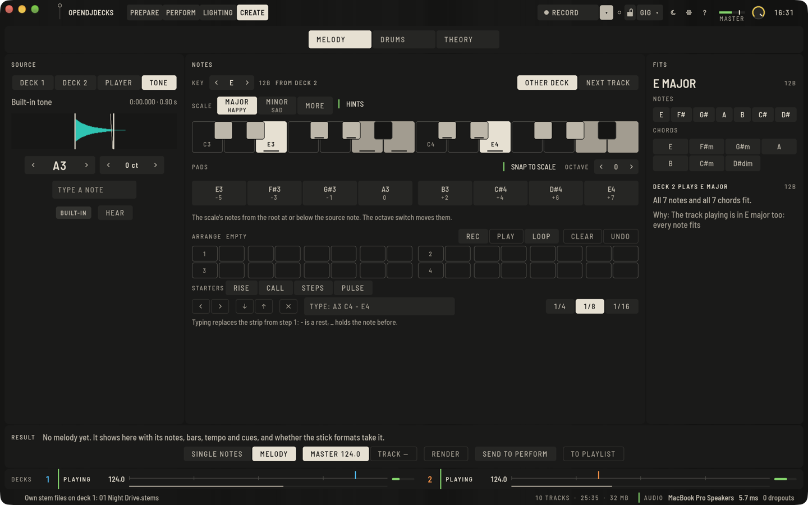
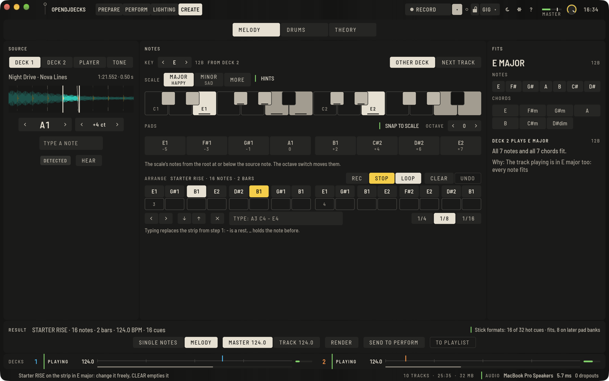
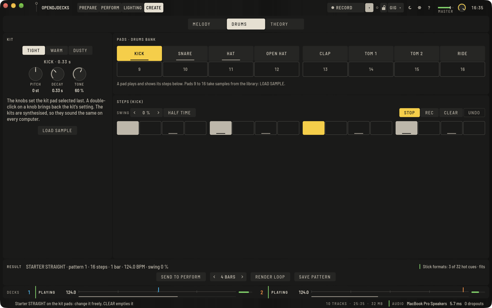
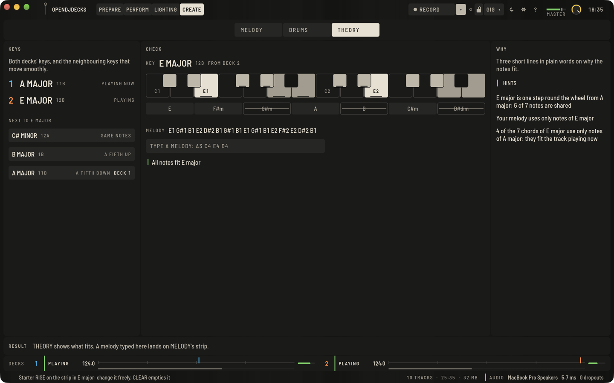

**CREATE** is the fourth tab next to PREPARE, PERFORM and LIGHTING. It is for the things you would otherwise do in a separate production program before a set:

- play the next track's melody with one note taken from the track playing now,
- play a small drum machine,
- see which notes and keys fit.

What you make becomes a normal file in your library, with a beatgrid and hot cues, so it goes into playlists and onto sticks like any track. CREATE is deliberately small: there is no timeline, no piano roll and no mixing console.

The decks keep playing while CREATE is open. The strip at the foot shows both decks: playing or paused, the tempo, where they are in the bar, and the level.

## The first screen

CREATE is never empty, even before you have loaded anything:

- **SOURCE** holds the built-in tone (**TONE**, marked **BUILT-IN**): a plain A3 made by the app. The pads and the keyboard strip play it at once, without a track.
- An empty strip in MELODY and THEORY offers **STARTERS**: four short melodies (**RISE**, **CALL**, **STEPS**, **PULSE**).
- Empty drum steps offer three starter patterns (**STRAIGHT**, **BROKEN**, **SPACIOUS**) on the built-in kit.

A starter only ever goes onto an empty strip or empty steps, so it never replaces what you made. It plays in the key in use. When no key is chosen yet, it brings its own key from the source note, shown as **STARTER KEY**. While you have not changed it, the strip and the RESULT bar say STARTER and its name. Change one note, and it is yours. **CLEAR** empties the strip, and the starters come back.

The starters are short exercises written for OpenDJDecks (broken chords, scale steps, a repeated root), not melodies from songs.

## MELODY: a melody from one note

MELODY reads left to right: **SOURCE**, then **NOTES**, then **FITS**.

### Pick a note

1. Under SOURCE, press **DECK 1**, **DECK 2** or **PLAYER**. CREATE takes a short piece of that track where it stands now.
2. Drag **IN** and **OUT** on the zoomed waveform around one clean note. The arrow keys move a handle in small steps.
3. **HEAR** plays it, with a short fade at OUT.

The pitch shows as a note and cents, for example "A3 +12 ct":

- **DETECTED**: CREATE is sure.
- **UNSURE**: check it by ear.
- **SET BY YOU**: you corrected it with the arrows, or typed a note such as A3 or F#2.

**TONE** goes back to the built-in tone at any time.

### Key, pads and the keyboard strip

- **KEY** follows the other deck's key (**OTHER DECK**). **NEXT TRACK** takes the key of the next track in the queue or the set. The arrows and **MAJOR**, **MINOR** or **MORE** set it by hand.
- With **SNAP TO SCALE** on, the 8 pads hold the notes of the scale. Off, they hold every semitone from the source note. **OCTAVE** moves them.
- A pad marked **FAR** is more than 7 semitones away from the source note and may sound unnatural. A source note nearer to it sounds cleaner.
- The keyboard strip shows the root, the scale and the notes outside it. Press a key to hear it.

### Arrange

The strip below holds up to 32 steps on the master grid (**1/4**, **1/8**, **1/16**).

- **REC**, then play the pads, the keys or a MIDI keyboard. While a deck plays, notes land on the nearest step of the grid. Otherwise they fill the strip step by step.
- Or type the notes, such as `A3 C4 - E4 _`, where `-` is a rest and `_` holds the note before.
- Tap a step to select it. The arrows move or change it, and the cross empties it.
- **PLAY** plays the strip in time with the master on the headphones while a deck plays. **LOOP** repeats it.
- **CLEAR** empties the strip, and **UNDO** brings it back.

### Render

The RESULT bar says what the file will hold before you render it: the notes, bars, tempo and hot cues, and whether the stick formats take that many cues.

- **SINGLE NOTES** puts each different note on its own bar, with one hot cue per note, for playing them by hand.
- **MELODY** plays the strip in time, with one cue per note in order, ready as a transition.
- **MASTER** or **TRACK** chooses the tempo of the file.
- **RENDER** writes a new WAV file with a locked beatgrid and the cues. Your source track is never touched. Once it is done, the button reads **READY** in green.

Rendered files are kept in the `created` folder next to your library and listed under **CREATED** in the browser.

### Into your set

- **TO PLAYLIST** adds the rendered file to a playlist or set, or to a new playlist. Sticks that sync that playlist get the file with their next sync, and the status line names them.
- **SEND TO PERFORM** puts the notes on the **MELODY** pad mode of every deck and into the sampler's MELODY bank. Pads A–H play the notes, and the arrows next to the mode switch to the octave above. The button reads **SENT** in green.

## DRUMS: a small drum machine

- **KIT** chooses a built-in kit (**TIGHT**, **WARM**, **DUSTY**). The sounds are made by the app, so they sound the same on every computer. **PITCH**, **DECAY** and **TONE** change the pad selected last. Double-click a knob to get the kit's own setting back.
- Pads 1 to 8 are the kit: KICK, SNARE, HAT, OPEN HAT, CLAP, TOM 1, TOM 2 and RIDE. Pads 9 to 16 take your own samples: **LOAD SAMPLE** puts the track open in Prepare's player onto a pad.
- Press a pad to hear it and to see its 16 steps under STEPS. Tap a step to set it.
- **PLAY** runs the steps at the master tempo, from the next bar while a deck plays. **REC** puts the pads you press while it runs onto the nearest step.
- **SWING** delays every off-beat step. **HALF TIME** makes each step an eighth note, for material you read at half the tempo.
- **CLEAR** empties all steps, and **UNDO** brings them back.

The drum machine is the sampler's own sequencer and its DRUMS bank, not a second one:

- **SAVE PATTERN** keeps the steps on a PATTERN pad in Perform.
- **SEND TO PERFORM** also switches the sampler to the DRUMS bank.
- **RENDER LOOP** writes the pattern as a loop file of 1, 2, 4 or 8 bars at the master tempo. The file has a beatgrid, a loop over the whole file and one hot cue per sound.

## THEORY: which notes fit

- **KEYS** shows both decks' keys as note names, with the wheel notation beside them, and the keys next to the one in use that move smoothly.
- **CHECK** shows the key in use, the keyboard strip and its chords. A chord you press marks its notes on the strip. Type a melody here (it lands on MELODY's strip), or press a starter. The line below says "All notes fit" or names the notes outside the key.
- **WHY** gives up to three short reasons in plain words. **HINTS** hides them, together with HAPPY and SAD under the scales.

FITS in MELODY shows the same in brief: which notes and chords of the key in use fit the track playing now.

## A MIDI keyboard

Plug in any MIDI keyboard or pad controller that has no controller mapping in OpenDJDecks. While CREATE is shown, its notes play here. The first time, the status line names the device.

- **In MELODY and THEORY**, a key plays that note from the source note, as the keyboard strip does. While **REC** is armed, the note also goes onto the strip. Notes from C1 to C7 are used. The velocity is not used: every note plays at the level of a pad.
- **In DRUMS**, MIDI notes 36 to 51 (C2 to D#3 as OpenDJDecks names notes) play pads 1 to 16. Many pad controllers send these notes from their first pad on. Other notes do nothing there.

A mapped DJ controller, and a controller you gave to the lights, never plays CREATE: its notes stay its own. Outside CREATE a keyboard does nothing, and OpenDJDecks only opens such devices while CREATE is shown.

## Known limits

- The pitch detection can misread a long pad tail, a detuned note or a noisy one. Check **UNSURE** notes by ear and correct them.
- Large shifts (more than 7 semitones, marked FAR) can sound unnatural.
- Whether rendered files with many hot cues play as intended on club players has not yet been tried on real players.
- The MIDI keyboard is tested with simulated notes, not with real keyboards. Velocity, note-offs, the sustain pedal and pitch bend are not used.
- There is no timeline, piano roll, plug-in or automation, by design.
