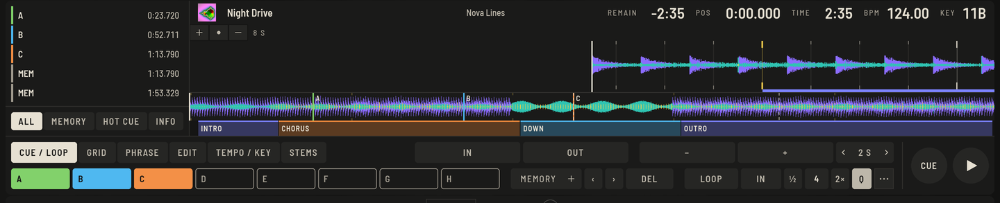
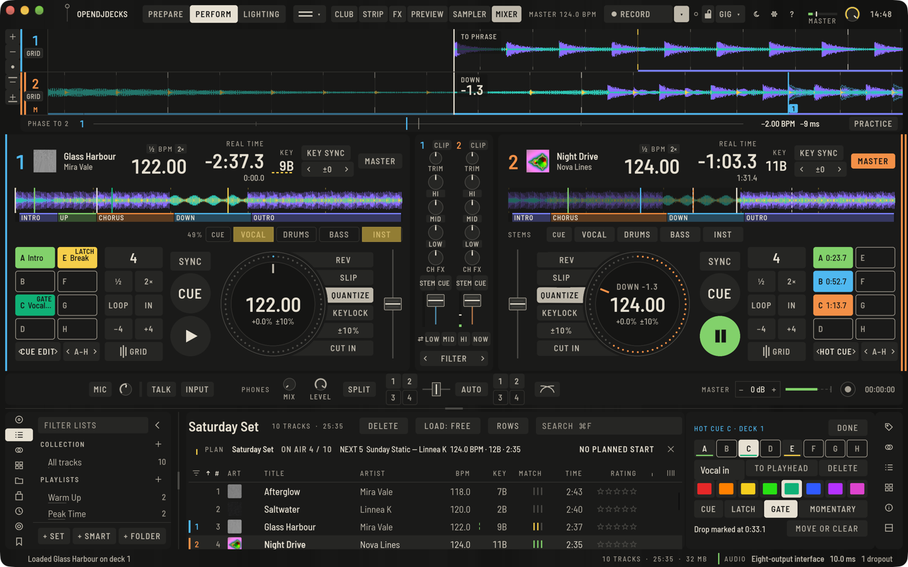
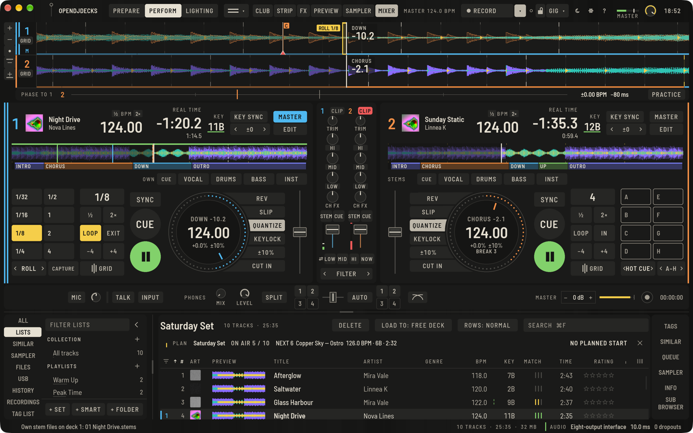

Open a track in the player at the top of Prepare to set cues. Everything you set here is saved with the track and reaches your [USB sticks](usb-sticks.md) by itself.

## Hot cues

Eight pads, **A** to **H**, jump to a place in the track at once.

1. Move the cursor to the place: click on the waveform, or use the arrow keys (`←` `→` fine, `⌥←` `⌥→` by two seconds).
2. Click an empty pad, or press `1` to `8`. With **Q** (quantize) on, the cue snaps to the beat.
3. Press a set pad to jump there. In Prepare `⇧⌘1` to `⇧⌘8` clear pads.

In Perform, pad presses work the same way and are saved at once: on the deck, or on a controller, hot cue set and delete are one undo step each. Hold a set hot cue while the deck is paused to preview it; a right click deletes.

With more than eight places, switch the bank at the deck: **A–H**, **I–P**, **Q–X** and **Y–AF** with **‹ ›** in **HOT CUE** pad mode, or by keyboard.

## Edit hot cues in Perform

Choose **CUE EDIT** as a deck's pad mode. The pads now pick a hot cue instead of playing it (the one you edit is lit), and a panel beside the list edits it, without leaving Perform:

- **NAME**: type and press Return. The name shows on the pad.
- **COLOUR**: eight colours; the chosen one is filled.
- The row **CUE**, **LATCH**, **GATE**, **MOMENTARY** says how the pad plays this cue. **CUE** is the usual pad: it jumps while the deck plays, and while it is paused it plays only as long as you hold it. **LATCH** jumps and plays on, also from a paused deck. **GATE** plays from the cue only while you hold the pad, also while the deck plays, then stops on the cue. **MOMENTARY** plays from the cue while you hold it and then lets the track carry on where it would have been, like slip. A pad that does not play the usual way names its behaviour in its corner.
- **TO PLAYHEAD** moves the cue to the playhead (on the beat with quantize), or stores one there when the pad was empty; **DELETE** removes it.
- **DROP** marks the drop of the track, see [Phrases](phrases.md#phrase-jumps-and-the-drop).

Every edit is one undo step and reaches sticks with the next sync. **DONE** (or another pad mode) goes back to the pads. On a controller, `deck.pad_mode` with `mode = "cue_edit"` switches to it; the controller's pads then pick the cue. The behaviours are tested in the engine; they have not been tried on a hardware controller.

With the **PLATTER** hidden (**View › Deck Layout › SHOW**), the pads take its room and show the cue names in full.

## Memory cues

Memory cues are markers you can step through without using a pad.

1. Press **MEMORY +** (or `M`) at the cursor.
2. **‹** and **›** step through them, or `R` and `T`.
3. **DEL** (or `⇧M`) removes the memory cue at the cursor.

In Perform the previous / next memory cue keys and the same controller buttons call them; the memory cue pad mode shows them on the pads. Setting and deleting them from a controller edits the track too.

## The cue list

The list on the right of the player has the tabs **ALL**, **MEMORY** and **HOT CUE**. Select a cue to edit it:

- Double-click it, type a **name** and press Return. Names show on the pads.
- Pick one of the eight **colours**.
- **TO CURSOR** moves it to the cursor, on the beat; loops keep their length.
- **→ HOT** turns a memory cue into a hot cue on the first free pad.
- The delete key removes it.

## Loops

In the player's **CUE / LOOP** tab and on the Perform deck:

- **LOOP** starts an auto loop of the shown length; press it again to leave. **½** and **2×** change the length, from 1/32 to 32 beats.
- **IN** and **OUT** set a manual loop; **EXIT** leaves it. In Perform it reloops with the same control. Until you press **OUT**, the waveform marks the in point with an amber **IN** line; **EXIT** (or RELOOP/EXIT on a controller) cancels it.
- On a controller whose LOOP IN and OUT keys are printed 1/2X and 2X, they halve and double a running loop and set the in and out points otherwise; with SHIFT they always halve and double. CUE/LOOP CALL ◀ / ▶ halve and double a running loop too, and call memory cues otherwise.
- The **ROLL** pad mode rolls a short loop while you hold a pad, see below.

Press **MEMORY +** while a loop plays to store it as a memory loop, or set a hot cue on a loop. **ACTIVE** in the cue editor turns a stored loop into an active one: it engages by itself when playback reaches it.

## Loop roll and capture

Pick **ROLL** as the pad mode in Perform. The pads hold the sizes **1/32**, **1/16**, **1/8**, **1/4** (left) and **1/2**, **1**, **2**, **4** beats (right).

- **Hold a pad** to roll: the loop starts on the grid (with **Q** on) and repeats while you hold. The track carries on underneath, a thin line on the waveform shows where; when you let go, playback continues from there, as with slip.
- The held pad is filled, and the loop band on the waveform names the roll, for example **ROLL 1/8**.
- **CAPTURE** in the mode bar keeps the loop you just heard, a roll or a loop, as a hot loop on the first free pad of the bank. With all eight pads taken it becomes a memory loop. Each capture is one undo step and is saved with the track.

On a controller: `deck.loop_roll` with `beats`, the pad mode `loop_roll`, and `deck.loop_capture`. Rolls are tested in the engine and the app; they have not been tried on hardware pads yet.

## Cues like on your other tracks

Row menu: **Set cues like my others**. OpenDJDecks looks at where you placed hot cues and memory cues on tracks you already prepared, measured in bars from the first beat, the phrases and the end, and fills free pads on the selected tracks with the same names, colours and loop lengths. At least three analysed tracks with cues are needed.

Under **Preferences › Analysis › Cue points** you can have this happen for newly analysed tracks that have no cues. It is off by default. Each placement is one undo step.

## Auto cue on load

When you load a track, it waits at its first sound, or at the first memory cue if it has one. Turn this off under **Preferences › Controller › Decks › Auto cue**.
