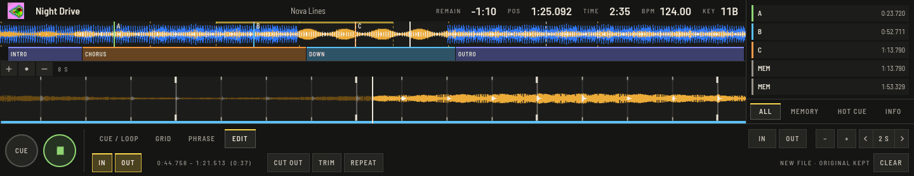

Sometimes a track needs a shorter intro, one breakdown less, or a part played twice. The **EDIT** tab of the Prepare player makes a new track from a region you mark. The original file is never touched, and the result is an ordinary audio file that plays anywhere, in OpenDJDecks or any other software.

## How it works

1. Open the track in the **Prepare** player and choose the **EDIT** tab.
2. Mark the region: put the cursor at the start and press **IN** (`⇧I`), put it at the end and press **OUT** (`⇧O`). You can also `⇧`-drag across the overview at the top. **CLEAR** forgets the region.
3. Choose what happens with it:
   - **CUT OUT** makes a new file *without* the region (`⇧⌘X`).
   - **TRIM** makes a new file with *only* the region (`⇧⌘K`).
   - **REPEAT** makes a new file with the region played twice (`⇧⌘E`).
4. While it renders the display shows **RENDERING…**. The joins get short 5 ms crossfades so they do not click.

## The result

A new 24-bit WAV file next to the original, added to your library as **Title (Edit)** with the original tags and cover. It is analysed automatically, so the new tempo, grid and phrases are ready.

> [!TIP]
> Set the region on the beat: with the cursor snapped to the grid the edit stays in time. Use the **Q** quantize button and [check the grid](beatgrid.md) first if the track is not perfectly on it.

## Good to know

- This is an editor for one region at a time, with no multi-track arrangement.
- Hot cues of the original are not carried into the edit. Set new ones in the new track.
- To remove an edit, delete the file from the library like any track; nothing was written to the original.
