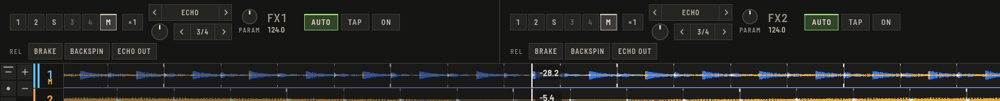

Press **FX** in the top bar (`⌥⌘F`) to open the two Tempo FX units above the decks.

## Tempo FX

Each unit, **FX1** and **FX2**, picks an effect (the list or **‹ ›**), a beat length and a target:

1. Choose the effect by clicking its name for the list, or with **‹ ›**.
2. Choose the length with the **BEAT** keys, from 1/8 to 16 beats. It follows the deck tempo; **TAP** sets your own tempo (three taps) and **AUTO** returns to the deck.
3. Assign it: the keys **1** to **4** for channels, the sampler or **MASTER**.
4. Set **LEVEL** (depth) and **PARAM** (the effect's second control, such as filter direction or pitch), then press **ON**.

**×3** chains three effects in one unit: each slot has its own effect, beat, depth and on/off.

### Effects

Echo, Delay, Ping Pong, Reverb, Flanger, Phaser, Roll, Slip Roll, Filter, Trans, Pitch, Vinyl Brake, Helix, Spiral and more, including the remix effects below. On a controller, its effect names map to the closest one.

### Remix effects

In the same list:

- **BUILD UP** cuts the lows higher and higher over its length, while a noise sweep rises. **PARAM** sets the noise.
- **BREAKDOWN** closes the highs and dips the level.
- **REVERSE ROLL** repeats the captured beats backwards.

### Exit FX

**BRAKE**, **BACKSPIN** and **ECHO OUT** act on a unit's target while held, then the music comes back. On a controller the release button is echo out.

## Channel FX

**‹ FILTER ›** under the mixer selects the Channel FX that every channel's **CH FX** knob controls: Filter, Noise, Space, Crush, Echo, Pitch, Dub Echo and Sweep. Your choice is remembered. `⇧J` and `⇧S` step through them.

Auto Channel FX is one of these: a single knob with low-pass and echo to the left, high-pass and reverb to the right.

## Hold FX

The **HOLD FX** pad mode puts eight presets on the pads, beat effects and release effects, active while held. **‹ ›** switches between two pages.

## Stem FX

Under a unit's channel assign, the part keys **ALL**, **VOC**, **DRUM**, **BASS** and **INST** limit it to one part of the channel: the unit works on that part only, and it rejoins the channel before the EQ and fader. This needs the track to have [separated parts](stems.md).
