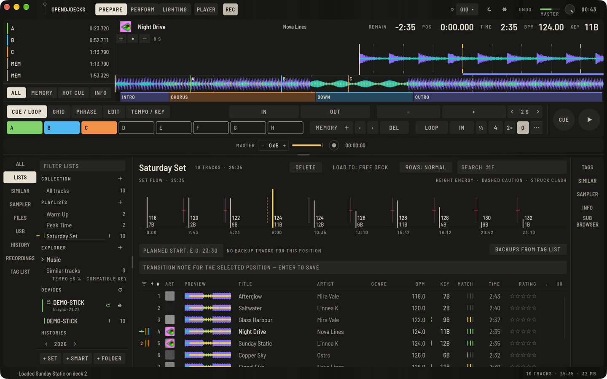

OpenDJDecks has two work modes. **Prepare** is where you sort music and set cues at home. **Perform** is the decks and the mixer for the gig. You switch between them at the top left at any time; whatever is loaded stays loaded.

## 1. Install

Download the app for your computer from the [download page](/en/download/) and follow the short guide for your system there. On a Mac the first start needs one extra confirmation, because the app is not signed by Apple.

The interface is in English or German and follows your system. To choose it yourself, open **Preferences** (the gear at the top, or `⌘,` on the Mac and `Ctrl+,` on Windows and Linux), then **View › Language**.

## 2. Add your music

The app references your music where it already lies. Files are never copied or changed.

1. On the empty library screen press **ADD MUSIC FOLDER**, or use **ADD MUSIC** above the list, or **File › Add Music Folder…**.
2. Pick the folder that holds your tracks. Subfolders are included.
3. The tracks appear in **All tracks** straight away.

You can also drop files and folders from the Finder or file manager onto the window; they join the collection and, if one is open, the current playlist or set.

If you already have a library in other DJ software, see [Import your library](importing-your-library.md) first: the import brings your cues and grids with it.

## 3. Let the analysis run

New tracks are analysed by themselves in the background: BPM and beatgrid with the first beat of the bar, key, waveforms in three colour bands, phrases and loudness. The band at the very bottom of the window shows the progress, and you can keep working while it runs.

- A short line in the state column means a track is waiting for analysis. A struck line means the file is missing; [Troubleshooting](troubleshooting.md#a-track-shows-a-struck-line) helps with that.
- To analyse a track again, right-click it and choose **Analyse** (or press `⇧⌘A` in the player). Grids and keys you set by hand or brought from another program stay as they are; to protect a whole track from re-analysis use **Lock / unlock analysis** in the same menu.
- Tempo is folded into a range of 87 to 175 BPM by default. For hip-hop or drum & bass, change **Preferences › Analysis › BPM range** before you analyse.

## 4. Listen

Click a track in the list to open it in the player at the top of Prepare. Press `Space` to preview it, or click anywhere on the large waveform to jump there.

## 5. Go to Perform

1. Click **PERFORM** at the top.
2. Double-click a track in the list to load it on a free deck. In Prepare a double-click opens the player instead.
3. Press the play button on the deck or `Z` for deck 1 and `N` for deck 2.

If you own a compatible controller, plug it in by USB; it is picked up within a few seconds and its audio interface is used automatically. See [Controllers](controllers.md).

## Words used in OpenDJDecks

The app uses one name for each thing, in the interface and in these guides. Where a key is too small for the full word, the short form is listed here and the tooltip spells it out.

| Word | What it means | Short form |
|---|---|---|
| **Keylock** | The key stays the same when the tempo changes. | **LOCK** on small decks |
| **Quantize** | Hot cues and loops snap to the beat. | **Q** on small decks |
| **Stems** | The stems of a track: **VOCAL**, **DRUMS**, **BASS** and **INST** (instrumental). | |
| **Sync** | Tempo and beat follow the master deck. | |
| **Lighting** | The work mode with the rig, stage and show. | |
| **Light strip** | The small lighting panel inside Perform, under the waveforms. | **STRIP** in a narrow top bar |
| **Load to** | Where a double-click loads a track in Perform: the free deck, or a fixed deck. | **LOAD: FREE** when a side panel is open |
| **Rows** | How tall the rows of the track list are: compact, normal or roomy. | **ROWS** when a side panel is open |
| **Side rails** | The tall strips beside the browser: sources on the left (**ALL**, **LISTS**, **SIMILAR**, **SAMPLER**, **FILES**, **USB**, **HISTORY**, **RECORDINGS**, **TAG LIST**), panels on the right (**TAGS**, **SIMILAR**, **SAMPLER**, **INFO**, **SUB BROWSER**). | Short forms in the touch layout |
| **Tag list** | Tracks you are collecting for later. | |
| **Set** | An ordered list prepared for a gig. | |
| **Similar** | Tracks that fit after the one that is playing. | |
| **Sub browser** | A second tree and list under the browser, for dragging tracks between lists. | |
| **Channel FX** | The effect on a mixer channel, set with the **CH FX** knob. | |
| **Hot cue** / **Memory cue** | A stored point on a pad / a stored point you jump to on the waveform. | |
| **Gig preset** | One click for high contrast, the colour-blind palette and a larger interface; **GIG** in the top bar. | |
| **Beatgrid** | The beat markers of a track. | |

## Where next

- [Library and playlists](library.md): sorting and finding tracks
- [Cues and loops](cues-and-loops.md): marking the places you play
- [USB sticks](usb-sticks.md): taking your music to your Raspberry Pi or another computer
- [The basics of Perform](perform-basics.md)
