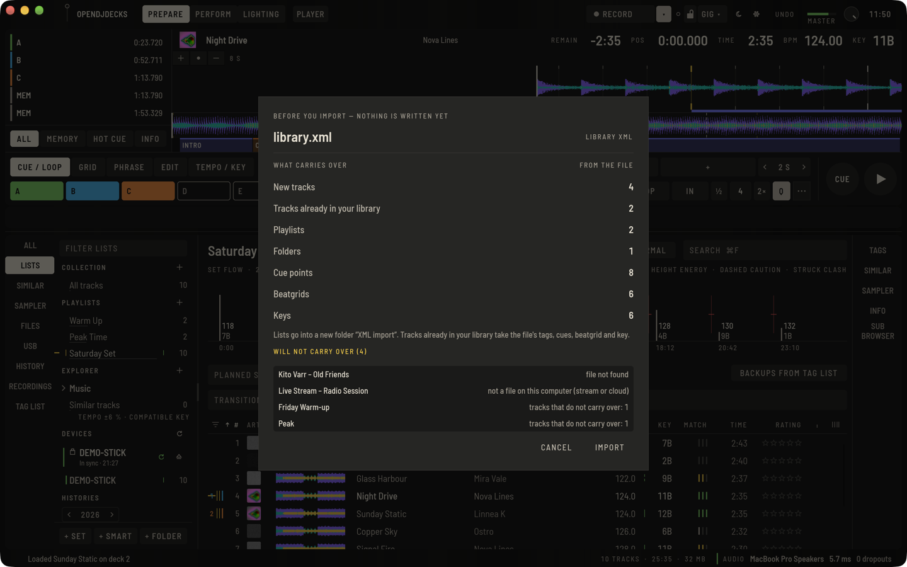
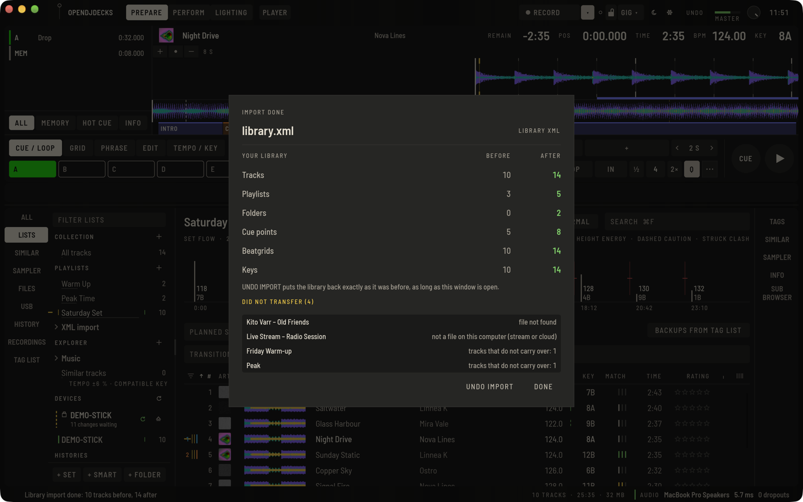

OpenDJDecks can read a library from a **library XML file**, so you start with your cues, beatgrids, keys and playlists in place.

## Create the XML file

In rekordbox, export your collection as an XML file from the File menu and save it somewhere you can find it. OpenDJDecks reads only the file you choose; it does not look for other software's files on your computer.

**File › Import rekordbox Preferences and Shortcuts…** (also under **Preferences › Advanced**) carries over preferences and keyboard shortcuts as well, wherever they do not clash with existing ones. It asks you to choose the preferences folder yourself.

## Import the file

1. Open **File › Import Library XML…** (`⇧⌥⌘X`), or use **IMPORT LIBRARY** on the empty library screen.
2. Choose the XML file.

Before anything is written, a window shows what the file carries over: new tracks, tracks already in your library, playlists, folders, cue points, beatgrids and keys. Below it, **WILL NOT CARRY OVER** lists every item that stays behind, with the reason:

- **file not found**: the audio file is not where the XML says;
- **not a file on this computer (stream or cloud)**: a streaming or cloud entry;
- **cue points that cannot be read**: cue points of a track that are incomplete in the file;
- **tracks that do not carry over**: entries of a playlist whose tracks are among the ones above.

Tracks that are already in your library take the file's tags, cues, beatgrid and key. Press **CANCEL** to leave everything as it is, or **IMPORT** to go ahead.

After the import, the window shows your library before and after (tracks, playlists, folders, cue points, beatgrids and keys) and what did not transfer. **UNDO IMPORT** puts the library back exactly as it was before the import, from a copy taken right before it started. Undo is offered as long as this window is open; **DONE** closes it and removes the copy. Undo restores that copy as a whole, so anything else you change in the library while the window is open is undone with it. The preview, before and after, and undo cover the two XML formats on this page, not the encrypted database below.

Lists go into a new folder **XML import**. Cover art is taken from the files themselves. Your music files stay where they are. If a track can no longer be found afterwards, see [moved files](library.md#moved-files).

## Other formats

- **File › Export Library XML…** writes your library as a file other DJ software can read (`⌥⌘X`).
- **File › Import Music / iTunes Library XML…** reads a `Library.xml` exported from Apple Music or iTunes, with tags, ratings and playlist folders (`⇧⌥⌘M`). It shows the same preview, before and after, and undo. Videos, podcasts and the lists the app makes itself (the whole library, built-in lists) do not carry over and are listed as such.

To move your whole OpenDJDecks library to a new computer, use the library archive instead; see [Moving to a new computer](library.md#moving-to-a-new-computer).

## Encrypted library database

From version 0.6, OpenDJDecks can also read an encrypted library database directly, with tracks, cues, beatgrids, keys, playlists, smart playlists (as ordinary playlists with their contents at import time), cover art and the play history. This is optional; the XML route above needs no key.

1. Choose **File › Import an Encrypted Library Database…**.
2. **CHOOSE FILE**: pick the database file of your library yourself. OpenDJDecks never searches your computer for one.
3. Under **ADVANCED**, enter the key for this library.
4. Press **IMPORT**.

You need the key for your own library. OpenDJDecks neither contains nor fetches it, and it cannot help you find it. The key is used for this import only: it is not saved or logged. Your database file is only read, never changed, and the temporary decrypted copy is removed when the import ends, also if it fails. If the key is wrong, you see the message "The key was not accepted", and nothing is imported.

Lists arrive in a **Library import** folder. Running the import again adds nothing twice.
