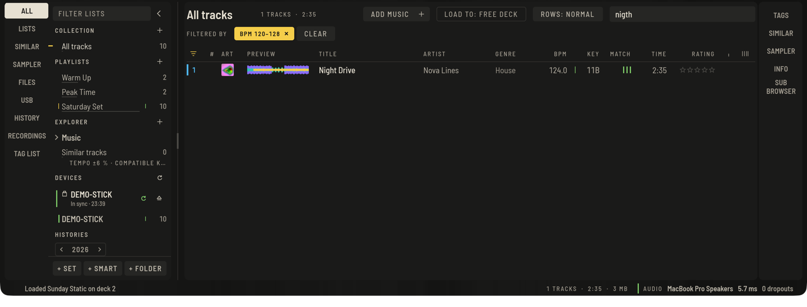

The browser is the same in Prepare and Perform. On the left are your sources and lists, in the middle the tracks, on the right a strip of panels.



## The sources on the left

The narrow rail switches what the tree shows: **ALL** (the whole collection), **LISTS** (playlists, sets and smart lists), **SIMILAR** (similar tracks), **SAMPLER** (the sampler panel in Perform), **FILES** (the explorer), **USB** (your sticks), **HISTORY** (histories), **RECORDINGS** (recordings) and **TAG LIST** (the tag list).

The words stay whole wherever there is room. In a narrow window, or with a panel open beside the list, both rails show a sign instead: a record for the collection, lines for the lists, two rings for similar tracks, four pads for the sampler, a folder, a stick, a clock for the histories, a microphone for recordings and a bookmark for the tag list; on the right a tag, two rings, four pads, an "i" for info and two stacked panes for the sub browser. Hold the pointer over a sign to read its name; screen readers read the name too.

The key with the arrow beside **FILTER LISTS** (**HIDE LISTS**) folds the lists away to the rail, so the tracks get the room. The arrow at the foot of the rail (**SHOW LISTS**), or any source of the rail, brings them back.

The lists, the track list and the panel strip each sit on their own surface with a little space between them, so you always see which area you are in.

## Sorting by key (from version 0.6)

Click the **KEY** column to sort your tracks by key. Right-click the column heading to choose how:

- **Sort keys by circle of fifths** runs in musical order, the way the numbers go round the wheel: 1A, 1B, 2A, 2B and so on. Tracks next to each other mix harmonically. This is the default.
- **Sort keys alphabetically** simply sorts by the key text you see.

Your choice is remembered. The column uses the key notation you chose under **Preferences › Analysis**.

## Playlists, sets, smart lists and folders

Use **+ SET**, **+ SMART** and **+ FOLDER** under the tree, or the keys: new playlist `⌘N`, set `⇧⌘N`, folder `⇧⌘F`, smart list `⇧⌘M`.

- Click the name of a list to rename it.
- Drag a list onto a folder to move it inside, or onto another list to place it before that list. Every change can be undone.
- To add tracks, select them and press **+** next to the list, or drag the rows onto it.
- Drag rows between the rows of a list that is sorted by **#** to reorder it.
- **DELETE** removes the open list (`⌘⌫`). Remove selected tracks from a list with `⌦` or the row menu.

For planning an evening, use a [set](preparing-sets.md) rather than a playlist: it can show the flow of tempo, key and energy.

## Smart lists

A smart list fills itself according to rules you type. Conditions are separated by commas; a track must match all of them. Create one with **+ SMART**, then type into the rules field and press Return:

```text
bpm 120-126, key 8A~, genre house, rating >= 3, added < 30d
```

- `bpm`, `rating`, `year`, `plays` and `duration` take a value (`128`), a range (`120-126`) or a comparison (`>= 3`).
- `key 8A` matches exactly; `key 8A~` matches keys that mix well (one step around the wheel, or the relative key).
- `title`, `artist`, `album`, `genre`, `label`, `comment` and `format` match when the text contains the word. A leading `-` excludes (`-genre techno`).
- `added < 30d` compares age: `d` days, `w` weeks, `m` months, `y` years.

## Search and filter

Press `⌘F` and type; the list narrows as you type. You can also just start typing after clicking a row: letters and digits go straight into the search. The list shows it has the keys with a light line along its left edge; `Esc` gives the keys back to the decks.

The search forgives typos and finds words in the title, artist and album, also across them (`nova drive` finds *Night Drive* by *Nova Lines*), and in genre, label, remixer and comment as typed. One typo is allowed in words of four to seven letters, two in longer ones. The best matches come first: a match in the title before one in the artist, a whole word before a part of one. Click a column header to sort the results by that column instead.

- `↓` and `↑` in the search move through the results.
- `Return` loads the top hit, or the row you moved to: into a free deck in Perform, into the player in Prepare, where it starts playing. In Perform the deck keys work again right after the load.

The filter button above the list (`⌘J`) opens a bar with a BPM range, **Key fits master**, **BPM ±%** around the master deck (double and half time count), a minimum **RATING** and one **TAGS** value.

Every condition that is set shows above the list as a chip, also when the bar is closed: **FILTERED BY** **BPM 120–128**, **RATING ≥ 3** and so on. Click a chip to remove that condition; **CLEAR** next to the chips removes them all.

## The MATCH column

Next to the key, **MATCH** rates every row against what is playing: the master deck, otherwise another playing deck, otherwise the selected track. Up to three lines light up for key and tempo, and hovering a row tells you why. Sort by it to put the best fits on top; it follows the master deck while you play.

## Auto sort

**AUTO SORT** in the tree groups your analysed tracks by **tempo**, **energy**, **mood**, **character** and **genre**, computed on your own computer. Open a list like any other; it is sortable, loadable and you can drag tracks from it into a playlist.

## Similar tracks

The **SIMILAR** panel in the right strip shows what fits after the selected track: within ±6 % tempo and a compatible key. Double-click loads into a free deck, **SHOW AS LIST** opens the same selection as the Similar list. In the tree, **Similar tracks** does the same for the master deck or a chosen deck 1 to 4.

## Tags, rating and colour

- Click the stars in a row to rate it; click again to clear. The row menu has the same options, and **Colour** sets one of eight marks.
- The **INFO** panel on the right shows every tag of the selected track; click a field, type, press Return to store it, including the **COMMENT**. The **ARTWORK** tab shows the cover.
- **TAGS** is yours to fill: in the panel type `Category: Value` (for example `Mood: Peak`) and press Return to tag the selection, then click a value to tag or untag. The Tags filter and column use the same values.

## The tag list

Collect candidates while you browse: press `⌥⌘T`, use the row menu or drag rows onto **TAG LIST** in the tree. **SAVE AS PLAYLIST** turns it into a playlist and **CLEAR** empties it.

## The explorer

**FILES** browses folders on your disk without importing anything. Press **+** next to **EXPLORER** to add a folder. **Include subfolders** in the list header shows all files beneath it. A track you load from the explorer joins the collection and is analysed in the background.

## Columns and sorting

Click a column header to sort, click again to reverse. `⇧`-click adds a second and third sort column. Drag a header onto another column to move it, or drag a column edge to resize. Right-click the header or use the columns button at the right end to choose which columns appear; **Default columns** resets.

Rows also show where a track is loaded (a deck number), a tick when it has been on air this session for 30 seconds in all, and cover art in the **ART** column.

### Reading the list

The list is drawn so the title leads: titles are brighter and heavier, the artist and the figures come second, and the other columns step back. Numbers (**BPM**, **KEY**, **TIME**, **YEAR**, **PLAYS** and the rest) sit right-aligned with digits of one width, so they read down the page like a register. The selected row is filled in a lighter grey with a short yellow tick at its left edge. A track that is loaded on a deck carries that deck's line and number in the deck's colour (blue for 1, orange for 2, green for 3, violet for 4).

The divider between the lists on the left and the track list stops where the lists still fit: the three **+** keys, a name and its count. The lists never draw over the tracks.

## Row menu

Right-click a row for everything else: **Load to deck**, **Analyse**, **Lock / unlock analysis**, **Separate stems**, the lists you used recently, **Add to playlist**, **Add to tag list**, **Reload tags from file**, **Export file…**, **Reset play count**, **Memory cues to hot cues**, **Sort hot cues by time**, **Set cues like my others**, **Show similar tracks**, **Colour**, **Rating**, **Remove from this list**, **Show info** and **Show in file manager**.

## Loading tracks

- Double-click a row: into a free deck in Perform, into the player in Prepare, where it starts playing (a track that already plays there goes on). `Return` does the same for the selected row, and in the search for the top hit. **LOAD TO: FREE DECK** above the list says where a double-click loads in Perform; click it to choose a fixed deck. **ROWS: NORMAL** beside it sets the row height of the list.
- Drag a row onto a deck or a Prepare player, from the list, the explorer, or from the Finder or file manager.
- `⇧←` / `⇧→` load the selection into decks 1 and 2, `⌥⇧←` / `⌥⇧→` into decks 3 and 4, and `Return` into a free deck.

## A second browser

**SUB BROWSER** in the panel strip on the right opens a second tree and list underneath, so you can drag tracks between lists without losing your place.

## Histories

**HISTORIES** lists every session you played, with the tracks in order. Sessions are recorded automatically, whether or not you are recording.

## Undo

Every edit can be undone with `⌘Z` and redone with `⇧⌘Z`. The app also backs up your library automatically; see **Preferences › Advanced**.

## Moved files

If you rename or move music on disk, tracks show a struck line and the top of the list offers **{n} MOVED**. Press it (or `⇧⌘L`) and point at the new folder; tracks are matched and reconnected.

## Duplicates and tidying up

**File › Find Duplicate Tracks** (`⌥⌘Y`) lists tracks that exist more than once. **REMOVE SELECTED** or **KEEP ONE OF EACH** take copies out of the collection; the files stay on disk.

**File › Consolidate Library…** copies every track into one folder you pick (`<folder>/<Artist>/…`) and points the library at the copies, leaving the originals alone.

## Moving to a new computer

**File › Export Library Archive…** writes everything into one file, with or without the audio. On the new computer, **File › Restore Library Archive…** unpacks it into a folder you pick, opened from the next start.
