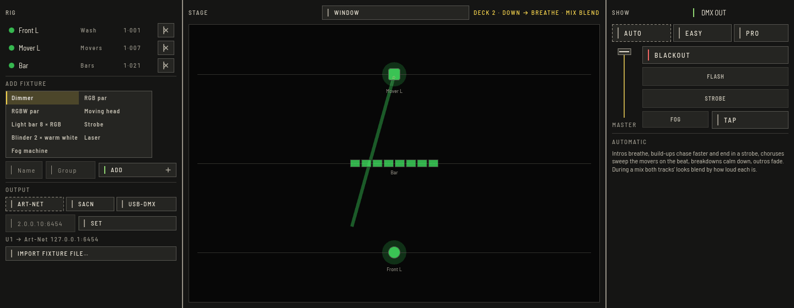

OpenDJDecks can run the lights itself. The **LIGHTING** tab (`⌥⌘3`) has three views: **RIG** to patch your lights, **STAGE** with a live 2D preview, and **SHOW** to run it.

## Patch your lights

In **RIG**:

1. **ADD FIXTURE**: give a **Name**, pick a **Group** (movers, front, and so on), choose a built-in type such as PAR, mover, bar, strobe, blinder, laser or fog, and press **ADD**. The next free DMX address is used, and overlaps are checked.
2. Or **IMPORT FIXTURE FILE…** for a fixture definition from the Open Fixture Library (`.json`).

**OUTPUT** chooses how a universe leaves the computer: Art-Net, sACN, or a USB-DMX interface (Enttec Pro). **SET** applies it; several universes are possible.

## Run the show

**DMX OUT** sends the show to your outputs. Choose how it runs:

- **AUTO** follows phrases, beat and energy. Intros breathe, build-ups chase faster and end in a strobe, choruses sweep the movers on the beat, breakdowns calm down and outros fade. During a mix the looks of both tracks blend by how loud each is, and phrase changes crossfade over a bar.
- **EASY** is one **LOOK** for the whole rig, locked to the beat, with colour swatches, a master dimmer, **BLACKOUT**, and **FLASH**, **STROBE** and **FOG** while held. **TAP** sets the tempo when no deck plays.
- **PRO** sets a **PROGRAM**, a **COLOUR** and an attribute effect (sine, saw, square, random on dimmer, pan, tilt; phase spread; beat-synced) per group, an XY programmer for pan and tilt, and a **CUE STACK** with **GO**, **BACK** and **STORE** with fades counted in beats. **TRACK CUES** stores a cue at a bar of the track you hear, recalled whenever that track plays.

On the decks the **LIGHTING** pad mode gives you looks A to F, strobe (G) and flash (H) from the pads. Every lighting control can also be mapped to MIDI.

## Where to see it

- The **LIGHT** button (`⌥⌘K`) in Perform shows a lighting strip.
- **WINDOW** opens the lighting view in its own window, for a second screen.
