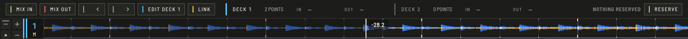

Mix Preview starts the waiting deck at the moment the playing deck reaches its exit point. Press **PREVIEW** in the top bar (`⌥⌘P`) to show the panel above the waveforms.

## Set the points

1. **EDIT DECK** selects the deck you are working on. Press it to switch.
2. Move that deck to where it should come in or go out, and press **MIX IN** or **MIX OUT**. The points are stored with the track.
3. **◀** and **▶** step through the deck's points: memory cues and mix points.

## Link

Press **LINK**: when the playing deck passes its mix-out point, the other deck starts from its mix-in point. Press again to stop linking.

## Reserve the next tracks

**RESERVE** queues the tracks selected in the list. When a deck in the panel is empty, or has played out while the other plays, the next reserved track loads there and waits at its mix-in point for the next link. **NEXT** shows what is coming and **CLEAR** empties the queue. **NOTHING RESERVED** means the list is empty.
