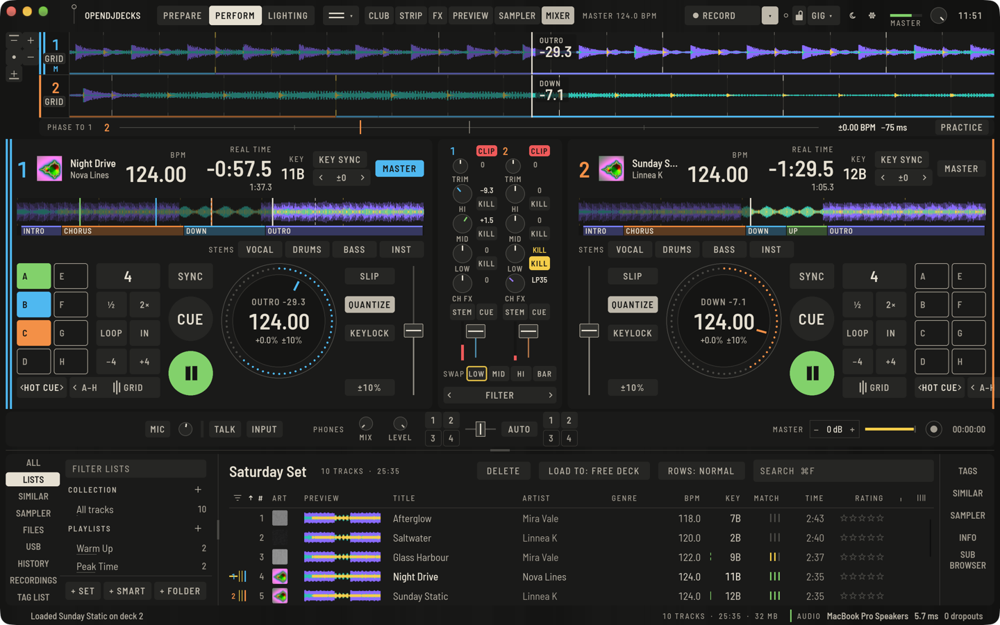

The mixer stands between the decks. Press **MIXER** in the top bar (`⌥⌘M`) to hide it when your controller does the job; the decks then meet in the middle.

## A channel

From top to bottom: the channel number with its **CLIP** lamp, **TRIM**, **HI**, **MID**, **LOW**, **CH FX** (the Channel FX knob), **STEM** and **CUE** side by side, and the channel fader with its meter. Every knob and the fader stand on the channel's centre line, and each knob's name sits right under it. Drag a knob up or down to turn it; double-click (or double-tap) it to reset it to the centre.

While you turn a knob, the name under it shows its value, and it goes back to the name when you let go: TRIM and the EQ in dB (**OFF** when an isolator band is turned fully down), CH FX as the filter side and depth (**LP40** is a low-pass at 40 %, **HP25** a high-pass at 25 %), other Channel FX as a signed percent.

- **TRIM** sets the level of the channel. **Auto gain** in **Preferences › Controller › Mixer** levels tracks by their analysed loudness first. Each track can be corrected by ±0.5 dB steps in the [GRID panel](beatgrid.md#fix-a-grid-while-the-track-plays).
- The **EQ** knobs default to an isolator. **Preferences › Controller › Mixer › EQ** switches between **ISOLATOR** and **CLASSIC EQ**.
- **CH FX** drives the selected Channel FX; see [Effects](effects.md#channel-fx).
- **STEM** turns the channel's HI, MID and LOW knobs into controls for the vocals, the instruments and the drums of that track. The middle position is full level; the normal EQ stays as you left it. See [Stems](stems.md).
- **CLIP** lights red once the channel has gone over full scale before the fader (after trim and EQ), and stays lit so you see it even if you looked away. Turn the trim down, then click the lamp to clear it; the click clears every clip indicator, the master's too.

## Knobs, faders and meters

Each knob draws its value as an arc on its ring: from the small mark at the top for **TRIM**, the EQ knobs and **CH FX**, which turn both ways from the middle, and from the start for **MIX** and **LEVEL**. While you drag a knob its value stands above it and in the legend below (`−6.0`, `LP35`). The fader caps have a centre line to read them by.

The channel meters and the **MASTER** meter in the top bar hold their peak: a short tick stays at the highest recent level for about a second and a half, then falls back. It turns amber near the top and red at clip. The meters are never smoothed: they show the sound as it is.

## Bass swaps

The names **HI**, **MID** and **LOW** under the EQ knobs are kill keys: tap one to take that band out (it fills in yellow and reads **KILL**), tap it again to bring the band back. The knob stays where it is; when you release the kill, the band comes back at the knob's value. With the isolator EQ a killed band is silent; with the classic EQ it is at the knob's lowest setting (−26 dB).

The swap row under the channels (marked with two opposed arrows) exchanges one band between the two decks in the mix with one tap:

1. Kill the LOW of the incoming deck (or turn it down) while the playing deck has its bass.
2. Tap **LOW** in the swap row. The two decks trade their LOW knob and kill: the incoming deck gets the bass, the outgoing deck loses it. **MID** and **HI** do the same for their bands.

The key at the end of the row sets when the swap happens: **NOW** (at once), **BEAT** (on the next beat) or **BAR** (on the next downbeat), counted on the master deck's beatgrid. Click it to step through the three. While a swap waits for its beat or bar, its key shows an outline; tap it again to cancel. When no deck is playing there is no beat to wait for, and the swap happens at once.

The swap acts on the two loudest playing decks. When only one deck plays, it swaps with the next deck that has a track loaded; with nothing playing, decks 1 and 2. With four decks, the row names the pair (for example **2/3**).

A controller can do both: map `mixer.eq_kill` (with `band = "low"`, `"mid"` or `"high"`) to a button of a channel, and `eq_swap` (with a `band`) to any button; see [Controller mappings](controllers.md). No shipped controller mapping uses them yet, and they have not been tried on a hardware controller; they are tested in software only.

## Crossfader

Below the mixer, the crossfader blends between its sides. The small **1** / **2** / **3** / **4** keys left and right send a deck to side A or B; press again to put the deck straight through.

**AUTO** beside the crossfader turns on Auto Fader: the crossfader also swaps the basses of the two sides and keeps the decks on it in tempo with the master.

Curves live in **Preferences › Controller › Mixer**: the **Channel fader curve** (linear, smooth, sharp) and the **Crossfader curve** (constant power, linear, cut).

## Headphones and master

**PHONES** has the **MIX** between cue and master and the **LEVEL**. Press **CUE** on a channel to listen to it. On a controller, the master cue button listens to the master.

**MASTER** sets the output level with **−** and **+**, or the slider, and has a meter and a safety limiter that is always on. The record button and time sit next to it; see [Recording](recording.md). The booth output is set with the controller's booth knob.

## Microphone and aux

**MIC** in the bar below the mixer switches on an input, with the level, a meter and an input device selector. **TALK** ducks the music while you speak. The mic signal goes through the mixer, so Tempo FX and the recording include it.
