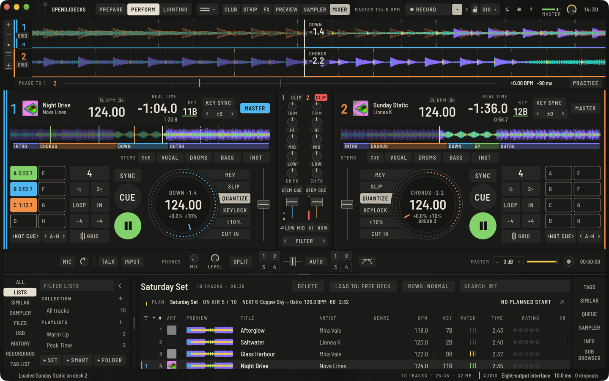
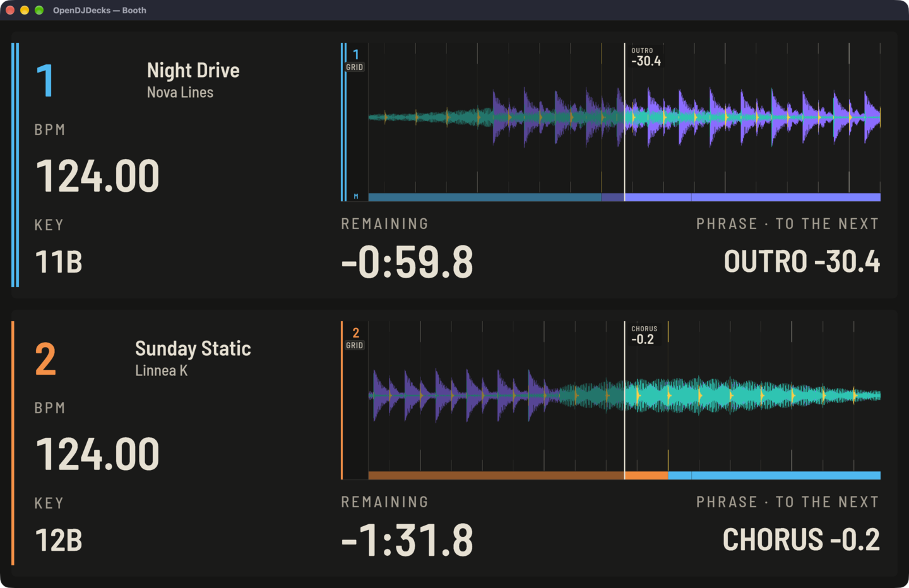

Perform is the live mode: the decks, the mixer and the browser in one view.

## Load and play

Double-click a track in the browser, drag it onto a deck, or use `⇧←` and `⇧→`. **Play** and **CUE** work as on a player: CUE at rest sets the cue point, CUE while playing returns to it, holding CUE plays from it until you let go.

## Deck readouts

The deck header shows the number, the artwork, title and artist, **BPM**, the remaining or elapsed time, the **KEY** and the sync state. The platter below shows the tempo, the bar counter and the current phrase with a countdown, and under the tempo the bars to the next drop and break ([Phrases](phrases.md#mix-on-the-phrase)). **÷2** and **×2** beside **BPM** halve or double the track's grid ([Beatgrids](beatgrid.md#fast-music-and-half-or-double-on-the-deck)).

The narrow waveform in each deck is the whole track with hot cues and phrases. Click it to jump there (needle search); on a controller the touch strip does the same.

Above the decks, the wide zone shows one scrolling waveform per deck. Turn the wheel over a lane to zoom that deck, double-click to reset, and use the zoom keys at the left for all decks.

## Layout and views

The view button at the top of Perform opens a menu with a picture of each view: **2 Decks** or **4 Decks**, each **horizontal** or **vertical**, and **Browse**, which keeps the decks small and gives the browser the room. Shortcuts: `⌥⌘V` for vertical waveforms and `⌥⌘B` for Browse. A four-deck controller switches to four decks automatically.

The top bar has three zones. On the left are the work modes, in the middle what the current mode shows, and on the right what is live: the master tempo, recording, the controller and the master out. **FX**, **PREVIEW**, **SAMPLER** and **MIXER** show or hide panels, plus **CLUB** and **LIGHT STRIP**. **RECORD** starts a recording and turns red with the running time; the small key next to it shows or hides the recording section. **UNDO** appears in Prepare, where you edit. Drag the separator bars between the areas to resize them, double-click to reset.

## Tempo and sync

- The **tempo fader** changes the speed; up is slower, as on a player. The range key with the setup keys beside the fader cycles through **±6 %**, **±10 %**, **±16 %** and **WIDE**. The default comes from **Preferences › Controller › Decks**, and you can type a BPM into the field on the platter.
- **SYNC**, above **CUE** and **PLAY**, locks a deck to the **MASTER** deck by tempo and beat position. `⇧Q` and `⇧Y` make decks 1 and 2 master. Under **Preferences › Controller › Decks › Sync** you choose full beat sync, tempo only or phrase sync. A right click on **PLAY** starts a cued deck on the master's next phrase ([Phrases](phrases.md#mix-on-the-phrase)).
- **Q** (quantize) makes cues, loops and jumps land on the beat.
- **KEY SYNC** moves the deck to the key of the master deck.
- **‹ ±0 ›** in the deck header shifts the key a semitone at a time; click the value to reset.
- **KEYLOCK** keeps the key the same when the tempo changes (also known as master tempo).
- Keyboard bend: `W` / `E` and `U` / `I` while held.

## Phase and tempo between decks

The strip under the waveforms compares each deck with the **reference** deck: the sync master, otherwise the deck that plays. **PHASE TO 1** names it.

- The ruler spans half a beat to each side. The centre is the reference beat; the deck's own line (in its colour, beside its numeral) sits where its beat falls. Left of the centre is behind, right is ahead.
- On the right: the tempo difference in BPM and the phase in milliseconds.
- When tempo and phase both match (within 0.05 BPM and 2 % of a beat) the centre turns into a solid green line and the readout says **IN SYNC**.

To beatmatch by hand, bring the tempo difference to ±0.00 with the tempo fader, then nudge with the jog wheel or the bend keys until the line sits in the centre.

**PRACTICE** at the right of the strip turns SYNC off on every deck and keeps it off, so you can practise without it. Click it again to use SYNC.

## Booth view

**View › Booth View** (`⌥⇧⌘B`, `Ctrl+Alt+Shift+B` on Linux and Windows) opens the decks in their own window, drawn large enough to read from a few metres: the waveform, BPM, key, the time left and the phrase with the count to the next one. Put it on a second screen in the booth, or double-click it for full screen. Everything scales with the window: on a 1080p screen the BPM and time are about three times their size on the deck. It shows what Perform shows, frame by frame; the last tenth of a playing track turns its time yellow.

The booth view is a window of the desktop app; the Raspberry Pi kiosk has no second window.

## Jog wheels

On a controller the jog wheel scratches, bends or searches. Vinyl mode is switched per deck, and in **Preferences › Controller › Decks › Jog wheel**. The on-screen platter shows where you are. On the player screens the ◀◀ and ▶▶ keys search while held.

## Slip and censor

**SLIP** lets you loop, cue or scratch while the track carries on silently underneath; when you let go, it comes back where it would have been.

**Censor** is available from a controller and as the **CENSOR** pad mode (see below): the deck plays backwards with slip on, then carries on where it would be. A controller can also play a deck in reverse.

## Loops and beat jump

**LOOP** starts a loop of the shown length, with **½** and **2×** to change it; **IN** / **OUT** / **EXIT** make a manual one. More in [Cues and loops](cues-and-loops.md).

**−** and **+** (with the jump size on the key) jump by beats; the size is set in the **BEAT JUMP** pad mode, from 1/8 to 64 beats.

## Pads and pad modes

The sixteen pads at the left of each deck change meaning with the mode. Pick a mode with **‹ ›** next to its name, or click the name for the list. `⇧⌘D` and `⇧⌘S` step through them for deck 1, `⇧⌘;` and `⇧⌘K` for deck 2. On a controller the pad mode buttons light up the current mode; pads glow when engaged, dimly when set.

| Mode | The pads do |
|---|---|
| **HOT CUE** | Jump to or set hot cues A to H; bank with ‹ › |
| **BEAT LOOP** | Loop this many beats; press again to exit |
| **BEAT JUMP** | Jump by this many beats; ‹ › sets the size |
| **SAMPLER** | Play sampler slots: odd decks pads 1–8, even decks 9–16 |
| **HOLD FX** | Beat and release effects while held; two pages with ‹ › |
| **KEYBOARD** | Play the chosen hot cue at −3 to +4 semitones |
| **KEY SHIFT** | Set the key shift from −3 to +4 |
| **SLICER** | Play one of eight slices while held; domain 4 to 64 beats |
| **STEMS** | Mute and shape the stems, see [Stems](stems.md) |
| **MEMORY CUE** | Jump to the memory cues of the track |
| **CENSOR** | Censor for ¼ to 32 beats, then carry on where it would be |
| **PATTERN** | Store and recall sampler sequences |
| **LIGHTING** | A–F looks, G strobe, H flash, see [Light show](light-show.md) |
| **ROLL** | Roll 1/32 to 4 beats while held; CAPTURE keeps it, see [Loop roll](cues-and-loops.md#loop-roll-and-capture) |

The **GRID** key next to the mode swaps the pads for the grid and gain panel; see [Beatgrids](beatgrid.md#fix-a-grid-while-the-track-plays).
