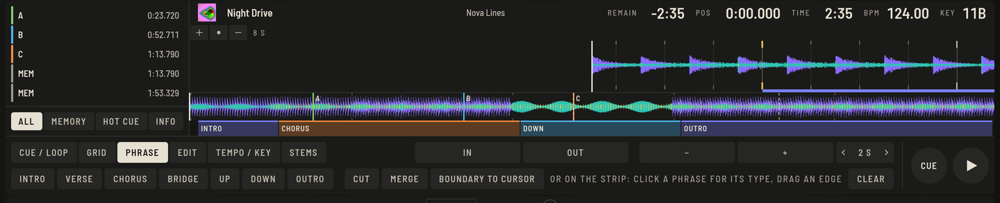
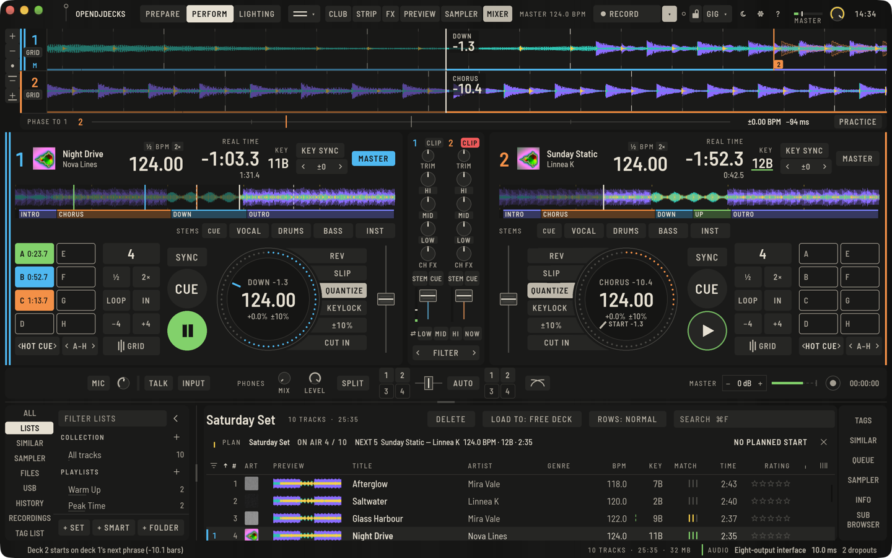

Phrases are the sections of a track: intro, chorus, up, down, outro. The analysis finds them for you and draws them as a coloured bar under the overview in Prepare and on every deck, so you can see at a glance what comes next.

## How phrases are found

The analysis listens to the track bar by bar, on the beatgrid:

- **What each bar sounds like:** how loud it is, how much is in the low, middle and high end, whether a kick hits, whether a bass holds under it, how many hits there are per beat, how bright it is and which notes sound.
- **Where the music changes:** every bar is compared with every other one. Where the bars before a point sound different from the bars after it, a section may start. Small changes (under about 3 dB) do not count.
- **Where the sections go:** the boundaries are placed where the music changes most, with a preference for the lengths tracks are built from: 8, 16 and 32 bars, starting on a 4-bar group. Other lengths (4, 12, 24 bars, an odd fill) are allowed when the music clearly says so; nothing shorter than 4 bars.
- **What each section is:**
  - **Intro** and **Outro** are the beat-led ends you mix on: the beat without the bass, whatever comes before the first beat, and a beatless tail at the end.
  - **Down** is a breakdown: the kick drops out.
  - **Up** is a build: energy, hits or brightness rise, and the beat comes back right after it.
  - **Chorus** is the drop: kick and bass, out of a breakdown or a build, near the loudest part of the track. A section that sounds like a drop is a drop too.
  - **Verse** is the groove before the first drop.
  - **Bridge** is a groove after a drop that does not sound like it.

A track without a breakdown or build gets no drop: a long groove stays Intro, Verse and Outro.

## How sure the analysis is

Every phrase the analysis finds gets a percentage: how clear its boundaries are and how clearly it is the type it got, whichever is weaker. Under 50 % it counts as unsure. On the phrase bar in Prepare an unsure phrase has a **half-height sodium line** at its start (the same mark as an unsure key) and shows its percentage on hover; with the cursor inside it, the **PHRASE** tab says **UNSURE 41 %**.

Check an unsure phrase by ear. If it is right, click it and pick the type it already has: that confirms it and the mark goes. Cutting, merging or moving one of its edges confirms it too. Phrases you set yourself, imported phrases and phrases from an earlier version of the analysis carry no percentage and count as sure; **ANALYSE AGAIN** (in the **INFO** tab) finds them anew with the current analysis.

On 31 generated tracks (house, techno, drum & bass, breakbeat, half-time, tracks without a drop, long intros, 4- and 12-bar sections) the analysis puts 99 % of the boundaries within one bar of the right place, gives 99 % of the bars the right type and finds no drop where there is none; the earlier analysis managed 79 %, 73 % and 21 false drops. With other mixes, saturation, noise and the detected grid instead of the exact one the figures stay at 100 %, 99 % and none. These are generated tracks with a known structure, not records: real music is less tidy, so check the phrases before you rely on them at a gig.

## Correct a phrase

Open the track in Prepare and pick the **PHRASE** tab.

- **Change the type:** click a phrase on the bar and choose a type (or press `⇧P`). In a gap, this creates a new phrase.
- **Move a boundary:** drag the edge between two phrases; it snaps to bars. **BOUNDARY TO CURSOR** (`⇧B`) moves the nearest boundary to the cursor.
- **Split a phrase:** **CUT** (`⇧X`) at the cursor, on the nearest bar.
- **Join two phrases:** **MERGE** (`⇧J`).
- **CLEAR** removes all phrases of the track.

A new analysis of the track replaces your edits. Every change is one undo step, confirms the phrases it touches and reaches your sticks.

## How phrases are shown

Under **Preferences › View** you switch the phrases on the enlarged waveforms and the bar under the overviews separately, and choose **NAMES** or **COLOURS ONLY** for the types. The platter shows the current phrase with a countdown; see [Perform](perform-basics.md#deck-readouts).

## Mix on the phrase

- **Bars to the drop and the break:** under the tempo on each platter, **DROP 8 · BREAK 24** counts whole bars to the next drop (a chorus after something else) and the next breakdown (a down or bridge phrase), nearest first. The bars to the next phrase stay on the platter's top line and on the waveform.
- **Start on the next phrase:** cue the incoming track, then **right-click PLAY**. The key gets the armed outline and the platter counts **START -bars.beats**; the deck starts when the master deck reaches its next phrase (the next 16-bar mark if it has no phrases). Right-click again, **PLAY** or **CUE** cancel. On a controller: `deck.phrase_start`.
- **Phrase-snapped sync:** under **Preferences › Controller › Decks › Sync** choose **PHRASE**. When you press **SYNC** on a playing deck, it also jumps whole beats so it stands as far before one of its phrases as the master deck before its next one. Beat sync keeps the phase as before.
- **The incoming track over the playing one:** the master's lane draws the other deck's waveform as an outline in that deck's colour, on the same time scale. While it plays you see where its beats fall; while it is cued, the outline starts at its cue, placed on the master's next phrase, with a mark carrying the deck number. **Preferences › View › Incoming track** switches it off.

The start lands within one audio block of the phrase boundary (a few milliseconds) in tests with generated tracks. It has not been tried at a gig or on a hardware controller yet, and it can only be as right as the phrases and the grid: check them in Prepare first.
