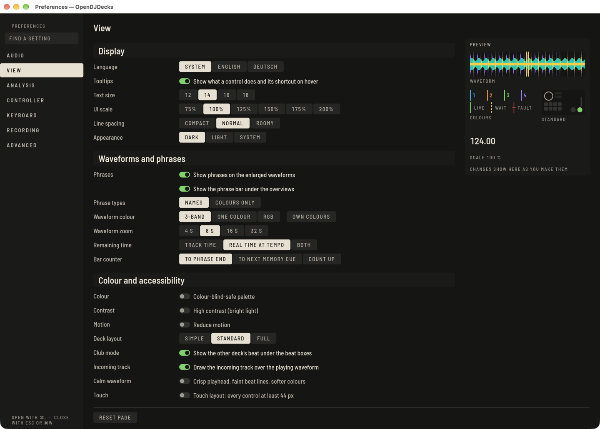
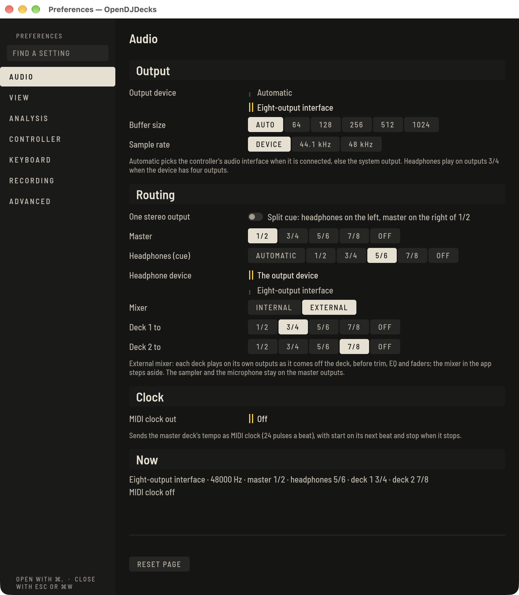

Open **Preferences** with the gear in the top bar, or `⌘,` on the Mac and `Ctrl+,` on Windows and Linux. `Esc` closes the window. **FIND A SETTING** at the top searches all pages.

## Audio

**Output device** defaults to the controller's audio interface when one is connected. **Buffer size** runs from 64 to 1024 samples: lower reacts faster, higher is safer on a slow computer. Device, buffer and routing apply at once; a new **Sample rate** waits for the next start, marked **APPLIES AFTER RESTART**.

### Routing

- **Master** and **Headphones (cue)** pick the outputs of the device: **1/2**, **3/4**, **5/6** or **7/8** (headphones **AUTOMATIC** use 3/4 when the device has four outputs). An output pair can carry only one signal, and a pair the device does not have is left out; **Now** at the foot of the page says what runs where and what was left out.
- **Headphone device** plays the headphones on a second audio device (its pair from **Headphones (cue)**). The two devices run on their own clocks; OpenDJDecks keeps the headphones in step by dropping or repeating a single sample frame now and then, which you may hear as a faint click on the headphones, never on the master.
- **One stereo output** is split cue on a single stereo output, such as the headphone jack of a laptop: the headphones (cue) in mono on the left and the master in mono on the right of outputs 1/2, for a Y-cable to the speakers and your headphones. **SPLIT** on the mixer turns on with it.
- **Mixer: EXTERNAL** hands the mixing to an external mixer: each deck plays on its own pair (**Deck 1 to** … **Deck 4 to**), as it comes off the deck, before trim, EQ, faders and crossfader. The mixer column in Perform then shows **EXTERNAL MIXER** and the output of each deck instead of the channel strips. The sampler and the microphone stay on the master pair, and the recorder records the master pair, so record on the external mixer.

### Clock

**MIDI clock out** sends the tempo of the master deck to a MIDI output as MIDI beat clock (24 pulses a beat), with Start on its next beat and Stop when it stops, so drum machines, sequencers or a lighting desk follow the mix. Tempo changes are followed at once; a jump (a cue, a loop, another master deck) is followed on the next pulse. **Now** shows the port and the pulses sent. OpenDJDecks sends clock only; it does not follow an incoming clock.

The routing is tested in the engine and the device layer with generated signals (each deck on its own pair, split cue in mono left and right, the headphones through the second-device ring) and the clock with a timing test; none of it has been tried with a real multi-output interface, an external mixer or a clock receiver.

On Windows audio goes through WASAPI, on macOS through CoreAudio, and on Linux through ALSA, JACK or PipeWire, whichever you pick here.

## View

**GIG** in the top bar is a preset for playing out: one click sets high contrast, the colour-blind palette and a larger interface at once, and a second click puts back what you had. The arrow beside it adjusts each part. The empty library offers the same **GIG PRESET** button on the first run.

Language, key notation (**Camelot**, **Open Key** or **musical**), the appearance (dark, light or following the system), **UI scale** from 75 to 200 % (applies at once), and the **Waveform colour**: 3-band, one colour or RGB. With **OWN COLOURS** you can pick your own colours for the lows, mids and highs; **STANDARD COLOURS** brings back the default ones.

**PREVIEW** at the top of the page shows what the settings below change, as you change them: a waveform drawn with your **Waveform colour** and **Calm waveform** setting, the four deck colours and the status lines (they follow **Colour-blind-safe palette** and **High contrast (bright light)**), a reading at your **UI scale**, and a plan of the **Deck layout**. **Deck layout** chooses **SIMPLE**, **STANDARD** or **FULL** for the decks in Perform, the same as **View › Deck Layout**.

The pages are drawn like the rest of the app: each section starts on a band of its own, the chosen value of a choice is filled, and switches are filled tracks.

- **Colour-blind-safe palette** and **High contrast (bright light)** apply at once.
- **Reduce motion** stops every animation: keys, switches, panels and the mode tabs change at once, and the pulse of an armed key, the loading sweep and the strobe preview stand still. It starts off, because the system's own setting cannot be read. Meters, waveforms and playheads never animate either way: they always show the sound as it is.
- **Calm waveform** (off by default) draws a crisp, thin playhead, faint beat lines and softer band colours on the large waveforms, for long sets or bright rooms. See [Perform](perform-basics.md#calm-waveform).
- **Touch** turns on the touch layout: every control of the decks, mixer, pads, effects, browser and lighting at least 44 px. See [Perform](perform-basics.md#touch-layout).
- **Low-CPU mode** (under **Computer load**, off by default) is for older or busy computers. The **LOW CPU** key is filled while it is on, with **ON** or **OFF** beside it. It draws the decks 30 times a second instead of 60, moves the waveforms in steps on each of those frames instead of gliding at the display's rate, turns off decorative motion as **Reduce motion** does, draws the Prepare player's large waveform less often while a preview plays, and leaves half the processor cores free when the stems of a loaded track are separated (they arrive later). With the buffer size on **AUTO**, audio uses 256 instead of 128 frames from its next start, never in the middle of a set (2.7 ms more latency at 48 kHz). The engine's timing, controller response, LEDs and the light show are not changed. The automatic analysis and stems prepared ahead already wait while a deck plays, with or without this mode. The Lite profile on a Raspberry Pi always has it on. Measured numbers are on [Long-run results](long-run-results.md#the-whole-app-with-its-window).
- **Waveform zoom** sets how many seconds a waveform shows when a track opens; the wheel still zooms.
- Under **Browser** set the **Text size** and **Line spacing** of the list.

## Analysis, Recording

See [Beatgrids](beatgrid.md#if-the-tempo-keeps-coming-out-wrong) for the **BPM range** and [Recording](recording.md) for the recording page.

**BPM range** (from version 0.6) tells the tempo analysis which range your music lives in. Tracks that come out at half or double the tempo are moved into the range you pick:

- **70–180** is the default and suits most music.
- **58–115** is for slow music like reggae or downtempo.
- **98–195** is for faster genres, where a track should not read as half tempo.
- **118–236** is for very fast music like drum and bass or hardcore.
- **150–300** is for music above 200 BPM, such as gabber or speedcore; see [Beatgrids](beatgrid.md#fast-music-and-half-or-double-on-the-deck).

The range only applies to tracks analysed from now on. To change an analysed track, choose **Analyse again** from its menu in the player or list.

## Controller

**Decks** holds the defaults sent to every deck: tempo range, quantize, sync mode (**BEAT**, **TEMPO ONLY** or **PHRASE**, see [Phrases](phrases.md#mix-on-the-phrase)), jog mode and auto cue. **Mixer** holds EQ and fader curves. The rest is in [Controllers](controllers.md).

## Keyboard

The **Keyboard** page lists every action with its binding. Search by action, id or key.

1. Click a binding (or pick one with `↑` `↓` and press Return) and press the new keys. `Esc` cancels, Backspace removes the binding.
2. If a key is taken, the page says by whom. **REPLACE** moves it, **CANCEL** keeps both as they were.
3. **DEFAULT** resets one action and **RESET ALL** resets everything. **IMPORT…** and **EXPORT…** read and write the bindings as a file.

The defaults follow a layout DJs commonly use: decks 1 and 2 use the left and right halves of the keyboard, for example play `Z` and `N`, cue `A` and `H`, sync `Q` and `Y`, hot cues on the number rows, loop in, out and exit on `D F G` and `K L ;`. Decks 3 and 4 sit on `F1` to `F11`. View and layout switches use `⌥⌘` on the Mac.

The full table, per deck and per mode, is on the [Keyboard shortcuts](../../keyboard.md) page.

## Advanced

Backups, the library location, consolidate and relocate, and the update check. Updates only read GitHub's public release list; nothing is sent about you, checks do not run while a deck plays in Perform, and an update never interrupts a performance.

## Accessibility

- **Keyboard:** `Tab` and `⇧Tab` reach every control in the order of the screen, and the focused one carries a bone ring. Return or Space presses a key; the arrow keys turn a knob or move a fader in steps of five percent, Return puts a knob back to its default. `Esc` hands the keys back to the window.
- **Screen readers:** every control has a name you can read: the action's name from the keymap where it has one ("Deck 1: Play / pause"), else its legend or the start of its tooltip, with the deck, channel or effect unit it belongs to. Its description is the tooltip and its shortcut. The names follow the language of the app.
- **Help:** `F12` or the **?** key names every control on screen ([Perform](perform-basics.md#help-on-every-control)).
- **Colour is never alone:** a state shown in colour also has a form or a word: line forms (solid, dashed, half, struck) for key relations, sticks, transitions and the audio line, words such as **CLIP**, **KILL**, IN SYNC and **LOCKED**, the deck numeral beside each deck colour and the letter beside each cue colour, and the initial of each phrase where its name does not fit.
- **Touch** and **High contrast (bright light)** are on the **View** page.

These parts have been tested with the app's own tests only; they have not been tried with a real screen reader or a real touch screen yet.
