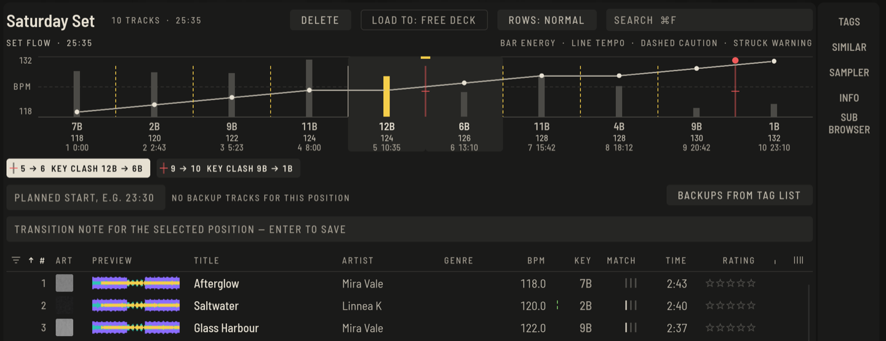

A set is an ordered list with extras for playing it live: it shows how tempo, key and energy move from track to track, and you can leave yourself notes for each transition.

## Build a set

1. Press **+ SET** under the tree (or `⇧⌘N`) and give it a name by clicking the title.
2. Select tracks in **All tracks** and press **+** next to the set, or drag them over.
3. Drag rows inside the list to change the order. Use the column **#** to keep it in play order.

## Read the flow

**SET FLOW** draws a line for each track: its height is the energy, with BPM and key below. Between two tracks a marker shows how well they connect:

- no extra mark: a good transition
- **dashed**: caution, a tempo or key step worth rehearsing
- **struck**: a clash

Click a position to select it. Notes, backups and the track you hear all relate to the selected position.

## Notes and backups

- Type in **TRANSITION NOTE** and press Return to keep a note for that transition.
- **PLANNED START**, for example `23:30`, adds real clock times to the flow.
- **BACKUPS FROM TAG LIST** turns the tracks of the tag list into backups for the selected position, in case the crowd goes elsewhere. The button next to it clears them.

## Find the right order

- Sort or read the **MATCH** column while a candidate plays, or open **SIMILAR** for suggestions; see [Library](library.md#the-match-column).
- Hot cues and memory cues you set while preparing appear on the stick and in Perform automatically.

## Hear a track at another tempo or key (from version 0.6)

Before you commit to a transition you can listen to a track as if it were pitched: in the Prepare player open the **TEMPO / KEY** tab.

- The **TEMPO** arrows change the speed of the preview (in percent); the key stays the same.
- The **KEY** arrows move it up or down by semitones.
- Next to the arrows you can read the tempo and key the preview comes to, and **RESET** brings it back to the original.

This is only for listening: the stored track, its beatgrid and its analysis do not change, and when you load it on a deck it plays as usual. The shift ends by itself as soon as you preview another track.

## Layouts for preparing

The layout button at the top of Prepare cycles through **PLAYER** (one player above the browser), **2 PLAYERS** (a full player and a compact second one), **DUAL** (two compact players side by side), **SIMPLE** (one compact player) and **FULL BROWSER**. `⌥⌘4` to `⌥⌘8` choose one directly. Player 2 takes the selected track with **LOAD** or a dragged row; it is handy for checking a transition.
