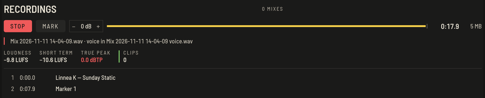
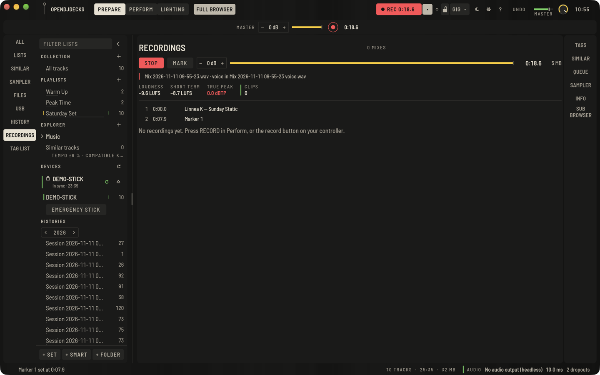
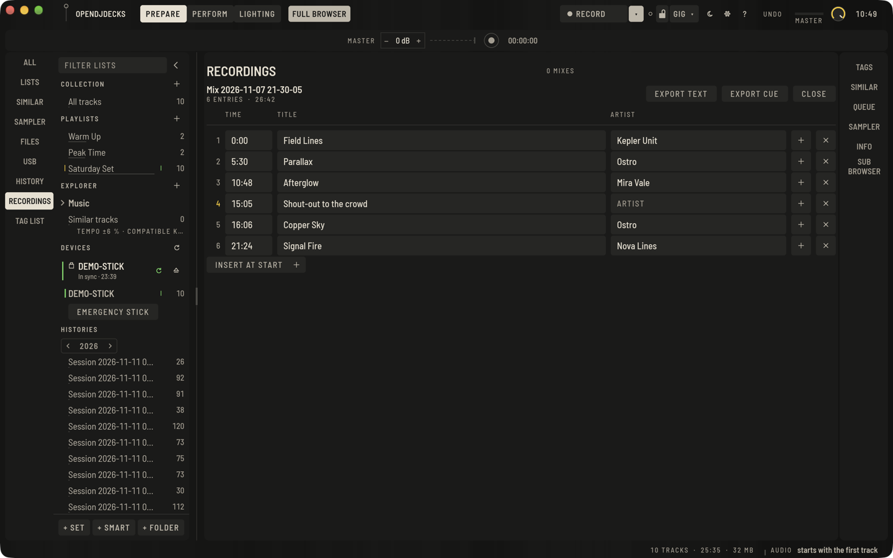

Press the round record button next to the master level (or `⌘Return`, or the record button on your controller) to record the master output. Press again to stop.

## While you record

**RECORD** in the top bar starts and stops a recording; it turns red with the running time. The small key beside it shows the recording section: the level, a meter, the elapsed time and file size, and the tracklist as it grows. Tracks are added as they become audible. Record level goes from −12 to +12 dB.

**MARK** (or `⇧⌘Return`) sets a chapter marker at the current time, for a shout-out, a guest or a change of mood. It joins the tracklist as *Marker 1*, *Marker 2* and so on, and you can name it later.

Under the file name the recording panel shows what is going into the file:

- **LOUDNESS**: the integrated loudness of the recording so far in LUFS, measured as EBU R 128 describes it (quiet passages under the gate do not pull it down).
- **SHORT TERM**: the loudness of the last three seconds.
- **TRUE PEAK**: the highest peak in dBTP, including peaks between the samples. Above −1 dBTP it turns red: encoders and streaming services want that headroom.
- **CLIPS**: how often the signal hit full scale. Its line is solid green while there are none and struck red once there are. Lower the recording level when it counts up.

The file on disk is a complete WAV at every moment, updated once a second. If the app or the computer crashes, the recording keeps everything up to the crash and appears under Recordings with its tracklist the next time OpenDJDecks starts. See [Safe during a set](set-safety.md#after-a-crash).

## After recording

Open **Recordings** from the **RECORDINGS** rail: every mix is listed with its file. Right there:

- **TRACKLIST** opens the tracklist editor (see below).
- **SHOW FILE** opens it in your file manager.
- **SPLIT INTO TRACKS** cuts it into one file per played track.

Under its name and length each mix shows its loudness, true peak and clips, in red when it clipped or peaked above −1 dBTP. A mix with a voice track says **VOICE TRACK**.

## Format, folder and automation

In **Preferences › Recording**:

- **Format**: WAV is recorded directly; FLAC (bit-exact) or MP3 (320 kbit) are encoded when recording stops.
- **Folder** and **File name**: use `{date}`, `{time}` and `{n}` (number of the day) in the name.
- **Recording level**, also on the recording panel.
- **Split** into one file per track when recording stops.
- **Voice track**: record the microphone on its own as well (see below).
- **Start**: start recording when sound starts. The master must carry sound for two seconds. **Stop** ends it after 30 seconds of silence. Stopping by hand disarms the automatic start until the next time the app starts.

## The tracklist

Each recording also gets the tracklist as a `.cue` file and as plain text, ready to paste into Mixcloud or SoundCloud. Timing and titles come from what was actually audible. Every entry is also a chapter inside the file itself: a cue point with its name in a WAV, a chapter in the MP3's tags and a chapter comment in a FLAC, so players and editors that show chapters jump from track to track.

## Edit the tracklist before you publish

**TRACKLIST** on a finished mix opens its tracklist as rows of time, title and artist:

- Type a new title or artist; it is saved as you type.
- Type a time such as `12:34` (or `1:02:03`) and press Return to move an entry; the list keeps itself in time order. A time outside the recording is refused with a message.
- **+** inserts an entry halfway to the next one, **INSERT AT START** one before the first, **×** removes one.
- **EXPORT TEXT** and **EXPORT CUE** write the text and the CUE sheet next to the recording again and put the edited chapters into its files (the WAV or FLAC and an MP3 copy).
- **CLOSE** goes back to the recordings.

The edited tracklist is kept with the recording (in a small `.json` file beside it and in the library), so **SPLIT INTO TRACKS** cuts by it too.

## Voice track

With **Preferences › Recording › Voice track** on, the microphone (the **MIC** input) is recorded on its own as well, to a second WAV beside the mix named `… voice.wav`. It starts and stops with the mix and lines up with it sample for sample, so you can level, clean or replace the voice later. The mix itself keeps the voice as you heard it. Turn the microphone input on under **MIC** for anything to arrive.
