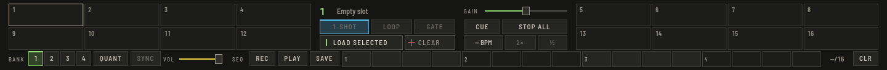

Press **SAMPLER** in the top bar (`⌥⌘S`) to open the panel between the mixer and the browser.

The sampler stays in view: when a small window runs out of room for Perform's bottom panels, the Tempo FX panel or the mix preview gives way (the status band says which), never the sampler.

## Load samples

Select a track in the browser and press **LOAD SELECTED** on a slot, or drag a track onto a pad. Slots are kept with your library and come back when the audio starts.

There are six banks of 16 slots; **BANK** switches them (`⇧R` and `⇧T`). Banks 1 to 4 are yours. **MELODY** holds the notes sent from CREATE and **DRUMS** holds the drum machine's kit and samples; you can play both like any other bank.

## Play

Click a pad, or press the keys `X C V B M , . /` for slots 1 to 8. **STOP ALL** (`⇧P`) stops everything.

Select a slot to set its mode:

- **1-SHOT** plays to the end once.
- **LOOP** repeats until stopped.
- **GATE** plays only while the pad is held.

**QUANT** starts pads on the next beat of the master, **SYNC** follows the master tempo (with **÷2** and **×2** to correct a slot that was detected at the wrong speed). **GAIN** is per slot, **VOL** is the whole sampler. **CUE** sends it to the headphones.

From the deck, the **SAMPLER** pad mode plays slots: odd decks pads 1 to 8, even decks 9 to 16.

The **MELODY** pad mode plays the notes sent from CREATE on every deck: pads A to H play the eight notes, and the ‹ › beside the mode switches to the octave above. **QUANT** starts a note on the next beat; a note keeps its pitch at any master tempo. Before anything was sent, the pads stay outlined and the bar says so.

## Sequencer

The row at the bottom of the panel draws the pattern of the selected slot in 16 steps. Click steps to set them. **PLAY** (`⇧O`) starts it, locked to the master beat, and **REC** records pads into the pattern while it runs. **CLR** clears the selected slot's pattern. Swing and half time are set in CREATE's drum machine and apply to the whole sequencer.

**SAVE** stores the patterns of all slots, with their swing and half time, on the next free pad of the **PATTERN** pad mode. Stored patterns survive a restart. In that mode, a stored pad recalls the patterns and starts the sequencer; **Shift** plus the pad clears it.
