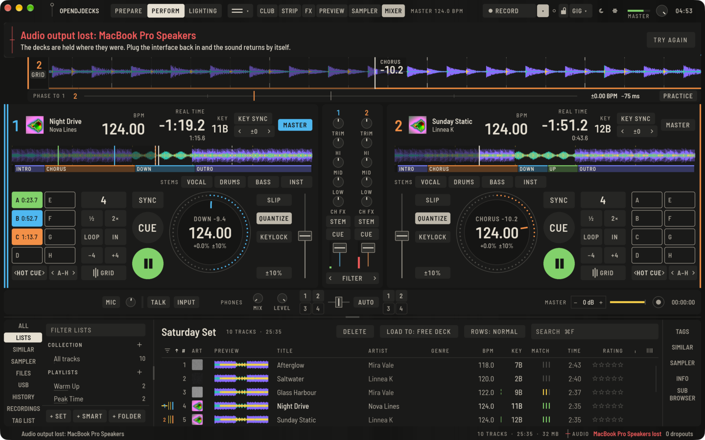
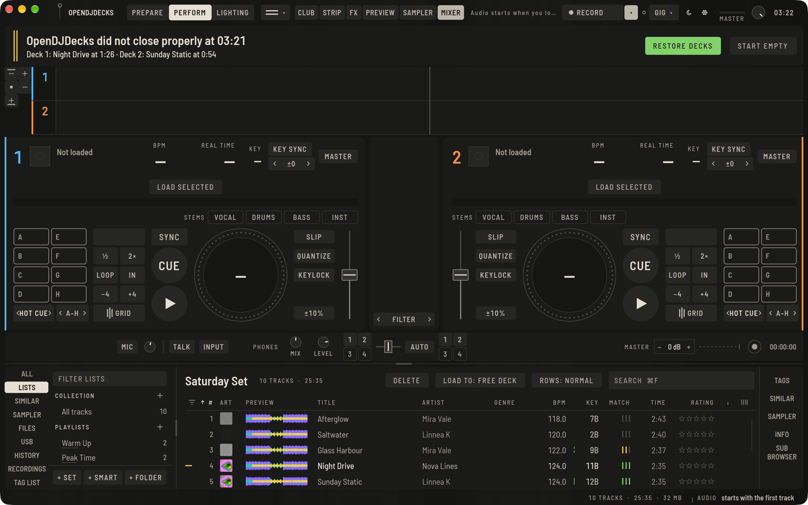

OpenDJDecks keeps an eye on the things that can end a set early. This page explains what it shows and what you can do.

## The audio line

The status band at the bottom right always shows **AUDIO**, the output that plays, its latency in milliseconds and the dropouts so far. The line in front of it says the state at a glance:

| Line | Meaning |
|---|---|
| Solid green | Audio runs without dropouts |
| Dashed yellow | A dropout in the last 20 seconds |
| Struck | The device is lost |
| Half height | Audio has not started yet; it starts with the first track |

If dropouts keep coming, raise the buffer size in **Preferences › Audio**. The device, buffer size and headphone output there apply at once, without a restart. Only a new sample rate waits for the next start.

## When the audio interface is lost

If the interface is unplugged or stops working, a red band appears under the top bar at once and names the device. The decks wait where they were: tracks, positions, loops and the mixer stay as they are.

- Plug the interface back in: the sound returns by itself on the same device.
- **SWITCH OUTPUT** goes on on the computer's own output straight away.
- **TRY AGAIN** opens the lost device once more.

A device counts as lost when the system reports it gone, or when it has not asked for audio for one and a half seconds.

This was tested with a simulated device that fails the way an unplugged interface does. It has not yet been checked with a real interface being unplugged on every system.

## The gig check

Open the menu next to **GIG** in the top bar and press **RUN GIG CHECK**, or choose **View › Gig Check** (`⌥⇧⌘C`, `Ctrl+Alt+Shift+C` on Linux and Windows). A band shows four results:

- **AUDIO OUTPUT**: the device, its latency, whether master and headphones both have an output, and dropouts so far.
- **CONTROLLER**: the connected controller.
- **RECORDING SPACE**: free space where recordings go, and roughly how many hours of recording fit.
- **TRACK FILES**: tracks of the library whose file is missing.

A solid green line is ready, a dashed one is worth a look, a struck one needs fixing before you play. **CHECK AGAIN** runs it once more, **CLOSE** hides the band.

## After a crash

While you play, OpenDJDecks writes the state of the decks next to your library once a second: the tracks, their positions, tempo and range, keylock, key shift, sync, loops, and the mixer. It writes a new copy and then swaps it in, so a crash at any moment leaves a complete state behind.

If the app did not close properly, the next start offers it back in a band under the top bar:

- **RESTORE DECKS** loads the tracks where they were, with tempo, loops and the mixer, and opens Perform. The decks wait for **PLAY**.
- **START EMPTY** leaves the decks empty.

A recording that was running is kept either way. Its file is made whole up to the moment of the crash and is listed under Recordings with the tracklist so far. The band says how long it is.
