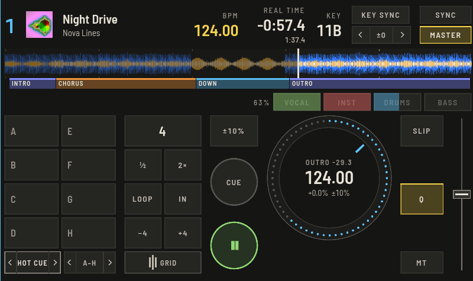

OpenDJDecks can split a track into four parts: vocals, instruments, drums and bass. This happens on your own computer, in the background, and nothing leaves the machine. The first time, a model is downloaded once; after that it works offline.

## Separate tracks

There are two ways:

- **On load:** load a track on a deck. It plays as usual; the strip above the pads shows **SPLIT** and a percentage while the parts are being made. The part keys stay in place, dimmed, until the parts exist, and you can play the whole time.
- **Ahead of time:** select tracks in Prepare, right-click and choose **Separate parts** (`⌥⇧⌘S`). They are done in the background and the band at the bottom shows the progress.

## Use the parts on a deck

Each deck has **VOCAL**, **INST**, **DRUMS** and **BASS** under the waveform.

- Click a key to mute or unmute the part. Lit means audible.
- Turn the wheel over a key to set the part's level; the line under the key shows it.

For hands-on mixing, press **STEM** on a mixer channel: **HI** becomes the vocals, **MID** the instruments and **LOW** the drums. The **STEMS** pad mode gives you the part mutes and stem effects on the pads.

On the overview, spans where the vocals sing are drawn as a band along the top, so you can see where to mix.

To run an effect on one part only, see [Stem FX](effects.md#stem-fx).

## Stems on a stick and on the Raspberry Pi

When a stick uses the OpenDJDecks format, the parts are copied to it with the sync. Tracks loaded from that stick use them, so the Raspberry Pi plays parts that were separated on your laptop without doing the work itself.
