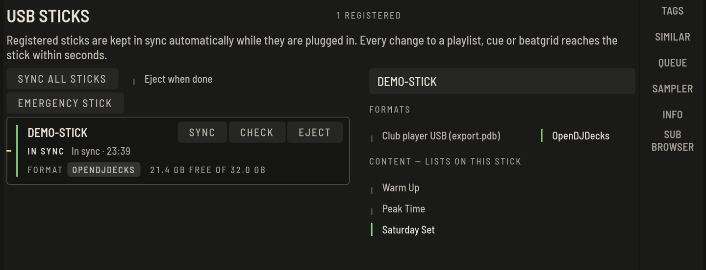

The stick is a mirror of your library. Register it once with the lists that belong on it, and every changed cue, playlist or beatgrid reaches it within seconds, while it is plugged in. There is no export step to remember.

## Register a stick

1. Plug in the stick. It appears under **DEVICES** in the tree (or on the **USB** rail).
2. Select the playlist, set or folder that should go on it.
3. Press **REGISTER WITH …**. The first sync writes everything once; afterwards only changes are written.

The stick board shows its state, what is pending, and the progress of the sync.

- **SYNC NOW** (`⌘S`) syncs at once. Syncing starts by itself anyway, a few seconds after any change.
- **REBUILD STICK** writes the whole stick again from your library.
- **EJECT** (`⌘E`) ejects it safely. Wait for that before you pull it out.
- **FORGET** stops keeping that stick in sync.

## What is on the stick

Under **CONTENT — LISTS ON THIS STICK** you choose the lists. The stick holds your music with its cues, beatgrids, phrases and, if you have them, the separated parts for stems. Sticks are read by OpenDJDecks, for example on another computer or the [Raspberry Pi unit](raspberry-pi.md). To also play a stick on club players, turn on the Club player USB format below.

## Playing from a stick

Open a stick in the tree to browse and load from it directly, read-only. This is what the Raspberry Pi unit does all day.

## Play on club players (Club player USB)

From version 0.6, a stick can also carry the Club player USB format, which is compatible with Pioneer DJ players. You choose this per stick: select the stick and turn on **Club player USB (export.pdb)** under **FORMATS**. OpenDJDecks' own format stays on by default and you can keep both.

With the format on, every sync also writes the database and the analysis the players read, with your playlists, cues, beatgrids and waveforms, and takes over your default player settings (quantize, auto cue, tempo range, jog mode, language). Only changed tracks are rewritten. Ogg and Opus files are left out because players cannot play them.

### Cues and histories from the players

If a player changes cues on the stick or writes a history, OpenDJDecks does not overwrite that. The next sync lists it under **CHANGES MADE ON PLAYERS — REVIEW** on the stick board. **TAKE STICK CUES** moves the player's cues into your library, **KEEP LIBRARY** keeps yours and writes them to the stick again; a history can be imported as a playlist or dismissed.

### Import a stick from other software

From version 0.6, **File › Import a Club Player USB…** reads a Club player USB written by other software: tracks, tags, cues, beatgrids, phrases, playlists and the history. Choose the stick's root folder. Nothing on the stick is changed; imported lists appear in a **Library import** folder.
